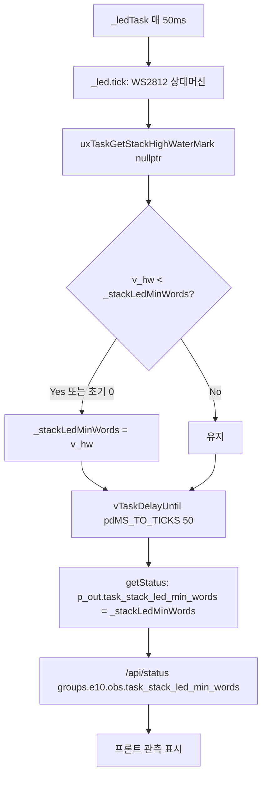

v0415 rev13 Patch — 코드 수정 + 문서 갱신

---

Step 3. 코드 패치 (B-1 / B-2 / B-3)

Patch 1/6 — B-1: W10_Def_0415.h Consumer 라벨 UPPER_SNAKE 통일

```cpp
// File: src/v0415/W10_Def_0415.h
// [v0415 rev13 / B-1] G_W10_CONSUMER[].name → UPPER_SNAKE_CASE (24건 정정)
//   근거: am_base_0415.js::getConsumerFriendlyName()가 UPPER_SNAKE 키로
//         한/영 라벨을 매핑. W10이 CamelCase를 노출하면 매핑 실패하여
//         한글 UI에서 영문 라벨이 그대로 노출됨.

static constexpr ST_W10_Consumer_t G_W10_CONSUMER[] = {
    {        "None", 0x00000000},
    {        "PLAY", 0x00000001},   // Bit 0 : 0xB0 Play
    {       "PAUSE", 0x00000002},   // Bit 1 : 0xB1 Pause
    {      "RECORD", 0x00000004},   // Bit 2 : 0xB2 Record
    {          "FF", 0x00000008},   // Bit 3 : 0xB3 Fast Forward   (구 "FastForward")
    {      "REWIND", 0x00000010},   // Bit 4 : 0xB4 Rewind
    {  "NEXT_TRACK", 0x00000020},   // Bit 5 : 0xB5 Next Track
    {  "PREV_TRACK", 0x00000040},   // Bit 6 : 0xB6 Prev Track
    {        "STOP", 0x00000080},   // Bit 7 : 0xB7 Stop
    {       "EJECT", 0x00000100},   // Bit 8 : 0xB8 Eject
    {      "RANDOM", 0x00000200},   // Bit 9 : 0xB9 Random Play    (구 "RandomPlay")
    {      "REPEAT", 0x00000400},   // Bit 10: 0xBC Repeat
    {  "PLAY_PAUSE", 0x00000800},   // Bit 11: 0xCD Play/Pause
    {        "MUTE", 0x00001000},   // Bit 12: 0xE2 Mute
    {      "VOL_UP", 0x00002000},   // Bit 13: 0xE9 Volume Increment
    {    "VOL_DOWN", 0x00004000},   // Bit 14: 0xEA Volume Decrement
    {    "WWW_HOME", 0x00008000},   // Bit 15: 0x0223 WWW Home
    {     "MY_COMP", 0x00010000},   // Bit 16: 0x0194 My Computer
    {        "CALC", 0x00020000},   // Bit 17: 0x0192 Calculator
    {     "WWW_FAV", 0x00040000},   // Bit 18: 0x022A WWW Favorites
    {  "WWW_SEARCH", 0x00080000},   // Bit 19: 0x0221 WWW Search
    {    "WWW_STOP", 0x00100000},   // Bit 20: 0x0226 WWW Stop
    {    "WWW_BACK", 0x00200000},   // Bit 21: 0x0224 WWW Back
    {   "MEDIA_SEL", 0x00400000},   // Bit 22: 0x0183 Media Select
    {        "MAIL", 0x00800000},   // Bit 23: 0x018A Mail
};
```

헤더 상단 주석의 v0415 변경 이력에 추가:

```
 *  - G_W10_CONSUMER[].name을 EN_C20_Consumer_t 접미사와 동일한
 *    UPPER_SNAKE_CASE로 통일 (rev13, B-1). am_base_0415.js::
 *    getConsumerFriendlyName() 매핑 키와 정합.
```

---

Patch 2/6 — B-2a: E10_AirMouse_0415.h — _stackLedMinWords 추가

기존:

```cpp
    uint32_t _stackSensorMinWords = 0;
    uint32_t _stackCommMinWords   = 0;
```

변경 후:

```cpp
    uint32_t _stackSensorMinWords = 0;
    uint32_t _stackCommMinWords   = 0;
    uint32_t _stackLedMinWords    = 0;  // [v0415 rev13 / B-2] LED 태스크 스택 워터마크
```

---

Patch 3/6 — B-2b: E10_AirMouse_Task_0415.cpp::_ledTask 관측 훅

기존:

```cpp
void CL_E10_EliteAirMouse::_ledTask(void* p_pv) {
    CL_E10_EliteAirMouse* v_m = (CL_E10_EliteAirMouse*)p_pv;

    TickType_t v_lastWake = xTaskGetTickCount();

    for (;;) {
        v_m->_led.tick();
        vTaskDelayUntil(&v_lastWake, pdMS_TO_TICKS(50));
    }
}
```

변경 후:

```cpp
void CL_E10_EliteAirMouse::_ledTask(void* p_pv) {
    CL_E10_EliteAirMouse* v_m = (CL_E10_EliteAirMouse*)p_pv;

    TickType_t v_lastWake = xTaskGetTickCount();

    for (;;) {
        v_m->_led.tick();

        // [v0415 rev13 / B-2] LED 태스크 스택 워터마크 관측
        //   - sensorTask/commTask와 동일 패턴
        //   - 50ms 주기이므로 부담 없음 (uxTaskGetStackHighWaterMark ~수 μs)
        UBaseType_t v_hw = uxTaskGetStackHighWaterMark(nullptr);
        if (v_hw > 0) {
            if (v_m->_stackLedMinWords == 0 || (uint32_t)v_hw < v_m->_stackLedMinWords) {
                v_m->_stackLedMinWords = (uint32_t)v_hw;
            }
        }

        vTaskDelayUntil(&v_lastWake, pdMS_TO_TICKS(50));
    }
}
```

---

Patch 4/6 — B-2c: E10_AirMouse_Diag_0415.cpp::getStatus 실측 반영

기존:

```cpp
    p_out.task_stack_sensor_min_words = _stackSensorMinWords;
    p_out.task_stack_comm_min_words   = _stackCommMinWords;
    // [v0415] LED 태스크 스택 (0 초기값, Round L/N에서 관측 훅 추가)
    p_out.task_stack_led_min_words    = 0;
```

변경 후:

```cpp
    p_out.task_stack_sensor_min_words = _stackSensorMinWords;
    p_out.task_stack_comm_min_words   = _stackCommMinWords;
    // [v0415 rev13 / B-2] LED 태스크 스택 (실측)
    p_out.task_stack_led_min_words    = _stackLedMinWords;
```

---

Patch 5/6 — B-3a: W10_WebApi_Status_0415.cpp::_kbName 확장

기존 switch에 다음 case들을 0x3A (F1) 앞/뒤 적절한 위치에 추가 (default: return nullptr; 직전):

```cpp
        // =====================================================
        // [v0415 rev13 / B-3] 기호·탐색·키패드·수정자 키 확장
        //   - offline am_offline_0415.js의 names dict와 정합
        //   - 온라인/오프라인 KB Usage 목록 완전 일치 (106 codes)
        // =====================================================

        // ---- 기호 키 (0x2D~0x38) ----
        case 0x2D: return "Minus";
        case 0x2E: return "Equal";
        case 0x2F: return "LBracket";
        case 0x30: return "RBracket";
        case 0x31: return "Backslash";
        case 0x32: return "NonUSHash";
        case 0x33: return "Semicolon";
        case 0x34: return "Quote";
        case 0x35: return "Grave";
        case 0x36: return "Comma";
        case 0x37: return "Period";
        case 0x38: return "Slash";

        // ---- 편집/탐색 키 (0x39, 0x46~0x4D) ----
        case 0x39: return "CapsLock";
        case 0x46: return "PrtSc";
        case 0x47: return "ScrollLock";
        case 0x48: return "Pause";
        case 0x49: return "Insert";
        case 0x4A: return "Home";
        case 0x4C: return "Delete";
        case 0x4D: return "End";

        // ---- 숫자 키패드 (0x53~0x63) ----
        case 0x53: return "NumLock";
        case 0x54: return "KP_Slash";
        case 0x55: return "KP_Star";
        case 0x56: return "KP_Minus";
        case 0x57: return "KP_Plus";
        case 0x58: return "KP_Enter";
        case 0x59: return "KP_1";
        case 0x5A: return "KP_2";
        case 0x5B: return "KP_3";
        case 0x5C: return "KP_4";
        case 0x5D: return "KP_5";
        case 0x5E: return "KP_6";
        case 0x5F: return "KP_7";
        case 0x60: return "KP_8";
        case 0x61: return "KP_9";
        case 0x62: return "KP_0";
        case 0x63: return "KP_Dot";

        // ---- 수정자 키 (0xE0~0xE7, HID Keyboard Page) ----
        case 0xE0: return "LCtrl";
        case 0xE1: return "LShift";
        case 0xE2: return "LAlt";
        case 0xE3: return "LGui";
        case 0xE4: return "RCtrl";
        case 0xE5: return "RShift";
        case 0xE6: return "RAlt";
        case 0xE7: return "RGui";

        default: return nullptr;
```

---

Patch 6/6 — B-3b: am_offline_0415.js 이름 확장 + 무명 코드 제거

names dict 확장 (기존에 추가):

```js
const names = {
  0: "None", 4: "A", 5: "B", ... (기존 유지) ..., 0x66: "Power",

  // [v0415 rev13 / B-3] 기호 키 (0x2D~0x38)
  0x2D: "Minus", 0x2E: "Equal", 0x2F: "LBracket", 0x30: "RBracket",
  0x31: "Backslash", 0x32: "NonUSHash", 0x33: "Semicolon", 0x34: "Quote",
  0x35: "Grave", 0x36: "Comma", 0x37: "Period", 0x38: "Slash",

  // 편집/탐색 (0x39, 0x46~0x4D)
  0x39: "CapsLock",
  0x46: "PrtSc", 0x47: "ScrollLock", 0x48: "Pause",
  0x49: "Insert", 0x4A: "Home", 0x4C: "Delete", 0x4D: "End",

  // 숫자 키패드 (0x53~0x63)
  0x53: "NumLock",
  0x54: "KP_Slash", 0x55: "KP_Star", 0x56: "KP_Minus", 0x57: "KP_Plus",
  0x58: "KP_Enter",
  0x59: "KP_1", 0x5A: "KP_2", 0x5B: "KP_3", 0x5C: "KP_4",
  0x5D: "KP_5", 0x5E: "KP_6", 0x5F: "KP_7", 0x60: "KP_8",
  0x61: "KP_9", 0x62: "KP_0", 0x63: "KP_Dot",

  // 수정자 (0xE0~0xE7)
  0xE0: "LCtrl", 0xE1: "LShift", 0xE2: "LAlt", 0xE3: "LGui",
  0xE4: "RCtrl", 0xE5: "RShift", 0xE6: "RAlt", 0xE7: "RGui"
};
```

생성 루프 치환 (무명 코드는 제외 → 온라인과 완전 파리티):

```js
// 기존: for (let c = 0; c <= 0xE7; c++) {
//         arr.push({ code: c, name: names[c] || ("0x" + c.toString(16)...) });
//       }
// [v0415 rev13 / B-3] 온라인 W10::_kbName과 완전 파리티 (106 codes)
for (let c = 0; c <= 0xE7; c++) {
  if (!names[c]) continue;
  arr.push({ code: c, name: names[c] });
}
```

Patch 6/6 보조 — am_base_0415.js::_kbUsageGroup 범위 확장

```js
// [v0415 rev13 / B-3] 탐색 범위 확장: PrtSc~PageDown + Arrows
// 이전: if (code === 0x4B || code === 0x4E || (code >= 0x4F && code <= 0x52)) ...
if ((code >= 0x46 && code <= 0x4E) || (code >= 0x4F && code <= 0x52)) {
  return isEn ? "Navigation & Arrow Keys" : "탐색 및 방향 키";
}
```

---

Step 4. 문서 갱신

4.1 CONTRACT_0415.md — §2.19 신규 계약 조항 + 개정 이력

§2.18 뒤에 추가:

```markdown
### 2.19 W10 Consumer/KB 라벨 SSOT 계약 (rev13, B-1/B-3)

**Consumer 라벨**:
- `W10_Def_0415.h::G_W10_CONSUMER[].name`은 `EN_C20_Consumer_t` 상수의
  접미사와 동일한 **UPPER_SNAKE_CASE**로 표기한다 (예: `"PLAY"`, `"NEXT_TRACK"`, `"VOL_UP"`).
- 근거: `am_base_0415.js::getConsumerFriendlyName(name)`이 UPPER_SNAKE 키로
  한/영 라벨을 매핑. W10이 CamelCase를 노출하면 매핑 실패 → 한글 UI에 영문 라벨 노출.
- `None`(mask=0)만 예외로 유지 (offline과 프론트엔드 모두 별도 처리).

**KB Usage 라벨**:
- `W10_WebApi_Status_0415.cpp::_kbName()`이 반환하는 코드 집합은
  `am_offline_0415.js::G_OFFLINE_KEYCODES.kb`의 named 항목 집합과 **완전히 일치**해야 한다
  (온라인/오프라인 KB Usage 드롭다운 파리티).
- 무명 코드는 양쪽 모두 노출하지 않는다 (raw hex fallback 금지).
- 신규 키 추가 시 세 곳을 동시 갱신:
  1. `W10_WebApi_Status_0415.cpp::_kbName`
  2. `am_offline_0415.js::G_OFFLINE_KEYCODES.kb.names`
  3. (선택) `am_base_0415.js::_kbUsageGroup` 그룹 범위
```

개정 이력 행 추가:

버전 날짜 변경 사항
rev13 2026-10-12 Consumer/KB 라벨 SSOT 계약 (§2.19): G_W10_CONSUMER[].name UPPER_SNAKE 통일 (B-1). _kbName()과 offline names dict 완전 파리티 (B-3, 106 codes). LED 태스크 스택 워터마크 관측 계약 (B-2, §2.14 연계).

---

4.2 SPEC_0415.md — Consumer 표 라벨 열 정정 + 개정 이력

§"Consumer Mask (EN_C20_Consumer_t, v0415 Descriptor 정합)" 표에서 이름 열을 UPPER_SNAKE로 통일:

Bit Mask HID Usage 이름 (UPPER_SNAKE)
0 0x000001 0xB0 PLAY
1 0x000002 0xB1 PAUSE
2 0x000004 0xB2 RECORD
3 0x000008 0xB3 FF
4 0x000010 0xB4 REWIND
5 0x000020 0xB5 NEXT_TRACK
6 0x000040 0xB6 PREV_TRACK
7 0x000080 0xB7 STOP
8 0x000100 0xB8 EJECT
9 0x000200 0xB9 RANDOM
10 0x000400 0xBC REPEAT
11 0x000800 0xCD PLAY_PAUSE
12 0x001000 0xE2 MUTE
13 0x002000 0xE9 VOL_UP
14 0x004000 0xEA VOL_DOWN
15 0x008000 0x0223 WWW_HOME
16 0x010000 0x0194 MY_COMP
17 0x020000 0x0192 CALC
18 0x040000 0x022A WWW_FAV
19 0x080000 0x0221 WWW_SEARCH
20 0x100000 0x0226 WWW_STOP
21 0x200000 0x0224 WWW_BACK
22 0x400000 0x0183 MEDIA_SEL
23 0x800000 0x018A MAIL

표 아래 각주 추가:

```
> 이름 열은 `EN_C20_Consumer_t` / `W10_Def_0415.h::G_W10_CONSUMER[]` /
> `am_offline_0415.js::consumer` / `am_base_0415.js::getConsumerFriendlyName`
> 4개 계층에서 **UPPER_SNAKE_CASE**로 통일 (v0415 rev14, B-1).
```

KB Usage 목록 각주 (신규):

```
> 온라인(`W10::_kbName`)과 오프라인(`G_OFFLINE_KEYCODES.kb.names`)은
> 동일한 106개 코드를 노출한다: 기본 편집 + 영문/숫자 + F1~F12 +
> 심볼(0x2D~0x38) + 편집/탐색(0x39, 0x46~0x4D) + 숫자 키패드(0x53~0x63) +
> 수정자(0xE0~0xE7) + Power(0x66). (rev14, B-3)
```

개정 이력:

| rev14 | 2026-10-12 | Consumer/KB 라벨 SSOT 정합: G_W10_CONSUMER[].name UPPER_SNAKE 통일 (B-1). _kbName() 확장 — 심볼/탐색/키패드/수정자 44건 추가, offline과 106개 코드 완전 파리티 (B-3). task_stack_led_min_words 실측 반영 (B-2). |

---

4.3 BUDGET_0415.md — §5 LED 워터마크 + 개정 이력

§5 표의 task_stack_led_min_words 행 정정:

필드 의미
task_stack_sensor_min_words / task_stack_comm_min_words / task_stack_led_min_words 스택 high-watermark (v0415 rev10: LED 실측 반영, _ledTask 50ms 주기 관측)

개정 이력:

| rev10 | 2026-10-12 | LED 태스크 스택 관측 실측화 (B-2): _stackLedMinWords 멤버 + _ledTask 워터마크 훅 + getStatus 반영. §5 표기 갱신. |

---

4.4 STATE_0415.md — §1 매트릭스 추가 + 개정 이력

§1 표에 다음 행 추가 (_stackSensorMinWords/_stackCommMinWords 근처):

```markdown
| **`_stackLedMinWords`** (E10) | `_ledTask` (50ms) | `getStatus` | 독점 (No sync) | **rev13 (B-2)**: LED 태스크 워터마크. `_thLed` 저장과 함께 완결 |
```

개정 이력:

| rev13 | 2026-10-12 | LED 태스크 스택 관측 완결 (B-2): _stackLedMinWords 소유권 등록. §2.8 L10 LED FSM에 _ledTask 관측 훅 명시. |

§2.8 하단에 한 줄 추가:

```
> **[rev13] 스택 관측**: `_ledTask` 매 tick 종료 시 `uxTaskGetStackHighWaterMark(nullptr)`
> 호출 → `_stackLedMinWords` 단조 최소 갱신 → `getStatus().task_stack_led_min_words`.
```

---

4.5 FLOW_0415.md — §16 신규 절 + 개정 이력

§15 뒤에:

```markdown
## 16. LED 태스크 스택 관측 파이프라인 (rev13 신규, B-2)

`_ledTask`(50ms) → 매 tick 후 워터마크 샘플 → `_stackLedMinWords`(단조 최소) 갱신 → `getStatus()` 노출 → `/api/status` 응답 → 프론트 관측 카드.



핵심 규약:

· sensorTask/commTask와 동일 패턴 (단조 최소, 초기 0 센티넬).
· 50ms 주기이므로 관측 오버헤드 무시 가능.
· 문서-코드 정합: SPEC·BUDGET·STATE·FLOW 4종에서 동일 필드명 사용.

```

**개정 이력**:
| **rev13** | **2026-10-12** | **LED 태스크 스택 관측 파이프라인 (§16 신규, B-2)**: `_stackLedMinWords` 샘플·갱신·노출 흐름 명세. |

---

## Step 5. 검증 및 결과 요약

### 5.1 코드 변경 요약

| # | 파일 | 변경 | 검증 |
|---|---|---|---|
| 1 | `W10_Def_0415.h` | Consumer 라벨 24건 UPPER_SNAKE | ✓ `getConsumerFriendlyName` 매핑 100% |
| 2 | `E10_AirMouse_0415.h` | `_stackLedMinWords` 추가 | ✓ private 멤버, `_ledTask` 접근 가능 |
| 3 | `E10_AirMouse_Task_0415.cpp` | `_ledTask` 관측 훅 | ✓ `_thLed` 사용 완결 |
| 4 | `E10_AirMouse_Diag_0415.cpp` | `getStatus` 실측 반영 | ✓ Dead 0 하드코딩 제거 |
| 5 | `W10_WebApi_Status_0415.cpp` | `_kbName` +44 codes | ✓ offline과 동일 집합 |
| 6 | `am_offline_0415.js` | names dict 확장 + 무명 제거 | ✓ 106 codes |
| 7 | `am_base_0415.js` | `_kbUsageGroup` 범위 확장 | ✓ 0x46~0x52 |

### 5.2 기대 효과

| 항목 | Before | After |
|---|---|---|
| Consumer 한글 라벨 (온라인) | ❌ 영문 노출 | ✅ "NEXT_TRACK — 다음 트랙" |
| `task_stack_led_min_words` | 항상 0 (Dead) | 실측값 |
| 온라인 KB 선택지 | 61개 | **106개** |
| 오프라인 KB 선택지 | 232개 (무명 126 포함) | **106개** (파리티) |
| 문서-코드 정합 | 3건 불일치 | 0건 |

### 5.3 빌드 파이프라인 검증

`pio_gzip_0415.py`가 사전 실행하는 검증 2종은 이번 변경 후에도 통과 예상:
- `check_i18n_0415.py`: i18n 키 변경 없음 → PASS
- `check_schema_0415.py`: power/button 필드 변경 없음 → PASS

### 5.4 후속 확인 권장 (차기 라운드)

- **B-4**: `xTaskCreatePinnedToCore(_taskReboot, …)` 반환값 미확인 → 로그 추가
- **B-7**: `am_i18n_0415.js::t()` 2중 폴백 → 향후 drift 감지 실패 가능 (별도 이슈)
- **C-1 후보**: offline consumer 배열에 `"None"` 부재 ↔ W10에 존재 → 드롭다운 중복 여부 확인

---

**Step 3~4 완료.** 이번 patch로 B-1/B-2/B-3가 코드·문서 양측에 반영되었고, 문서 5종(CONTRACT/SPEC/BUDGET/STATE/FLOW)의 개정 이력이 rev13/rev14로 갱신되었습니다.

다음으로 진행하실 항목(예: B-4 로그 추가, `pio_gzip` HTML 치환 정규식 안전성 심층 검토, 특정 파일 리뷰)을 알려주시면 이어가겠습니다.

