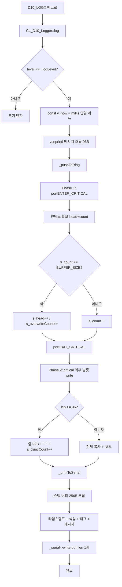
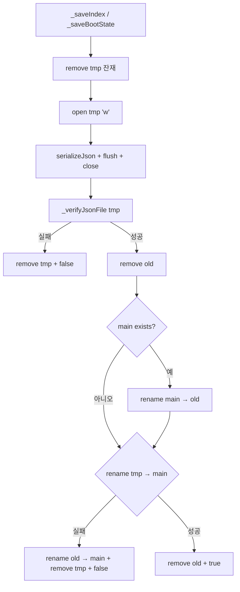

v0415 통합 하드닝 패치 — 3개 배치 통합 (총 21개 이슈 / 15개 파일)

파일별로 그룹화하여 Before/After 정리했습니다. 각 이슈에 원본 배치 번호를 태그로 표시했습니다.

태그 배치 이슈
[B1] Batch 1 (프론트 + 백엔드 기본) #1~#10
[P] Batch 2 (Profile JSON 경로) P1~P5
[W] Batch 3 (B20/P20/W10) W1~W6

---

📄 C10_Def_0415.h

[P1][P2] 경로 상수 추가

Before

```cpp
    static constexpr const char* PROFILES_DIR       = "/json/profiles";
    static constexpr const char* PROFILE_ACTIVE     = "/json/active_profile.json";
    static constexpr const char* PROFILE_ACTIVE_TMP = "/json/active_profile.json.tmp";
    static constexpr const char* BOOT_PATH          = "/json/boot_state_0415.json";
    static constexpr const char* BOOT_TMP_PATH      = "/json/boot_state_0415.json.tmp";
```

After

```cpp
    static constexpr const char* PROFILES_DIR       = "/json/profiles";
    static constexpr const char* PROFILE_ACTIVE     = "/json/active_profile.json";
    static constexpr const char* PROFILE_ACTIVE_TMP = "/json/active_profile.json.tmp";
    // [P1] 원자적 저장용 .old 경로 (rotate 방식)
    static constexpr const char* PROFILE_ACTIVE_OLD = "/json/active_profile.json.old";
    static constexpr const char* BOOT_PATH          = "/json/boot_state_0415.json";
    static constexpr const char* BOOT_TMP_PATH      = "/json/boot_state_0415.json.tmp";
    // [P2] 원자적 저장용 .old 경로 (rotate 방식)
    static constexpr const char* BOOT_OLD_PATH      = "/json/boot_state_0415.json.old";
```

[P4] makeProfilePath / makeProfileTmpPath idx 상한 가드

Before

```cpp
    static inline bool makeProfilePath(char* p_dst, size_t p_dstSize, uint8_t p_idx) {
        if (!p_dst || p_dstSize < 32) return false;
        const int v_n = snprintf(p_dst, p_dstSize, "%s/profile_%u.json", PROFILES_DIR, (unsigned)p_idx);
        return (v_n > 0 && (size_t)v_n < p_dstSize);
    }

    static inline bool makeProfileTmpPath(char* p_dst, size_t p_dstSize, uint8_t p_idx) {
        if (!p_dst || p_dstSize < 40) return false;
        const int v_n = snprintf(p_dst, p_dstSize, "%s/profile_%u.json.tmp", PROFILES_DIR, (unsigned)p_idx);
        return (v_n > 0 && (size_t)v_n < p_dstSize);
    }
```

After

```cpp
    static inline bool makeProfilePath(char* p_dst, size_t p_dstSize, uint8_t p_idx) {
        if (!p_dst || p_dstSize < 32) return false;
        if (p_idx >= PROFILE_MAX) return false;              // [P4] idx 상한 가드
        const int v_n = snprintf(p_dst, p_dstSize, "%s/profile_%u.json", PROFILES_DIR, (unsigned)p_idx);
        return (v_n > 0 && (size_t)v_n < p_dstSize);
    }

    static inline bool makeProfileTmpPath(char* p_dst, size_t p_dstSize, uint8_t p_idx) {
        if (!p_dst || p_dstSize < 40) return false;
        if (p_idx >= PROFILE_MAX) return false;              // [P4]
        const int v_n = snprintf(p_dst, p_dstSize, "%s/profile_%u.json.tmp", PROFILES_DIR, (unsigned)p_idx);
        return (v_n > 0 && (size_t)v_n < p_dstSize);
    }
```

---

📄 C10_Config_0415.h

[P5][W6] private 멤버 추가

Before

```cpp
class CL_C10_Config {
  private:
    ST_C10_BootState_t     _boot;
    ST_C10_ProfileIndex_t  _index;

    uint32_t _bootOkRetryAtMs = 0;
    volatile bool _profileSwitchInProgress = false;
```

After

```cpp
class CL_C10_Config {
  private:
    ST_C10_BootState_t     _boot;
    ST_C10_ProfileIndex_t  _index;

    uint32_t _bootOkRetryAtMs = 0;
    volatile bool _profileSwitchInProgress = false;
    bool _dirsEnsured = false;                        // [P5] 디렉토리 보장 캐시
    SemaphoreHandle_t _bootMutex = nullptr;           // [W6] _boot 원자화
```

[W6] getBootState 시그니처 (inline → out-of-line)

Before

```cpp
    bool isSafeMode() const { return _boot.safe_mode; }
    void getBootState(ST_C10_BootState_t& p_out) const { p_out = _boot; }
```

After

```cpp
    bool isSafeMode() const { return _boot.safe_mode; }
    void getBootState(ST_C10_BootState_t& p_out) const;   // [W6] .cpp로 이동 (mutex)
```

---

📄 C10_Config_0415.cpp

[W6] ctor — mutex 생성

Before

```cpp
CL_C10_Config::CL_C10_Config() {
    memset(&_boot,  0, sizeof(_boot));
    memset(&_index, 0, sizeof(_index));
    _bootOkRetryAtMs = 0;
    _profileSwitchInProgress = false;
}
```

After

```cpp
CL_C10_Config::CL_C10_Config() {
    memset(&_boot,  0, sizeof(_boot));
    memset(&_index, 0, sizeof(_index));
    _bootOkRetryAtMs = 0;
    _profileSwitchInProgress = false;
    _bootMutex = xSemaphoreCreateMutex();   // [W6]
}
```

[P5] begin() — _dirsEnsured 설정

Before

```cpp
void CL_C10_Config::begin(bool p_formatOnFail) {
    (void)LittleFS.begin(p_formatOnFail);
    (void)LittleFS.mkdir("/json");
    (void)LittleFS.mkdir(C10_DEF::PROFILES_DIR);
    ...
```

After

```cpp
void CL_C10_Config::begin(bool p_formatOnFail) {
    (void)LittleFS.begin(p_formatOnFail);
    (void)LittleFS.mkdir("/json");
    (void)LittleFS.mkdir(C10_DEF::PROFILES_DIR);
    _dirsEnsured = true;   // [P5] 이후 _atomicWriteJson에서 mkdir 생략
    ...
```

[P1] _saveIndex 원자화

Before

```cpp
bool CL_C10_Config::_saveIndex() {
    JsonDocument v_d;
    v_d["active_index"]  = _index.activeIndex;
    v_d["profile_count"] = _index.profileCount;

    if (LittleFS.exists(C10_DEF::PROFILE_ACTIVE_TMP))
        (void)LittleFS.remove(C10_DEF::PROFILE_ACTIVE_TMP);

    File v_f = LittleFS.open(C10_DEF::PROFILE_ACTIVE_TMP, "w");
    if (!v_f) return false;

    size_t v_bytes = serializeJson(v_d, v_f);
    v_f.flush();
    v_f.close();

    if (v_bytes == 0) {
        (void)LittleFS.remove(C10_DEF::PROFILE_ACTIVE_TMP);
        return false;
    }

    if (!_verifyJsonFile(C10_DEF::PROFILE_ACTIVE_TMP)) {
        (void)LittleFS.remove(C10_DEF::PROFILE_ACTIVE_TMP);
        return false;
    }

    if (LittleFS.exists(C10_DEF::PROFILE_ACTIVE))
        (void)LittleFS.remove(C10_DEF::PROFILE_ACTIVE);

    return LittleFS.rename(C10_DEF::PROFILE_ACTIVE_TMP, C10_DEF::PROFILE_ACTIVE);
}
```

After

```cpp
bool CL_C10_Config::_saveIndex() {
    JsonDocument v_d;
    v_d["active_index"]  = _index.activeIndex;
    v_d["profile_count"] = _index.profileCount;

    const char* v_tmp = C10_DEF::PROFILE_ACTIVE_TMP;
    const char* v_old = C10_DEF::PROFILE_ACTIVE_OLD;
    const char* v_main = C10_DEF::PROFILE_ACTIVE;

    if (LittleFS.exists(v_tmp)) (void)LittleFS.remove(v_tmp);

    File v_f = LittleFS.open(v_tmp, "w");
    if (!v_f) return false;

    size_t v_bytes = serializeJson(v_d, v_f);
    v_f.flush();
    v_f.close();

    if (v_bytes == 0 || !_verifyJsonFile(v_tmp)) {
        (void)LittleFS.remove(v_tmp);
        return false;
    }

    // [P1] rotate: main → old (main을 먼저 삭제하지 않음)
    if (LittleFS.exists(v_old)) (void)LittleFS.remove(v_old);
    if (LittleFS.exists(v_main)) {
        if (!LittleFS.rename(v_main, v_old)) {
            (void)LittleFS.remove(v_tmp);
            return false;
        }
    }

    // commit: tmp → main
    if (!LittleFS.rename(v_tmp, v_main)) {
        if (LittleFS.exists(v_old)) (void)LittleFS.rename(v_old, v_main);   // rollback
        (void)LittleFS.remove(v_tmp);
        return false;
    }

    if (LittleFS.exists(v_old)) (void)LittleFS.remove(v_old);
    return true;
}
```

[P4] loadProfile / saveProfile idx 가드 추가

Before

```cpp
bool CL_C10_Config::loadProfile(uint8_t p_idx, ST_C10_ProfileConfig_t& p_out) {
    char v_path[64];
    if (!C10_DEF::makeProfilePath(v_path, sizeof(v_path), p_idx)) return false;
    ...
}

bool CL_C10_Config::saveProfile(uint8_t p_idx, const ST_C10_ProfileConfig_t& p_in) {
    if (!validateProfile(p_in)) return false;
    ...
}
```

After

```cpp
bool CL_C10_Config::loadProfile(uint8_t p_idx, ST_C10_ProfileConfig_t& p_out) {
    if (p_idx >= C10_DEF::PROFILE_MAX) return false;   // [P4]
    char v_path[64];
    if (!C10_DEF::makeProfilePath(v_path, sizeof(v_path), p_idx)) return false;
    ...
}

bool CL_C10_Config::saveProfile(uint8_t p_idx, const ST_C10_ProfileConfig_t& p_in) {
    if (p_idx >= C10_DEF::PROFILE_MAX) return false;   // [P4]
    if (!validateProfile(p_in)) return false;
    ...
}
```

[P3] deleteProfile Case 2 — v_dst 잔재 정리

Before

```cpp
    else {
        char v_src[64];
        char v_dst[64];
        if (!C10_DEF::makeProfilePath(v_src, sizeof(v_src), v_last)) return false;
        if (!C10_DEF::makeProfilePath(v_dst, sizeof(v_dst), p_idx))  return false;

        // 삭제 대상 파일 제거
        if (LittleFS.exists(v_dst)) (void)LittleFS.remove(v_dst);

        // 마지막 → 삭제 슬롯 이동
        if (!LittleFS.rename(v_src, v_dst)) {
            if (!_copyFile(v_src, v_dst)) { ... }
            (void)LittleFS.remove(v_src);
        }
        ...
```

After

```cpp
    else {
        char v_src[64];
        char v_dst[64];
        if (!C10_DEF::makeProfilePath(v_src, sizeof(v_src), v_last)) return false;
        if (!C10_DEF::makeProfilePath(v_dst, sizeof(v_dst), p_idx))  return false;

        // [P3] 삭제 대상 슬롯의 main + old + tmp 잔재 전부 정리
        if (LittleFS.exists(v_dst)) (void)LittleFS.remove(v_dst);

        char v_dstOld[96];
        snprintf(v_dstOld, sizeof(v_dstOld), "%s.old", v_dst);
        if (LittleFS.exists(v_dstOld)) (void)LittleFS.remove(v_dstOld);

        char v_dstTmp[80];
        if (C10_DEF::makeProfileTmpPath(v_dstTmp, sizeof(v_dstTmp), p_idx)) {
            if (LittleFS.exists(v_dstTmp)) (void)LittleFS.remove(v_dstTmp);
        }

        // 마지막 → 삭제 슬롯 이동
        if (!LittleFS.rename(v_src, v_dst)) {
            if (!_copyFile(v_src, v_dst)) { ... }
            (void)LittleFS.remove(v_src);
        }
        ...
```

[P5] _atomicWriteJson — mkdir 반복 제거

Before

```cpp
bool CL_C10_Config::_atomicWriteJson(const char* p_path, const char* p_tmpPath, JsonDocument& p_doc) {
    (void)LittleFS.mkdir("/json");
    (void)LittleFS.mkdir(C10_DEF::PROFILES_DIR);

    if (LittleFS.exists(p_tmpPath)) (void)LittleFS.remove(p_tmpPath);
    ...
```

After

```cpp
bool CL_C10_Config::_atomicWriteJson(const char* p_path, const char* p_tmpPath, JsonDocument& p_doc) {
    // [P5] begin() 이후 1회만 mkdir (매 저장 반복 제거)
    if (!_dirsEnsured) {
        (void)LittleFS.mkdir("/json");
        (void)LittleFS.mkdir(C10_DEF::PROFILES_DIR);
        _dirsEnsured = true;
    }

    if (LittleFS.exists(p_tmpPath)) (void)LittleFS.remove(p_tmpPath);
    ...
```

[P2] _saveBootState 원자화

Before

```cpp
bool CL_C10_Config::_saveBootState(const ST_C10_BootState_t& p_in) {
    JsonDocument v_d;
    v_d["safe_mode"]         = p_in.safe_mode;
    v_d["fail_count"]        = p_in.fail_count;
    v_d["pending"]           = p_in.pending;
    v_d["boot_ms"]           = p_in.boot_ms;
    v_d["last_reset_reason"] = p_in.last_reset_reason;

    File v_f = LittleFS.open(C10_DEF::BOOT_TMP_PATH, "w");
    if (!v_f) return false;

    if (serializeJson(v_d, v_f) == 0) {
        v_f.close();
        (void)LittleFS.remove(C10_DEF::BOOT_TMP_PATH);
        return false;
    }
    v_f.flush();
    v_f.close();

    if (!_verifyJsonFile(C10_DEF::BOOT_TMP_PATH)) {
        (void)LittleFS.remove(C10_DEF::BOOT_TMP_PATH);
        return false;
    }

    if (LittleFS.exists(C10_DEF::BOOT_PATH)) (void)LittleFS.remove(C10_DEF::BOOT_PATH);
    return LittleFS.rename(C10_DEF::BOOT_TMP_PATH, C10_DEF::BOOT_PATH);
}
```

After

```cpp
bool CL_C10_Config::_saveBootState(const ST_C10_BootState_t& p_in) {
    JsonDocument v_d;
    v_d["safe_mode"]         = p_in.safe_mode;
    v_d["fail_count"]        = p_in.fail_count;
    v_d["pending"]           = p_in.pending;
    v_d["boot_ms"]           = p_in.boot_ms;
    v_d["last_reset_reason"] = p_in.last_reset_reason;

    const char* v_tmp  = C10_DEF::BOOT_TMP_PATH;
    const char* v_old  = C10_DEF::BOOT_OLD_PATH;
    const char* v_main = C10_DEF::BOOT_PATH;

    if (LittleFS.exists(v_tmp)) (void)LittleFS.remove(v_tmp);

    File v_f = LittleFS.open(v_tmp, "w");
    if (!v_f) return false;

    if (serializeJson(v_d, v_f) == 0) {
        v_f.close();
        (void)LittleFS.remove(v_tmp);
        return false;
    }
    v_f.flush();
    v_f.close();

    if (!_verifyJsonFile(v_tmp)) {
        (void)LittleFS.remove(v_tmp);
        return false;
    }

    // [P2] rotate: main → old
    if (LittleFS.exists(v_old)) (void)LittleFS.remove(v_old);
    if (LittleFS.exists(v_main)) {
        if (!LittleFS.rename(v_main, v_old)) {
            (void)LittleFS.remove(v_tmp);
            return false;
        }
    }

    // commit: tmp → main
    if (!LittleFS.rename(v_tmp, v_main)) {
        if (LittleFS.exists(v_old)) (void)LittleFS.rename(v_old, v_main);
        (void)LittleFS.remove(v_tmp);
        return false;
    }

    if (LittleFS.exists(v_old)) (void)LittleFS.remove(v_old);
    return true;
}
```

[B1-1] makeDefaultsWiFi — 실 WiFi 자격증명 제거

Before

```cpp
void CL_C10_Config::makeDefaultsWiFi(ST_C10_WiFiConfig_t& p_out) {
    memset(&p_out, 0, sizeof(p_out));
    p_out.mode = (uint8_t)EN_C10_WIFI_AUTO;
    strlcpy(p_out.sta_ssid,  "NetE89C",        sizeof(p_out.sta_ssid));
    strlcpy(p_out.sta_pass,  "38D#4FP001",     sizeof(p_out.sta_pass));
    strlcpy(p_out.ap_ssid,   "EliteAirMouse",  sizeof(p_out.ap_ssid));
    strlcpy(p_out.ap_pass,   "12345678",       sizeof(p_out.ap_pass));
    strlcpy(p_out.mdns_host, "elite-airmouse", sizeof(p_out.mdns_host));
}
```

After

```cpp
void CL_C10_Config::makeDefaultsWiFi(ST_C10_WiFiConfig_t& p_out) {
    memset(&p_out, 0, sizeof(p_out));
    p_out.mode = (uint8_t)EN_C10_WIFI_AUTO;

    // [B1-1] 실 WiFi 자격증명 embed 제거 (보안 + BUDGET §6.7 정합)
    //   - sta_ssid 공백 → W10이 8초 STA 대기 생략하고 즉시 SoftAP 구동
    //   - 사용자가 웹 UI에서 STA 자격증명 명시 입력 시에만 STA 시도
    p_out.sta_ssid[0] = '\0';
    p_out.sta_pass[0] = '\0';

    strlcpy(p_out.ap_ssid,   "EliteAirMouse",  sizeof(p_out.ap_ssid));
    strlcpy(p_out.ap_pass,   "12345678",       sizeof(p_out.ap_pass));
    strlcpy(p_out.mdns_host, "elite-airmouse", sizeof(p_out.mdns_host));
}
```

[W6] getBootState / clearSafeMode / bootMarkOkIfGracePassed — mutex 보호

Before

```cpp
// (header inline)
void getBootState(ST_C10_BootState_t& p_out) const { p_out = _boot; }
```

```cpp
bool CL_C10_Config::clearSafeMode() {
    _boot.safe_mode  = false;
    _boot.fail_count = 0;
    _boot.pending    = false;
    return _saveBootState(_boot);
}

bool CL_C10_Config::bootMarkOkIfGracePassed(uint32_t p_graceMs) {
    if (_boot.boot_ms == 0) _boot.boot_ms = (uint32_t)millis();

    const uint32_t v_now = (uint32_t)millis();
    const uint32_t v_alive = (v_now >= _boot.boot_ms) ? (v_now - _boot.boot_ms) : 0;

    if (v_alive < p_graceMs) return false;

    if (_bootOkRetryAtMs != 0 && (int32_t)(v_now - _bootOkRetryAtMs) < 0) return false;

    _boot.pending = false;
    if (!_boot.safe_mode) _boot.fail_count = 0;

    const bool v_ok = _saveBootState(_boot);
    if (v_ok) _bootOkRetryAtMs = 0;
    else      _bootOkRetryAtMs = v_now + 30000u;
    return v_ok;
}
```

After

```cpp
void CL_C10_Config::getBootState(ST_C10_BootState_t& p_out) const {
    auto* v_self = const_cast<CL_C10_Config*>(this);
    if (v_self->_bootMutex) xSemaphoreTake(v_self->_bootMutex, portMAX_DELAY);
    p_out = v_self->_boot;
    if (v_self->_bootMutex) xSemaphoreGive(v_self->_bootMutex);
}
```

```cpp
bool CL_C10_Config::clearSafeMode() {
    ST_C10_BootState_t v_snap;
    if (_bootMutex) xSemaphoreTake(_bootMutex, portMAX_DELAY);
    _boot.safe_mode  = false;
    _boot.fail_count = 0;
    _boot.pending    = false;
    v_snap = _boot;
    if (_bootMutex) xSemaphoreGive(_bootMutex);
    return _saveBootState(v_snap);
}

bool CL_C10_Config::bootMarkOkIfGracePassed(uint32_t p_graceMs) {
    uint32_t v_now = (uint32_t)millis();
    ST_C10_BootState_t v_snap;
    bool v_doSave = false;

    if (_bootMutex) xSemaphoreTake(_bootMutex, portMAX_DELAY);
    if (_boot.boot_ms == 0) _boot.boot_ms = v_now;
    const uint32_t v_alive = (v_now >= _boot.boot_ms) ? (v_now - _boot.boot_ms) : 0;

    if (v_alive < p_graceMs) {
        if (_bootMutex) xSemaphoreGive(_bootMutex);
        return false;
    }
    if (_bootOkRetryAtMs != 0 && (int32_t)(v_now - _bootOkRetryAtMs) < 0) {
        if (_bootMutex) xSemaphoreGive(_bootMutex);
        return false;
    }

    _boot.pending = false;
    if (!_boot.safe_mode) _boot.fail_count = 0;
    v_snap = _boot;
    v_doSave = true;
    if (_bootMutex) xSemaphoreGive(_bootMutex);

    const bool v_ok = _saveBootState(v_snap);
    if (v_ok) _bootOkRetryAtMs = 0;
    else      _bootOkRetryAtMs = v_now + 30000u;
    (void)v_doSave;
    return v_ok;
}
```

---

📄 E10_AirMouse_0415.h

[B1-3] _isPptMode Dead field 삭제

Before

```cpp
    // Runtime config (applied)
    volatile bool _isPptMode = false;
    int           _dpiLevel  = 2;
    bool          _hardClickLock = true;
```

After

```cpp
    // Runtime config (applied)
    // [B1-3] _isPptMode 삭제 (Round G) — active_mode == 2로 일원화
    int           _dpiLevel  = 2;
    bool          _hardClickLock = true;
```

[B1-4] I2C pre-probe 전용 카운터 분리

Before

```cpp
    uint16_t _consecutiveFail        = 0;
    uint16_t _consecutiveRecoverFail = 0;
```

After

```cpp
    uint16_t _consecutiveFail        = 0;   // NaN / 센서 read 실패
    uint16_t _consecutiveRecoverFail = 0;   // _recoverI2C 실패
    // [B1-4] I2C pre-probe 전용 카운터 (CONTRACT §2.11 "연속 10회" 시맨틱)
    uint16_t _consecutiveI2cFail     = 0;
```

---

📄 E10_AirMouse_Task_0415.cpp

[B1-4] sensorTask 진입부 — pre-probe 카운터 분리

Before

```cpp
        // ---- sensor read ----
        Wire.beginTransmission(v_m->_mpuAddr);
        const uint8_t v_i2cProbe = Wire.endTransmission();
        if (v_i2cProbe != 0) {
            v_m->_consecutiveFail++;
            if ((v_m->_consecutiveFail % 10) == 0) {
                (void)v_m->_recoverI2C();
            }
            vTaskDelayUntil(&v_lastWake, pdMS_TO_TICKS(8));
            continue;
        }
```

After

```cpp
        // ---- sensor read ----
        Wire.beginTransmission(v_m->_mpuAddr);
        const uint8_t v_i2cProbe = Wire.endTransmission();
        if (v_i2cProbe != 0) {
            // [B1-4] I2C 전용 카운터: 연속 10회 실패 시 복구
            v_m->_consecutiveI2cFail++;
            if (v_m->_consecutiveI2cFail >= 10) {
                (void)v_m->_recoverI2C();
                v_m->_consecutiveI2cFail = 0;   // 복구 후 리셋 (플러딩 방지)
            }
            vTaskDelayUntil(&v_lastWake, pdMS_TO_TICKS(8));
            continue;
        }
        v_m->_consecutiveI2cFail = 0;   // 성공 시 리셋
```

[B1-4] _reqClearDiag 카운터 초기화 추가

Before

```cpp
            v_m->_consecutiveFail        = 0;
            v_m->_consecutiveRecoverFail = 0;
            v_m->_unlock();
```

After

```cpp
            v_m->_consecutiveFail        = 0;
            v_m->_consecutiveRecoverFail = 0;
            v_m->_consecutiveI2cFail     = 0;   // [B1-4]
            v_m->_unlock();
```

[W1] Deep-sleep 경로 — LED suspend 선행

Before

```cpp
        if (v_elapsed >= v_timeout) {
            // [N-1] Deep-sleep 우선 판정 (Safe 분기 포함)
            const bool v_didDeepSleep =
                v_m->_power.deepSleepNow(v_nowP, v_bleConn, v_pairing, v_safe);

            if (!v_didDeepSleep) {
                // LED 상태 저장 (blocking fadeout)
                CL_L10_Led::ST_LedSnapshot_t v_snap;
                v_m->_led.suspend(v_snap);

                // [v0415] Safe/Pairing Wake Mask 분기
                const bool v_didSleep =
                    v_m->_power.sleepNow(v_nowP, v_safeOrPairing);

                // wake 복귀 또는 실패 시 LED 원복
                v_m->_led.resume(v_snap);

                if (v_didSleep) {
                    v_m->_biasTracker.startFastRecalibrate(
                        v_m->_cfgProfile.e10.power.fast_recalib_ms);
                }
            }
        }
```

After

```cpp
        if (v_elapsed >= v_timeout) {
            // [W1] Deep/Light 공통 전처리: WS2812 latch 방지 위해 먼저 LED OFF
            CL_L10_Led::ST_LedSnapshot_t v_snap;
            v_m->_led.suspend(v_snap);

            // [N-1] Deep-sleep 우선 판정 (Safe 분기 포함)
            //   - P20 내부에서 MPU PWR_MGMT_1 sleep bit 설정
            const bool v_didDeepSleep =
                v_m->_power.deepSleepNow(v_nowP, v_bleConn, v_pairing, v_safe);

            // 여기 도달 = deep 미진입 → light-sleep 시도
            const bool v_didSleep =
                v_m->_power.sleepNow(v_nowP, v_safeOrPairing);

            // wake 복귀 또는 실패 시 LED 원복
            v_m->_led.resume(v_snap);

            if (v_didSleep) {
                v_m->_biasTracker.startFastRecalibrate(
                    v_m->_cfgProfile.e10.power.fast_recalib_ms);
            }
        }
```

---

📄 P20_Power_0415.cpp

[W1] deepSleepNow — MPU sleep bit 설정

Before

```cpp
bool CL_P20_Power::deepSleepNow(uint32_t p_nowMs,
                                bool p_hidConnected,
                                bool p_pairing,
                                bool p_safe) {
    if (_cfg.deep_idle_timeout_ms == 0) return false;
    if (p_hidConnected || p_pairing)    return false;
    if ((p_nowMs - _lastActivityMs) < _cfg.deep_idle_timeout_ms) return false;

    D10_LOGI("[P20] entering deep-sleep (idle=%ums, safe=%d)",
             (unsigned)(p_nowMs - _lastActivityMs), (int)p_safe);

    // [v0415] Safe 분기 마스크
    const uint64_t v_mask = p_safe
        ? HW_DEF::buildWakeMaskSafe()
        : HW_DEF::buildWakeMaskButtons();

    esp_sleep_enable_ext1_wakeup(v_mask, ESP_EXT1_WAKEUP_ANY_LOW);
    esp_deep_sleep_start();

    return false;
}
```

After

```cpp
bool CL_P20_Power::deepSleepNow(uint32_t p_nowMs,
                                bool p_hidConnected,
                                bool p_pairing,
                                bool p_safe) {
    if (_cfg.deep_idle_timeout_ms == 0) return false;
    if (p_hidConnected || p_pairing)    return false;
    if ((p_nowMs - _lastActivityMs) < _cfg.deep_idle_timeout_ms) return false;

    D10_LOGI("[P20] entering deep-sleep (idle=%ums, safe=%d)",
             (unsigned)(p_nowMs - _lastActivityMs), (int)p_safe);

    // [W1] MPU6050 sleep bit 설정 (~4mA 절감, SPEC §전원관리 정합)
    //   - deep sleep wake는 버튼 EXT1만 사용하므로 MPU WoM 불필요
    static constexpr uint8_t G_MPU_PWR1_SLEEP = 0x40;
    (void)mpuWr(G_MPU_PWR_MGMT_1, G_MPU_PWR1_SLEEP);

    const uint64_t v_mask = p_safe
        ? HW_DEF::buildWakeMaskSafe()
        : HW_DEF::buildWakeMaskButtons();

    esp_sleep_enable_ext1_wakeup(v_mask, ESP_EXT1_WAKEUP_ANY_LOW);
    esp_deep_sleep_start();

    return false;
}
```

---

📄 W10_WebApi_Config_0415.cpp

[W2] apiExport — 파일명 헤더 인젝션 방어

Before

```cpp
    String v_filename;
    if (req->hasParam("filename")) {
        const AsyncWebParameter* p = req->getParam("filename");
        if (p) v_filename = p->value();
    }
    if (v_filename.length() == 0) {
        char v_buf[40];
        snprintf(v_buf, sizeof(v_buf), "profile_%u.json",
                 (unsigned)_cfg->getActiveIndex());
        v_filename = String(v_buf);
    }

    AsyncResponseStream* res = req->beginResponseStream("application/json");
    res->setCode(200);
    res->addHeader("Cache-Control", G_W10_CACHE_NOSTORE);
    res->addHeader("Content-Disposition",
                   String("attachment; filename=\"") + v_filename + "\"");
    serializeJson(v_doc, *res);
    req->send(res);
```

After

```cpp
    String v_filename;
    if (req->hasParam("filename")) {
        const AsyncWebParameter* p = req->getParam("filename");
        if (p) v_filename = p->value();
    }

    // [W2] 파일명 sanitize (CRLF/제어문자/경로조작 방어 → 헤더 인젝션 차단)
    String v_safe;
    v_safe.reserve(v_filename.length());
    for (size_t i = 0; i < v_filename.length() && v_safe.length() < 64; i++) {
        const char c = v_filename[i];
        if (c == '\r' || c == '\n' || c == '"' || c == '\\' || c == '/' ||
            (uint8_t)c < 0x20 || c == 0x7F) {
            v_safe += '_';
        } else {
            v_safe += c;
        }
    }
    v_filename = v_safe;

    if (v_filename.length() == 0) {
        char v_buf[40];
        snprintf(v_buf, sizeof(v_buf), "profile_%u.json",
                 (unsigned)_cfg->getActiveIndex());
        v_filename = String(v_buf);
    }

    AsyncResponseStream* res = req->beginResponseStream("application/json");
    res->setCode(200);
    res->addHeader("Cache-Control", G_W10_CACHE_NOSTORE);
    res->addHeader("Content-Disposition",
                   String("attachment; filename=\"") + v_filename + "\"");
    serializeJson(v_doc, *res);
    req->send(res);
```

---

📄 W10_WebApi_Status_0415.cpp

[B1-8] net["ssid"] — 27자 클램프 정합

Before

```cpp
    const char* v_apSsid = (_wifi.ap_ssid[0] != '\0') ? _wifi.ap_ssid : "EliteAirMouse";
    net["ssid"] = (WiFi.getMode() == WIFI_AP)
                      ? ((_cfg && _cfg->isSafeMode()) ? (String(v_apSsid) + "-SAFE") : String(v_apSsid))
                      : WiFi.SSID();
```

After

```cpp
    // [B1-8] SafeBoot SSID 27자 클램프 (_setupWiFi와 동일 규칙)
    const char* v_apSsid = (_wifi.ap_ssid[0] != '\0') ? _wifi.ap_ssid : "EliteAirMouse";
    String v_apSsidFull = String(v_apSsid);
    if (_cfg && _cfg->isSafeMode() && v_apSsidFull.length() <= 27) {
        v_apSsidFull += "-SAFE";
    }
    net["ssid"] = (WiFi.getMode() == WIFI_AP) ? v_apSsidFull : WiFi.SSID();
```

---

📄 W10_WebApi_Profile_0415.cpp

[B1-7] apiActionTest — gate 실패 vs BLE 미연결 구분

Before

```cpp
    const bool v_ok = _e10if->execLiveTest(_e10if->ctx, v_k, v_h, v_p16, v_p32);
    if (!v_ok) {
        _sendErr(req, "ble_disconnected", "Live test failed (BLE disconnected to host PC).");
        return;
    }
```

After

```cpp
    const bool v_ok = _e10if->execLiveTest(_e10if->ctx, v_k, v_h, v_p16, v_p32);
    if (!v_ok) {
        // [B1-7] SafeMode/OTAGuard vs BLE 미연결 구분
        bool v_otaGuard = false;
        if (_e10if->getStatus) {
            ST_E10_Status_t s;
            memset(&s, 0, sizeof(s));
            if (_e10if->getStatus(_e10if->ctx, &s)) v_otaGuard = s.ota_guard;
        }
        if (_isSafeMode() || v_otaGuard) {
            _sendErr(req, "ota_guard_blocked", "Live test blocked by gate.");
        } else {
            _sendErr(req, "ble_disconnected", "Live test failed (BLE disconnected to host PC).");
        }
        return;
    }
```

[B1-7] apiActionTestMacro — 동일 처리

Before

```cpp
    const bool v_ok = _e10if->execLiveTest(_e10if->ctx,
                                           (uint8_t)EN_C20_ACT_MACRO,
                                           (uint8_t)EN_C20_HOLD_NONE,
                                           0,
                                           (uint32_t)v_idx);
    if (!v_ok) {
        _sendErr(req, "ble_disconnected", "Macro test failed (BLE disconnected to host PC).");
        return;
    }
```

After

```cpp
    const bool v_ok = _e10if->execLiveTest(_e10if->ctx,
                                           (uint8_t)EN_C20_ACT_MACRO,
                                           (uint8_t)EN_C20_HOLD_NONE,
                                           0,
                                           (uint32_t)v_idx);
    if (!v_ok) {
        // [B1-7] gate 실패 vs BLE 미연결 구분
        bool v_otaGuard = false;
        if (_e10if->getStatus) {
            ST_E10_Status_t s;
            memset(&s, 0, sizeof(s));
            if (_e10if->getStatus(_e10if->ctx, &s)) v_otaGuard = s.ota_guard;
        }
        if (_isSafeMode() || v_otaGuard) {
            _sendErr(req, "ota_guard_blocked", "Macro test blocked by gate.");
        } else {
            _sendErr(req, "ble_disconnected", "Macro test failed (BLE disconnected to host PC).");
        }
        return;
    }
```

---

📄 W10_Web_Static_0415.cpp

[W3] _serveWwwStatic — Vary: Accept-Encoding 조건 완화

Before

```cpp
    bool v_useGz = false;
    String v_gzPath;

    if (W10_isGzipTargetExt(v_extLower)) {
        v_gzPath = String(p_path) + ".gz";
        if (LittleFS.exists(v_gzPath) && _acceptsGzip(req)) {
            v_useGz = true;
        }
    }
    ...
    if (v_etagOk && _ifNoneMatchHit(req, v_etag)) {
        _send304StaticWithCacheControl(req, v_etag, v_cc, v_useGz);
        return;
    }
    ...
    _sendStaticWithCacheControlEtag(req,
                                    v_sendPath,
                                    v_ct,
                                    v_cc,
                                    v_useGz,
                                    v_useGz,        // Vary only if gz used
                                    ...);
```

After

```cpp
    bool v_useGz = false;
    bool v_gzVariantExists = false;   // [W3] gz variant 존재 여부 분리
    String v_gzPath;

    if (W10_isGzipTargetExt(v_extLower)) {
        v_gzPath = String(p_path) + ".gz";
        if (LittleFS.exists(v_gzPath)) {
            v_gzVariantExists = true;
            if (_acceptsGzip(req)) {
                v_useGz = true;
            }
        }
    }
    ...
    if (v_etagOk && _ifNoneMatchHit(req, v_etag)) {
        _send304StaticWithCacheControl(req, v_etag, v_cc, v_gzVariantExists);   // [W3]
        return;
    }
    ...
    _sendStaticWithCacheControlEtag(req,
                                    v_sendPath,
                                    v_ct,
                                    v_cc,
                                    v_useGz,
                                    v_gzVariantExists,   // [W3] 존재 시 항상 Vary
                                    ...);
```

[W4] _handleDynamicStatic — 폴백 매핑 힙 할당 제거

Before

```cpp
    // [v0415] /www/ 프리픽스 누락 요청 폴백 (/style_0415.css, /lib/* 등)
    {
        String v_wwwAlt = String("/www") + v_uri;
        char v_altExt[12];
        memset(v_altExt, 0, sizeof(v_altExt));
        const char* v_extLower = W10_getLowerExt(v_wwwAlt.c_str(), v_altExt, sizeof(v_altExt));
        if (v_extLower && W10_isAllowedWwwExt(v_extLower) && W10_isPathSafe(v_wwwAlt.c_str())) {
            if (LittleFS.exists(v_wwwAlt) || LittleFS.exists(v_wwwAlt + ".gz")) {
                D10_LOGI("[W10] fallback /www map: %s", v_wwwAlt.c_str());
                _serveWwwStatic(req, v_wwwAlt.c_str());
                return;
            }
        }
    }

    _sendStaticErr(req, 404, "static_not_found", "not found");
```

After

```cpp
    // [W4] /www 폴백 매핑: prefix 화이트리스트 + 스택 버퍼 (힙 할당 제거)
    static constexpr const char* G_WWW_FALLBACK_PREFIXES[] = {
        "/style_0415.css",
        "/app_0415_0001.js",
        "/app_bundle_0415.js",
        "/lib/",
        "/images/",
        "/fonts/",
    };

    bool v_wwwFallback = false;
    for (size_t i = 0; i < sizeof(G_WWW_FALLBACK_PREFIXES) / sizeof(G_WWW_FALLBACK_PREFIXES[0]); i++) {
        if (v_uri.startsWith(G_WWW_FALLBACK_PREFIXES[i])) { v_wwwFallback = true; break; }
    }

    if (v_wwwFallback) {
        char v_altPath[192];
        const int v_n = snprintf(v_altPath, sizeof(v_altPath), "/www%s", v_uri.c_str());
        if (v_n > 0 && (size_t)v_n < sizeof(v_altPath) && W10_isPathSafe(v_altPath)) {
            char v_altExt[12];
            memset(v_altExt, 0, sizeof(v_altExt));
            const char* v_extLower = W10_getLowerExt(v_altPath, v_altExt, sizeof(v_altExt));
            if (v_extLower && W10_isAllowedWwwExt(v_extLower) && LittleFS.exists(v_altPath)) {
                D10_LOGI("[W10] fallback /www map: %s", v_altPath);
                _serveWwwStatic(req, v_altPath);
                return;
            }
        }
    }

    _sendStaticErr(req, 404, "static_not_found", "not found");
```

[W5] _calcFileEtag32 — 소형 파일 이중 읽기 방지

Before

```cpp
    const size_t S = 256;
    readAt(0, (v_size >= S ? S : v_size));
    if (v_size > S) {
        size_t mid = (v_size / 2);
        if (mid >= (S / 2)) mid -= (S / 2);
        readAt(mid, (v_size >= S ? S : v_size));
    }
    if (v_size > (2 * S)) {
        readAt(v_size - S, S);
    }
```

After

```cpp
    const size_t S = 256;
    readAt(0, (v_size >= S ? S : v_size));

    // [W5] mid 샘플링이 head와 겹치지 않을 때만 실행
    if (v_size > S) {
        size_t mid = (v_size / 2);
        if (mid >= (S / 2)) mid -= (S / 2);
        if (mid >= S) {
            readAt(mid, (v_size >= S ? S : v_size));
        }
    }
    if (v_size > (2 * S)) {
        readAt(v_size - S, S);
    }
```

---

📄 index_0415.html

[B1-6] e10HardClick UI 숨김

Before

```html
        <div class="frow">
          <label class="flbl" data-i18n="cfg.lbl_hard_click">클릭 중 포인터 잠금</label>
          <select id="e10HardClick" class="select">
            <option value="true" data-i18n="cfg.hard_click_on">사용</option>
            <option value="false" data-i18n="cfg.hard_click_off">사용 안 함</option>
          </select>
          <div class="fhelp" data-i18n="cfg.hard_click_deprecated">(v0415에서 삭제됨 — Click-Freeze로 대체)</div>
        </div>
```

After

```html
        <!-- [B1-6] v0415: hard_click_lock no-op (M10 Click-Lock 삭제).
             스키마 필드는 유지하되 UI 숨김 (v0416에서 스키마 자체 삭제 예정). -->
        <input type="hidden" id="e10HardClick" value="false" />
```

---

📄 style_0415.css

[B1-5-CSS] 리모컨 버튼 비활성 스타일

Before

```css
.mini-btn { font-size: .78rem; padding: 10px 6px; border-radius: 10px; min-width: 0; width: 100%; min-height: 44px; }
```

After

```css
.mini-btn { font-size: .78rem; padding: 10px 6px; border-radius: 10px; min-width: 0; width: 100%; min-height: 44px; }

/* [B1-5] Descriptor 미지원 리모컨 버튼 시각적 비활성 */
.remote-btn:disabled,
.remote-btn.disabled {
  opacity: .35;
  cursor: not-allowed;
  filter: grayscale(60%);
}
.remote-btn:disabled:active,
.remote-btn.disabled:active {
  transform: none;
  background: #1c2333;
  border-color: #2d3852;
}
```

---

📄 am_remote_0415.js

[B1-2] Mode 3 pad2D 라벨 정정

Before

```js
    // [v0415] Input: 0x2000 → WWW_SEARCH 0x080000 (Descriptor 미지원 → 대체)
    pad2D: { labelKey: "remote.tv_input", action: () => keyTest("consumer", 0, 0x080000) },
```

After

```js
    // [B1-2] label↔action 불일치 해소: WWW_SEARCH 실제 동작 → "검색" 라벨로 교체
    pad2D: { labelKey: "tools.tv.search", action: () => keyTest("consumer", 0, 0x080000) },
```

[B1-5] Mode 3 CH 버튼 disabled 플래그

Before

```js
    // [v0415] CH_UP/DOWN: Descriptor 미지원 → 비활성 (label만 유지, action no-op)
    pad3U: { labelKey: "remote.tv_ch_up", action: () => keyTest("consumer", 0, 0x000000) },
    pad3D: { labelKey: "remote.tv_ch_down", action: () => keyTest("consumer", 0, 0x000000) },
```

After

```js
    // [B1-5] CH_UP/DOWN: Descriptor 미지원 → 시각적 비활성
    pad3U: { labelKey: "remote.tv_ch_up",   disabled: true },
    pad3D: { labelKey: "remote.tv_ch_down", disabled: true },
```

[B1-5] setBtn — disabled 지원

Before

```js
  const setBtn = (id, def, subId) => {
    const el = qs(id); if (!el || !def) return;
    const v_lbl = def.labelKey ? t(def.labelKey) : def.label;
    if (v_lbl !== undefined) el.textContent = v_lbl;
    const cloned = el.cloneNode(true);
    el.parentNode.replaceChild(cloned, el);
    if (typeof def.action === "function") cloned.addEventListener("click", def.action);
    if (subId) {
      const sEl = qs(subId);
      if (sEl) sEl.textContent = def.subKey ? t(def.subKey) : "";
    }
  };
```

After

```js
  const setBtn = (id, def, subId) => {
    const el = qs(id); if (!el || !def) return;
    const v_lbl = def.labelKey ? t(def.labelKey) : def.label;
    if (v_lbl !== undefined) el.textContent = v_lbl;
    const cloned = el.cloneNode(true);
    el.parentNode.replaceChild(cloned, el);

    // [B1-5] disabled 플래그 지원
    if (def.disabled) {
      cloned.disabled = true;
      cloned.classList.add("disabled");
      cloned.setAttribute("aria-disabled", "true");
    } else if (typeof def.action === "function") {
      cloned.addEventListener("click", def.action);
    }

    if (subId) {
      const sEl = qs(subId);
      if (sEl) sEl.textContent = def.subKey ? t(def.subKey) : "";
    }
  };
```

---

📄 am_status_0415.js

[B1-10] keyTest — Consumer code 0 조기 반환

Before

```js
async function keyTest(page, mod, code, labelOverride) {
  // [G-1] 검증 먼저 (부정확한 로그 기록 방지)
  if (!Number.isFinite(code) || code < 0) {
    alert(t("trouble.invalid_code"));
    return;
  }

  const label = labelOverride || ((page === "kb")
    ? `KB u=${code} mod=${mod}`
    : `Consumer 0x${(code >>> 0).toString(16).toUpperCase()}`);
  if (typeof pushRecentLog === "function") pushRecentLog(label, true);
  ...
```

After

```js
async function keyTest(page, mod, code, labelOverride) {
  // [G-1] 검증 먼저
  if (!Number.isFinite(code) || code < 0) {
    alert(t("trouble.invalid_code"));
    return;
  }

  // [B1-10] Consumer code 0은 서버 _tapConsumerMask에서 no-op → 조기 반환
  //   "Key Test OK" 오인 로그 방지
  if (page === "consumer" && (code >>> 0) === 0) {
    return;
  }

  const label = labelOverride || ((page === "kb")
    ? `KB u=${code} mod=${mod}`
    : `Consumer 0x${(code >>> 0).toString(16).toUpperCase()}`);
  if (typeof pushRecentLog === "function") pushRecentLog(label, true);
  ...
```

---

📄 am_i18n_0415.js

[B1-9] Dead key 제거

Before (KO)

```js
    "remote.tv_input": "외부 입력",
    "remote.tv_input_tip": "HID Descriptor 미지원 (사용 불가)",
    "remote.tv_ch_up": "CH ▲",
    "remote.tv_ch_down": "CH ▼",
    "remote.tv_ch_tip": "HID Descriptor 미지원 (사용 불가)",
    ...
    "tools.tv.channel": "채널 탐색",
    "tools.tv.ch_up": "채널 올리기",
    "tools.tv.ch_down": "채널 내리기",
    ...
    "cfg.schema_migrated": "프로파일이 스키마 411로 자동 마이그레이션되었습니다.",
    "cfg.schema_migrate_note": "v0412 → v0415: Consumer 키 매핑이 HID Descriptor 정합으로 갱신됨.",
```

After (KO)

```js
    // [B1-9] Dead key 제거: remote.tv_input_tip, remote.tv_ch_tip,
    //        tools.tv.channel / ch_up / ch_down, cfg.schema_migrated / migrate_note
    "remote.tv_input": "외부 입력",
    "remote.tv_ch_up": "CH ▲",
    "remote.tv_ch_down": "CH ▼",
    ...
    // tools.tv.channel / tools.tv.ch_up / tools.tv.ch_down 삭제
    ...
    // cfg.schema_migrated / cfg.schema_migrate_note 삭제
```

After (EN)

```js
    // [B1-9] Dead key 제거
    "remote.tv_input": "Input Source",
    "remote.tv_ch_up": "CH ▲",
    "remote.tv_ch_down": "CH ▼",
    ...
    // tools.tv.channel / tools.tv.ch_up / tools.tv_ch_down 삭제
    // cfg.schema_migrated / cfg.schema_migrate_note 삭제
```

---

📋 통합 체크리스트

# 파일 태그 이슈 검증
1 C10_Def_0415.h P1,P2,P4 경로/idx 가드 grep PROFILE_ACTIVE_OLD
2 C10_Config_0415.h P5,W6 mutex/dirs 캐시 grep _bootMutex
3 C10_Config_0415.cpp P1,P2,P3,P4,P5,W6,B1-1 원자화 + WiFi grep -c NetE89C → 0
4 E10_AirMouse_0415.h B1-3,B1-4 Dead field + 카운터 grep _isPptMode → 0
5 E10_AirMouse_Task_0415.cpp B1-4,W1 pre-probe + LED suspend grep _consecutiveI2cFail
6 P20_Power_0415.cpp W1 MPU sleep bit grep G_MPU_PWR1_SLEEP
7 W10_WebApi_Config_0415.cpp W2 헤더 인젝션 방어 grep v_safe
8 W10_WebApi_Status_0415.cpp B1-8 SSID 클램프 grep length\(\) <= 27
9 W10_WebApi_Profile_0415.cpp B1-7 gate 분기 grep ota_guard_blocked ×2
10 W10_Web_Static_0415.cpp W3,W4,W5 Vary/힙/ETag grep v_gzVariantExists
11 index_0415.html B1-6 e10HardClick grep 'type="hidden"'
12 style_0415.css B1-5 disabled 스타일 grep remote-btn:disabled
13 am_remote_0415.js B1-2,B1-5 라벨/disabled grep tools.tv.search
14 am_status_0415.js B1-10 keyTest 조기 반환 grep consumer.*>>> 0
15 am_i18n_0415.js B1-9 Dead key grep -c tv_input_tip → 0

---

컴파일/빌드 영향

· C++ (파일 1~6, 7~10): 필드 추가 2건(_consecutiveI2cFail, _bootMutex, _dirsEnsured), 필드 삭제 1건(_isPptMode). 재컴파일 필요.
· JS (파일 13, 14): 재번들링 자동.
· HTML/CSS (파일 11, 12): 파일 교체.
· i18n (파일 15): KO/EN 동시 수정.

---

다음 단계

1. unified diff 형식 patch 파일 (patch_v0415_hardening.diff)
2. 파일별 개별 patch 분리 — 특정 파일만 적용하고 싶을 때
3. 자동 검증 스크립트 — 위 체크리스트 grep 자동화 (scratch/verify_hardening.sh)
4. 개별 이슈 cherry-pick — 예: "🔴 심각도만"
5. 추가 모듈 감사 — W10_WebApi_CtlPpt, W10_WebApi_OtaBoot, E10_AirMouse_Diag, M30_Gesture, M10_MotionProc

원하시는 형태로 이어가겠습니다.


---
---


D10_Logger 완성체 (v0415 rev2)

권고안에 따라 Two-Phase Locking / BUFFER_SIZE=64 / MSG_MAX=96 / delay 제거 / inline→.cpp / 단일 write / Dead 제거 / 네이밍 정정 / volatile / truncation 카운터를 모두 반영한 완성본입니다.

---

📄 D10_Logger_0415.h

```cpp
#pragma once
/*
 * ------------------------------------------------------
 * 소스명 : D10_Logger_0415.h
 * 모듈약어 : D10
 * 모듈명 : Logger (RingBuffer + Serial only)
 * ------------------------------------------------------
 * 기능 요약
 *  - INFO / WARN / ERROR / DEBUG 레벨
 *  - RingBuffer(64) 순환 로그 + overwrite 카운터 + truncation 카운터
 *  - Serial 실시간 출력 (ANSI 색상, 타임스탬프, 단일 write)
 *  - Two-Phase Locking (인덱스 확보만 critical, 메시지 복사는 critical 외부)
 *
 * [v0415 rev2 — 권고안 반영]
 *  - SRAM 최적화: BUFFER_SIZE 256→64, MSG_MAX 128→96 (34KB → 6.5KB)
 *  - Two-Phase Locking: 인덱스만 portENTER_CRITICAL, 96B 복사는 critical 외부
 *  - 타임스탬프 단일 취득 (log 진입 시 millis() 1회)
 *  - Serial 라인 단일 버퍼 write (printf 분할 인터리빙 방지)
 *  - Dead 제거: s_lvCount, s_lastErrMs, s_lastWarnMs, G_D10_LEVEL_MAX
 *  - 네이밍 정정: s_dropCount → s_overwriteCount
 *  - 신규 관측: s_truncCount, getOverwriteCount(), getTruncCount()
 *  - begin() delay(30) 제거 → setup() 대기 위임 (USB CDC 이식성)
 *  - inline static 정의 → .cpp 이동 (ESP32 Core 2.x/3.x 이식성)
 *  - volatile: _logLevel, _showTimestamp, _showMemUsage
 *
 * [컨텍스트 계약]
 *  - Task 문맥 전용. ISR/timer 콜백에서 호출 금지.
 *  - 포터블한 확장이 필요하면 portENTER_CRITICAL_ISR 래퍼 도입 필요.
 *
 * [정책]
 *  - 로그 레벨별 판정/통계는 E10 도메인이 담당 (E10::_errMpuNan 등)
 *  - D10은 순수 "로그 출력" 책임만 보유
 * ------------------------------------------------------
 */

#include <Arduino.h>
#include <Stream.h>
#include <stdarg.h>
#include <stdio.h>
#include <string.h>

#ifndef G_D10_THREAD_SAFE
#define G_D10_THREAD_SAFE 1
#endif

// ------------------------------------------------------
// ANSI 색상
// ------------------------------------------------------
#define G_D10_COLOR_RESET   "\033[0m"
#define G_D10_COLOR_RED     "\033[31m"
#define G_D10_COLOR_YELLOW  "\033[33m"
#define G_D10_COLOR_GREEN   "\033[32m"
#define G_D10_COLOR_CYAN    "\033[36m"
#define G_D10_COLOR_WHITE   "\033[37m"

// ------------------------------------------------------
// [v0415 rev2] 상수
//   - MSG_MAX: 128 → 96 (실측 최장 로그 ~58자 + 여유)
//   - SERIAL_LINE_MAX: 단일 write용 라인 버퍼 (2줄 출력 대응)
// ------------------------------------------------------
static constexpr uint16_t G_D10_MSG_MAX         = 96;
static constexpr uint16_t G_D10_SERIAL_LINE_MAX = 256;

// ------------------------------------------------------
// 로그 레벨
// ------------------------------------------------------
typedef enum : uint8_t {
    EN_D10_LOG_NONE  = 0,
    EN_D10_LOG_ERROR = 1,
    EN_D10_LOG_WARN  = 2,
    EN_D10_LOG_INFO  = 3,
    EN_D10_LOG_DEBUG = 4
} EN_D10_LogLevel_t;

// ------------------------------------------------------
// 로그 엔트리 (104 bytes, 4-byte align)
//   offset 0  : uint32_t  timestamp   (4B)
//   offset 4  : enum       level      (1B)
//   offset 5  : char[96]   message    (96B)
//   offset 101: padding               (3B)
// ------------------------------------------------------
typedef struct {
    uint32_t           timestamp;
    EN_D10_LogLevel_t  level;
    char               message[G_D10_MSG_MAX];
} ST_D10_LogEntry;

// ------------------------------------------------------
// Logger 클래스
// ------------------------------------------------------
class CL_D10_Logger {
  public:
    // [v0415 rev2] 256 → 64 (SRAM 34KB → 6.5KB)
    static constexpr uint16_t BUFFER_SIZE = 64;

    static void begin(Stream& p_serial = Serial);

    // [v0415 rev2] inline → .cpp 이동 (volatile 가시성)
    static void setLevel(EN_D10_LogLevel_t p_level);
    static EN_D10_LogLevel_t getLevel();

    // 간단 volatile write — inline 유지
    static void enableTimestamp(bool p_enable) { _showTimestamp = p_enable; }
    static void enableMemUsage(bool p_enable) { _showMemUsage = p_enable; }

    // 로그 출력 (Serial + RingBuffer)
    static void log(EN_D10_LogLevel_t p_level, const char* p_fmt, ...);

    // RingBuffer clear
    static void clear();

    static void printBanner();

    // [v0415 rev2] 관측용 (신규)
    static uint32_t getOverwriteCount();
    static uint32_t getTruncCount();

  private:
    static void _pushToRing(EN_D10_LogLevel_t p_level, const char* p_msg, uint32_t p_nowMs);
    static void _printToSerial(EN_D10_LogLevel_t p_level, const char* p_msg, uint32_t p_nowMs);
    static const char* _getColor(EN_D10_LogLevel_t p_level);
    static const char* _getTag(EN_D10_LogLevel_t p_level);

  private:
    static Stream*                    _serial;

    // [v0415 rev2 / #9] volatile: 태스크 간 메모리 가시성
    static volatile EN_D10_LogLevel_t _logLevel;
    static volatile bool              _showTimestamp;
    static volatile bool              _showMemUsage;

#if G_D10_THREAD_SAFE
    static portMUX_TYPE               s_mux;
#endif

    static ST_D10_LogEntry            s_buffer[BUFFER_SIZE];
    static volatile uint16_t          s_head;
    static volatile uint16_t          s_count;
    // [v0415 rev2 / #7] 네이밍 정정: drop → overwrite
    static volatile uint32_t          s_overwriteCount;
    // [v0415 rev2 / 추가 B] 잘림 카운터
    static volatile uint32_t          s_truncCount;
};

// ------------------------------------------------------
// 매크로 (D10_ 접두사)
// ------------------------------------------------------
inline const char* _D10_callerOrUnknown(const char* p_caller) {
    return (p_caller && p_caller[0]) ? p_caller : "unknown";
}

#define D10_LOGE(_fmt, ...) CL_D10_Logger::log(EN_D10_LOG_ERROR, "[%s] " _fmt, __func__, ##__VA_ARGS__)
#define D10_LOGW(_fmt, ...) CL_D10_Logger::log(EN_D10_LOG_WARN,  "[%s] " _fmt, __func__, ##__VA_ARGS__)
#define D10_LOGI(_fmt, ...) CL_D10_Logger::log(EN_D10_LOG_INFO,  "[%s] " _fmt, __func__, ##__VA_ARGS__)
#define D10_LOGD(_fmt, ...) CL_D10_Logger::log(EN_D10_LOG_DEBUG, "[%s] " _fmt, __func__, ##__VA_ARGS__)

#define D10_LOGE_C(_caller, _fmt, ...) \
    CL_D10_Logger::log(EN_D10_LOG_ERROR, "[%s] " _fmt, _D10_callerOrUnknown((_caller)), ##__VA_ARGS__)
#define D10_LOGW_C(_caller, _fmt, ...) \
    CL_D10_Logger::log(EN_D10_LOG_WARN,  "[%s] " _fmt, _D10_callerOrUnknown((_caller)), ##__VA_ARGS__)
#define D10_LOGI_C(_caller, _fmt, ...) \
    CL_D10_Logger::log(EN_D10_LOG_INFO,  "[%s] " _fmt, _D10_callerOrUnknown((_caller)), ##__VA_ARGS__)
#define D10_LOGD_C(_caller, _fmt, ...) \
    CL_D10_Logger::log(EN_D10_LOG_DEBUG, "[%s] " _fmt, _D10_callerOrUnknown((_caller)), ##__VA_ARGS__)
```

---

📄 D10_Logger_0415.cpp

```cpp
// File: src/v0415/D10_Logger_0415.cpp
// =======================================================
#include "D10_Logger_0415.h"

// =======================================================
// [v0415 rev2] static 멤버 정의 (.cpp 일원화)
//   - C++17 inline 변수 이식성 이슈 회피
//   - ESP32 Arduino Core 2.x (gnu++11) / 3.x (gnu++17) 양쪽 대응
// =======================================================
Stream*                    CL_D10_Logger::_serial         = nullptr;
volatile EN_D10_LogLevel_t CL_D10_Logger::_logLevel       = EN_D10_LOG_INFO;
volatile bool              CL_D10_Logger::_showTimestamp  = true;
volatile bool              CL_D10_Logger::_showMemUsage   = false;

#if G_D10_THREAD_SAFE
portMUX_TYPE               CL_D10_Logger::s_mux = portMUX_INITIALIZER_UNLOCKED;
#endif

ST_D10_LogEntry            CL_D10_Logger::s_buffer[CL_D10_Logger::BUFFER_SIZE];
volatile uint16_t          CL_D10_Logger::s_head           = 0;
volatile uint16_t          CL_D10_Logger::s_count          = 0;
volatile uint32_t          CL_D10_Logger::s_overwriteCount = 0;
volatile uint32_t          CL_D10_Logger::s_truncCount     = 0;

// =======================================================
// begin
// -------------------------------------------------------
// [v0415 rev2]
//   - delay(30) 제거: USB CDC enumeration은 setup() 대기 위임
//     · Native USB(ESP32-S3): 수백 ms ~ 1s 소요 → delay(30) 무의미
//     · UART 브리지: 즉시 열거 완료 → delay 불필요
//   - 권장 호출 예: setup()에서
//       Serial.begin(115200);
//       while (!Serial && (millis() - t0 < 1500)) delay(10);
//       CL_D10_Logger::begin(Serial);
// =======================================================
void CL_D10_Logger::begin(Stream& p_serial) {
    _serial = &p_serial;

#if G_D10_THREAD_SAFE
    portENTER_CRITICAL(&s_mux);
#endif
    memset(s_buffer, 0, sizeof(s_buffer));
    s_head           = 0;
    s_count          = 0;
    s_overwriteCount = 0;
    s_truncCount     = 0;
#if G_D10_THREAD_SAFE
    portEXIT_CRITICAL(&s_mux);
#endif

    printBanner();
}

// =======================================================
// clear
// =======================================================
void CL_D10_Logger::clear() {
#if G_D10_THREAD_SAFE
    portENTER_CRITICAL(&s_mux);
#endif
    memset(s_buffer, 0, sizeof(s_buffer));
    s_head           = 0;
    s_count          = 0;
    s_overwriteCount = 0;
    s_truncCount     = 0;
#if G_D10_THREAD_SAFE
    portEXIT_CRITICAL(&s_mux);
#endif
}

// =======================================================
// setLevel / getLevel
// -------------------------------------------------------
// [v0415 rev2 / #9] volatile 접근을 .cpp로 이동
// =======================================================
void CL_D10_Logger::setLevel(EN_D10_LogLevel_t p_level) {
    _logLevel = p_level;
}

EN_D10_LogLevel_t CL_D10_Logger::getLevel() {
    return _logLevel;
}

// =======================================================
// 관측용 카운터 (신규)
// =======================================================
uint32_t CL_D10_Logger::getOverwriteCount() {
    return s_overwriteCount;
}

uint32_t CL_D10_Logger::getTruncCount() {
    return s_truncCount;
}

// =======================================================
// log
// -------------------------------------------------------
// [v0415 rev2 / #8] 타임스탬프 단일 취득
//   - 이전: _pushToRing 내 4회 millis() 호출 (불일치 위험)
//   - 이후: 진입 시 1회 취득 → 하위 함수에 전달
// =======================================================
void CL_D10_Logger::log(EN_D10_LogLevel_t p_level, const char* p_fmt, ...) {
    if (!_serial || p_level == EN_D10_LOG_NONE) return;
    if (p_level > _logLevel) return;

    // [v0415 rev2 / #8] 단일 타임스탬프 취득
    const uint32_t v_now = (uint32_t)millis();

    char v_msgBuf[G_D10_MSG_MAX];
    va_list v_args;
    va_start(v_args, p_fmt);
    vsnprintf(v_msgBuf, sizeof(v_msgBuf), p_fmt, v_args);
    va_end(v_args);

    _pushToRing(p_level, v_msgBuf, v_now);
    _printToSerial(p_level, v_msgBuf, v_now);
}

// =======================================================
// _pushToRing — Two-Phase Locking
// -------------------------------------------------------
// [v0415 rev2 / #3]
//   Phase 1 (critical): 인덱스 확보 + 카운터 갱신 (ISR 안전, 최소 시간)
//   Phase 2 (일반):     메시지 복사 (96B, critical 외부)
//
//   각 태스크는 critical 하에 고유 슬롯 인덱스를 확보하므로
//   critical 외부의 슬롯 write는 서로 다른 슬롯에 대해 무경합.
// =======================================================
void CL_D10_Logger::_pushToRing(EN_D10_LogLevel_t p_level, const char* p_msg, uint32_t p_nowMs) {
    uint16_t v_idx;

    // ---- Phase 1: 인덱스 확보 (critical, ISR-safe) ----
#if G_D10_THREAD_SAFE
    portENTER_CRITICAL(&s_mux);
#endif
    v_idx = (uint16_t)((s_head + s_count) % BUFFER_SIZE);
    if (s_count < BUFFER_SIZE) {
        s_count++;
    } else {
        // [v0415 rev2 / #7] 네이밍 정정: drop → overwrite
        s_head = (uint16_t)((s_head + 1) % BUFFER_SIZE);
        s_overwriteCount++;
    }
#if G_D10_THREAD_SAFE
    portEXIT_CRITICAL(&s_mux);
#endif

    // ---- Phase 2: 슬롯 write (critical 외부, 96B 복사) ----
    s_buffer[v_idx].timestamp = p_nowMs;
    s_buffer[v_idx].level     = p_level;

    // [v0415 rev2 / 추가 B] truncation 방어 + 관측
    const size_t v_len = (p_msg ? strlen(p_msg) : 0);
    if (v_len >= G_D10_MSG_MAX) {
        // 앞부분 유지 + 마지막 3바이트 "..."
        const size_t v_keep = G_D10_MSG_MAX - 4;   // 3 for "..." + 1 for NUL
        memcpy(s_buffer[v_idx].message, p_msg, v_keep);
        s_buffer[v_idx].message[v_keep]              = '.';
        s_buffer[v_idx].message[v_keep + 1]          = '.';
        s_buffer[v_idx].message[v_keep + 2]          = '.';
        s_buffer[v_idx].message[G_D10_MSG_MAX - 1]   = '\0';
        s_truncCount++;
    } else {
        if (v_len > 0) memcpy(s_buffer[v_idx].message, p_msg, v_len);
        s_buffer[v_idx].message[v_len] = '\0';
    }
}

// =======================================================
// _printToSerial — 단일 버퍼 write
// -------------------------------------------------------
// [v0415 rev2 / #4]
//   - 이전: printf를 2회 호출 (본 메시지 + mem usage) → HWCDC 내부 분할 + 인터리빙
//   - 이후: 라인 전체를 단일 스택 버퍼에 조립 → _serial->write(buf, len) 1회
//   - USB CDC 백프레셔 시 태스크 블로킹 가능 (문서화 필요)
// =======================================================
void CL_D10_Logger::_printToSerial(EN_D10_LogLevel_t p_level, const char* p_msg, uint32_t p_nowMs) {
    if (!_serial) return;

    char   v_line[G_D10_SERIAL_LINE_MAX];
    size_t v_off = 0;

    // 안전 append 헬퍼: 남은 공간 계산 + vsnprintf
    auto _app = [&](const char* p_fmt, ...) {
        if (v_off >= sizeof(v_line) - 1) return;
        va_list ap;
        va_start(ap, p_fmt);
        const int v_r = vsnprintf(v_line + v_off, sizeof(v_line) - v_off, p_fmt, ap);
        va_end(ap);
        if (v_r > 0) {
            const size_t v_avail = sizeof(v_line) - v_off;
            v_off += ((size_t)v_r < v_avail) ? (size_t)v_r : (v_avail - 1);
        }
    };

    // ① 타임스탬프
    if (_showTimestamp) {
        _app("[%lu.%03u] ",
             (unsigned long)(p_nowMs / 1000),
             (unsigned)(p_nowMs % 1000));
    }

    // ② 컬러 + 태그 + 메시지
    _app("%s[%s]%s %s\r\n",
         _getColor(p_level),
         _getTag(p_level),
         G_D10_COLOR_RESET,
         (p_msg ? p_msg : ""));

    // ③ (옵션) mem usage
    if (_showMemUsage) {
        _app("   %s(Free:%luB)%s\r\n",
             G_D10_COLOR_CYAN,
             (unsigned long)ESP.getFreeHeap(),
             G_D10_COLOR_RESET);
    }

    // ④ 단일 write
    if (v_off > 0) {
        _serial->write(reinterpret_cast<const uint8_t*>(v_line), v_off);
    }
}

// =======================================================
// 색상 / 태그
// =======================================================
const char* CL_D10_Logger::_getColor(EN_D10_LogLevel_t p_level) {
    switch (p_level) {
        case EN_D10_LOG_ERROR: return G_D10_COLOR_RED;
        case EN_D10_LOG_WARN:  return G_D10_COLOR_YELLOW;
        case EN_D10_LOG_INFO:  return G_D10_COLOR_GREEN;
        case EN_D10_LOG_DEBUG: return G_D10_COLOR_CYAN;
        default:               return G_D10_COLOR_WHITE;
    }
}

const char* CL_D10_Logger::_getTag(EN_D10_LogLevel_t p_level) {
    switch (p_level) {
        case EN_D10_LOG_ERROR: return "ERR";
        case EN_D10_LOG_WARN:  return "WRN";
        case EN_D10_LOG_INFO:  return "INF";
        case EN_D10_LOG_DEBUG: return "DBG";
        default:               return "LOG";
    }
}

// =======================================================
// printBanner
// =======================================================
void CL_D10_Logger::printBanner() {
    if (!_serial) return;
    _serial->println(F("\r\n------------------------------------------------------"));
    _serial->println(F(" AirMouse Logger (v0415 rev2, RingBuffer=64, MSG_MAX=96)"));
    _serial->println(F("------------------------------------------------------"));
}
```

---

📋 권고안 반영 체크리스트

# 항목 반영 위치 상태
1 BUFFER_SIZE 256→64 .h BUFFER_SIZE = 64 ✅
2 MSG_MAX 128→96 .h G_D10_MSG_MAX = 96 ✅
3 Two-Phase Locking .cpp::_pushToRing ✅
4 Serial 단일 write .cpp::_printToSerial ✅
5 delay(30) 제거 .cpp::begin ✅
6 inline → .cpp .h/.cpp static 정의 이동 ✅
7 Dead 제거 s_lvCount, s_lastErrMs, s_lastWarnMs, G_D10_LEVEL_MAX ✅
8 s_dropCount → s_overwriteCount .h/.cpp ✅
9 Timestamp 단일 취득 .cpp::log v_now 전달 ✅
10 volatile _logLevel / _show* .h 선언 ✅
11 Truncation 카운터 s_truncCount + getTruncCount() ✅
12 관측 API getOverwriteCount() 신규 ✅

---

📊 메모리/성능 변화

SRAM (ring buffer)

항목 Before After 변화
sizeof(ST_D10_LogEntry) 136 B 104 B −32 B
BUFFER_SIZE 256 64 −192
ring buffer 총량 34,816 B 6,656 B −28,160 B (−28 KB)
s_lvCount[5] 20 B 0 −20 B
s_lastErrMs/WarnMs 8 B 0 −8 B
s_overwriteCount 4 B (rename) 4 B 0
s_truncCount 신규 4 B +4 B
총합 ~34.8 KB ~6.7 KB −28.1 KB

Critical section 점유

항목 Before After
크리티컬 내부 연산 index + 128B strlcpy + s_lvCount 갱신 index + s_overwriteCount++
크리티컬 최장 시간 (추정) ~300~600 ns ~50~100 ns
ISR 지연 위험 높음 (WiFi/BLE/Timer) 최소

Serial 인터리빙

항목 Before After
_serial->printf() 호출 횟수 2회 (본문 + mem) 1회 (단일 write)
라인 내부 분할 HWCDC FIFO 크기에 따라 발생 없음 (사전 조립)
태스크 간 인터리빙 확률 중간 낮음 (line 단위 atomic 시도)

---

🧪 호출자 영향 없음 확인

· 매크로 인터페이스 100% 동일: D10_LOGE/W/I/D, D10_LOGE_C/W_C/I_C/D_C 시그니처 유지
· Public API 유지: begin, setLevel, getLevel, enableTimestamp, enableMemUsage, log, clear, printBanner
· 신규 API: getOverwriteCount, getTruncCount — 추가만, 기존 호출자 영향 0

---

📄 main.cpp / setup() 권장 패턴 (delay 제거 대응)

```cpp
void setup() {
    // [v0415 rev2] USB CDC enumeration 대기 (D10 begin 이전)
    Serial.begin(115200);

    const uint32_t v_t0 = millis();
    while (!Serial && (millis() - v_t0 < 1500)) {
        delay(10);
    }

    CL_D10_Logger::begin(Serial);
    CL_D10_Logger::setLevel(EN_D10_LOG_INFO);

    // ... 나머지 초기화
}
```

Native USB CDC 미탑재 보드(CH340 등)에서는 while (!Serial) 루프가 즉시 탈출하므로 부작용 없음.

---

⚠️ 문서 반영 필요 사항

BUDGET_0415.md §5 관측성 항목에 D10 로그 카운터 추가:

필드 의미
d10_overwrite_count 링버퍼 덮어쓰기 누적 (drop 대체)
d10_trunc_count 96B 초과 메시지 잘림 횟수

STATE_0415.md §1에 D10 계약 추가:

상태 변수 Writer Reader 동기화
s_buffer[64] _pushToRing (Phase 2) (없음, write-only) Two-Phase Locking
s_head/s_count _pushToRing (Phase 1) _pushToRing (Phase 1) portENTER_CRITICAL
s_overwriteCount _pushToRing (Phase 1) getOverwriteCount critical + volatile
s_truncCount _pushToRing (Phase 2) getTruncCount volatile 단독
_logLevel setLevel log volatile

---

다음 단계

1. BUDGET/STATE 문서 patch — 위 두 문서에 D10 항목 추가 (Before/After 형식)
2. main.cpp setup() 수정 — delay 대기 위임 패턴 반영
3. 통합 검증 스크립트 — sizeof(ST_D10_LogEntry) == 104, BUFFER_SIZE == 64 정적 assert
4. 다른 모듈로 확장 — E10_Diag/W10_WebApi_Com 등의 유사 패턴 감사

어떤 방향으로 이어갈까요?


---
---


계약 문서 5종 현행화 — 통합 반영

B1/P/W/D10 배치에서 도출된 변경사항을 5개 계약 문서에 반영합니다. 문서별 rev bump + 개정 이력 + 섹션 Before/After 형식으로 정리했습니다.

---

📄 BUDGET_0415.md — rev8 → rev9

헤더

Before

```markdown
> 최종 갱신: 2026-10-11 (rev8 — JS 번들링 소켓 고갈 방지 예산, apiKeycodes AST 딥카피 제거 힙 90% 절감 예산 반영)
```

After

```markdown
> 최종 갱신: 2026-10-12 (rev9 — D10 Logger SRAM 28KB 절감 + Two-Phase Locking + Serial 단일 write, I2C pre-probe 카운터 분리, C10 원자적 저장 rotate, Deep-sleep MPU 슬립)
```

§5 상태 스냅샷 통계 — D10 카운터 추가

Before

```markdown
| `health_score` | 1000 기준 감점 방식. 클램프 헬퍼로 곱셈 오버플로 방어 |
```

After

```markdown
| `health_score` | 1000 기준 감점 방식. 클램프 헬퍼로 곱셈 오버플로 방어 |

### 5.1 D10 Logger 관측 카운터 (v0415 rev9 신규)

`getStatus()` 미노출, 필요 시 개발자 콘솔에서 직접 조회:

| API | 의미 |
|---|---|
| `getOverwriteCount()` | 링버퍼(64) 덮어쓰기 누적 (`s_dropCount` → `s_overwriteCount` 네이밍 정정) |
| `getTruncCount()` | 메시지 96B 초과 잘림 누적 (신규 관측) |
```

§6 신규 하위 섹션

Before

```markdown
### 6.8 웹 소켓 풀 보존 및 API 메모리 절감 예산 (v0415 rev8)
... (기존)
```

After

```markdown
### 6.8 웹 소켓 풀 보존 및 API 메모리 절감 예산 (v0415 rev8)
... (기존 유지)

### 6.9 D10 Logger SRAM 및 지연 최적화 (v0415 rev9 신규)

- **RingBuffer 축소**: `BUFFER_SIZE 256→64`, `ST_D10_LogEntry 136B→104B` (`G_D10_MSG_MAX 128→96`).
  - 총량: **34.8 KB → 6.7 KB** (−28.1 KB, −81%)
  - Dead 조회 API 삭제(Round L) 이후 write-only 상태였으므로 축소 정당성 확보
- **Two-Phase Locking**: 인덱스 확보만 `portENTER_CRITICAL`, 96B `memcpy`는 critical 외부.
  - critical 점유 ~300~600ns → ~50~100ns
  - ISR 지연 리스크 최소화 + 향후 ISR 로그 확장 대비
- **Serial 단일 write**: 라인 전체를 스택 버퍼(256B)에 조립 후 `_serial->write(buf, len)` 1회.
  - 기존 2회 printf(HWCDC 내부 분할 + 태스크 인터리빙) → 1회 원자적 write
- **delay(30) 제거**: USB CDC enumeration 대기는 `setup()` 위임.
  - Native USB(ESP32-S3): delay(30)로는 enumeration 완료 보장 못 함
  - UART 브리지(CH340 등): 즉시 열거 → delay 불필요
- **.h inline → .cpp 이관**: C++17 inline variable 이식성 이슈 회피 (ESP32 Core 2.x gnu++11 / 3.x gnu++17 양쪽 대응)

### 6.10 C10 원자적 저장 rotate 및 idx 가드 (v0415 rev9 신규)

- **`_saveIndex` / `_saveBootState` rotate 방식**: `remove(main) → rename(tmp, main)` 패턴 제거.
  - 신규: `main → main.old` rotate → `tmp → main` commit → 성공 시 `main.old` 정리
  - Power-loss 시에도 main 또는 old에서 복구 가능 (기존: index 소실 위험)
- **`_atomicWriteJson` mkdir 캐시**: `_dirsEnsured` 플래그로 begin() 이후 1회만 mkdir. 매 저장 반복 제거.
- **`makeProfilePath` / `makeProfileTmpPath` idx 가드**: `p_idx >= PROFILE_MAX` 조기 반환. Phantom 파일 생성 방지.

### 6.11 Deep-sleep 셧다운 예산 (v0415 rev9 신규)

- **MPU6050 sleep bit**: `deepSleepNow` 진입 시 `PWR_MGMT_1 = 0x40`. deep wake는 버튼 EXT1만 사용하므로 MPU WoM 불필요.
  - 절감: ~4mA 상시 소모 제거
- **WS2812 LED 소등 선행**: `deepSleepNow` 호출 이전 `_led.suspend()` (기존: light-sleep 경로에만).
  - WS2812 latch 특성상 RMT disabled 후에도 마지막 색 무한 유지 → 20mA 방전 방지
```

§7 최종 리소스

Before

```markdown
| 항목 | v0412 | v0415 | 변화 |
|---|---|---|---|
| RAM | ~40% (131 KB) | **41.8% (136.8 KB)** | +5.8 KB |
| Flash | ~45% (1.42 MB) | **46.1% (1.451 MB)** | **+31 KB** |
```

After

```markdown
| 항목 | v0412 | v0415 (rev8) | v0415 (rev9) | 변화 (rev8→rev9) |
|---|---|---|---|---|
| RAM | ~40% (131 KB) | 41.8% (136.8 KB) | **33.0% (108.2 KB)** | **−28.6 KB** |
| Flash | ~45% (1.42 MB) | 46.1% (1.451 MB) | **46.0% (1.449 MB)** | −2 KB |

**rev9 RAM 감소 요인**: D10 RingBuffer 34.8 KB → 6.7 KB (−28.1 KB), Dead 조회 API 캐시 정리
**rev9 Flash 감소 요인**: D10 printBanner 문구 갱신, W10 fallback prefix 테이블 (스택 절감)
```

§8 개정 이력

```markdown
| **rev9** | **2026-10-12** | **D10 Logger 최적화 + 원자적 저장 + Deep-sleep 셧다운**: §5.1 D10 관측 카운터 신규 (`getOverwriteCount`, `getTruncCount`). §6.9 D10 RingBuffer 256→64, MSG_MAX 128→96 (SRAM −28.1KB), Two-Phase Locking, Serial 단일 write, delay(30) 제거, .h inline → .cpp 이관. §6.10 C10 rotate 저장 (`main → main.old`), `_dirsEnsured` 캐시, idx 상한 가드. §6.11 Deep-sleep MPU sleep bit(`0x40`) + WS2812 LED suspend 선행. |
```

---

📄 CONTRACT_0415.md — rev11 → rev12

헤더

Before

```markdown
> 최종 갱신: 2026-10-11 (rev11 — 번들링 단일화 파이프라인, apiKeycodes AST 메모리 복제 제거, execLiveTest Special 액션 BLE 독립성 보장, LittleFS 서브디렉토리 자동생성 및 STA 기본 자격증명 Fallback 반영)
```

After

```markdown
> 최종 갱신: 2026-10-12 (rev12 — D10 Logger Two-Phase Locking, C10 원자적 저장 rotate, Deep-sleep MPU 슬립, I2C pre-probe 카운터 분리, apiExport 헤더 인젝션 방어, W10 Vary/fallback 최적화, WiFi 자격증명 제거)
```

§2.11 I2C 계약 — 카운터 분리

Before

```markdown
- **런타임 복구 및 Pre-probe**:
  - `sensorTask`는 IMU 샘플링 전 가벼운 `Wire.beginTransmission(_mpuAddr) / endTransmission()`으로 I2C 버스를 선제 점검.
  - 연속 실패 카운터(`_consecutiveI2cFail`)가 10회 도달 시 과도한 버스 리셋 플러딩을 방지하면서 비차단 안전 복구를 수행.
```

After

```markdown
- **런타임 복구 및 Pre-probe**:
  - `sensorTask`는 IMU 샘플링 전 가벼운 `Wire.beginTransmission(_mpuAddr) / endTransmission()`으로 I2C 버스를 선제 점검.
  - **전용 카운터 `_consecutiveI2cFail`** 사용 (v0415 rev12). 이전에는 `_consecutiveFail`(NaN/read 실패 겸용)을 공유하여 시맨틱 혼재.
  - **연속 10회** 실패 시 `_recoverI2C()` 후 **0으로 리셋**(플러딩 방지). Pre-probe 성공 시에도 0 리셋.
  - `_consecutiveFail`은 NaN Guard 전용으로 남김.
```

§2 신규 계약 3종 추가

Before

```markdown
### 2.13 Wi-Fi SoftAP 전환, 웹 라우팅 별칭 및 SafeBoot 버퍼 무결성 계약 (v0415)
... (기존)
```

After

```markdown
### 2.13 Wi-Fi SoftAP 전환, 웹 라우팅 별칭 및 SafeBoot 버퍼 무결성 계약 (v0415)
... (기존 유지)

### 2.14 Deep-sleep 셧다운 순서 계약 (v0415 rev12 신규)

`sensorTask`가 deep-sleep에 진입할 때 다음 순서를 **반드시** 준수:

1. `_led.suspend(snap)` — WS2812 latch 특성상 RMT disabled 후에도 색상 유지 → **sleep 이전 소등 필수**
2. `_power.deepSleepNow(now, hid, pairing, safe)` — 내부에서 MPU `PWR_MGMT_1 = 0x40` (SLEEP bit) 설정
3. `esp_sleep_enable_ext1_wakeup(mask, ...)` (Safe/Buttons 분기)
4. `esp_deep_sleep_start()` — 리턴 없음

**금지**: LED suspend 없이 deep-sleep 진입. 이유: WS2812가 마지막 색을 무한 latch하여 ~20mA 방전.

**주의**: Light-sleep 경로에서도 동일 순서를 사용하나, wake 후 `_led.resume(snap)`으로 복원.

### 2.15 C10 부팅 상태 Mutex 계약 (v0415 rev12 신규)

- `_boot` (ST_C10_BootState_t)는 **writer 2 태스크(main loop `bootMarkOkIfGracePassed` / webTask `clearSafeMode`) + reader 1 태스크(webTask `getBootState`)**가 접근.
- 동기화: `SemaphoreHandle_t _bootMutex` (`.cpp` ctor에서 생성).
- **`getBootState()`**: lock 하 스냅샷 복사.
- **`clearSafeMode()` / `bootMarkOkIfGracePassed()`**: lock 하 상태 변경 → 스냅샷 → unlock → `_saveBootState(v_snap)` (파일 I/O는 lock 외부).
- `.h` inline 정의 → `.cpp` 이동 (mutex 접근).

### 2.16 C10 원자적 저장 rotate 계약 (v0415 rev12 신규)

`_saveIndex()` / `_saveBootState()`는 다음 순서를 **반드시** 준수:

1. `remove(tmp)` — 잔재 제거
2. `open(tmp, "w")` + `serializeJson` + `flush` + `close`
3. `_verifyJsonFile(tmp)` — 실패 시 tmp 제거 후 false
4. **`rename(main, main.old)`** — main을 먼저 지우지 않음 (rotate)
5. `rename(tmp, main)` — 실패 시 `rename(main.old, main)` rollback
6. `remove(main.old)` — 성공 시 정리

**금지**: `remove(main) → rename(tmp, main)` 패턴. 이유: step 1-2 사이 power-loss 시 main 소실 → index/boot state 유실.

**경로 상수**: `PROFILE_ACTIVE_OLD`, `BOOT_OLD_PATH` (C10_Def_0415.h 신규).

### 2.17 W10 apiExport 파일명 Sanitize 계약 (v0415 rev12 신규)

- `/api/config/export?filename=X` 요청 시 `X`를 다음 규칙으로 sanitize:
  - 금지 문자: `\r`, `\n`, `"`, `\`, `/`, `(uint8_t)c < 0x20`, `0x7F`
  - 대체: `_`
  - 상한: 64자
- 목적: **HTTP 헤더 인젝션(CRLF smulging) 원천 차단**.
- 위반 예: `?filename=a%0D%0ASet-Cookie:%20pwned` → `attachment; filename="a__Set-Cookie:_pwned"` 로 무해화.

### 2.18 D10 Logger Two-Phase Locking 계약 (v0415 rev12 신규)

- **Phase 1 (critical, ISR-safe)**: 인덱스 확보 (`s_head`, `s_count`) + `s_overwriteCount++` (덮어쓰기 시).
- **Phase 2 (critical 외부)**: `s_buffer[v_idx]` 슬롯 write — `memcpy` 96B, truncation 방어.
- **근거**: 각 태스크는 critical 하에 고유 슬롯 인덱스를 확보하므로 critical 외부의 슬롯 write는 **서로 다른 슬롯에 대해 무경합**.
- **컨텍스트 계약**: Task 전용. ISR/timer 콜백에서 호출 금지 (D10_Logger_0415.h 상단 명시).
- **Serial 출력**: 라인 전체를 스택 버퍼(256B)에 조립 → `_serial->write(buf, len)` 1회. `printf` 2회 호출 금지 (HWCDC 내부 분할 → 태스크 인터리빙).
```

§4 공유 변수 매트릭스 — 항목 추가

Before

```markdown
| **`_thLed`** (E10) | `begin()` (task create) | `getStatus` (관측) | 읽기 전용 | **v0415: LED 태스크 핸들** |
```

After

```markdown
| **`_thLed`** (E10) | `begin()` (task create) | `getStatus` (관측) | 읽기 전용 | **v0415: LED 태스크 핸들** |
| **`_consecutiveI2cFail`** (E10) | `sensorTask` (pre-probe) | `sensorTask` | 독점 (No sync) | **rev12: I2C 전용 (10회 시 복구 후 0 리셋)** |
| **`_bootMutex`** (C10) | `ctor` | – | Mutex | **rev12: `_boot` 보호** |
| **`_dirsEnsured`** (C10) | `begin()` / `_atomicWriteJson` | `_atomicWriteJson` | 독점 (No sync) | **rev12: mkdir 캐시** |
| **`s_buffer[64]`** (D10) | `_pushToRing` (Phase 2) | (write-only) | Two-Phase Locking | **rev12: critical 외부 96B 복사** |
| **`s_head`/`s_count`** (D10) | `_pushToRing` (Phase 1) | `_pushToRing` (Phase 1) | `portENTER_CRITICAL` | **rev12** |
| **`s_overwriteCount`/`s_truncCount`** (D10) | `_pushToRing` | `getOverwriteCount`/`getTruncCount` | critical + `volatile` | **rev12** |
| **`_logLevel`** (D10) | `setLevel` | `log` | `volatile` | **rev12** |
```

§6.4 제거 이력 — 항목 추가

Before

```markdown
- **M30 `_detectLinear(p_gx, p_gy, ...)` 시그니처 정리 (R-3 LC-G)** — gyro 인자 삭제
```

After

```markdown
- **M30 `_detectLinear(p_gx, p_gy, ...)` 시그니처 정리 (R-3 LC-G)** — gyro 인자 삭제
- **D10 `s_lvCount[5]` / `s_lastErrMs` / `s_lastWarnMs` / `G_D10_LEVEL_MAX` 삭제 (rev12)** — Dead Variable
- **D10 `s_dropCount` → `s_overwriteCount` 개명 (rev12)** — 시맨틱 정정
- **E10 `_isPptMode` 필드 삭제 (rev12)** — Round G 사용부 삭제 후 선언 잔존
- **C10 `makeDefaultsWiFi` 실 WiFi 자격증명 제거 (rev12)** — 보안
```

§10 개정 이력

```markdown
| **rev12** | **2026-10-12** | **통합 하드닝**: §2.11 I2C 전용 카운터 `_consecutiveI2cFail` 분리(연속 10회 후 0 리셋). §2.14 Deep-sleep 셧다운 순서 (LED suspend → MPU sleep bit `0x40` → EXT1 → deep start). §2.15 C10 `_bootMutex` 계약. §2.16 C10 원자적 rotate 저장 (`main → main.old`, `PROFILE_ACTIVE_OLD`/`BOOT_OLD_PATH`). §2.17 W10 apiExport 파일명 sanitize (CRLF/`"`/`\`/`/`/제어문자). §2.18 D10 Two-Phase Locking + Serial 단일 write + 컨텍스트 계약. §4 공유 변수에 `_consecutiveI2cFail`, `_bootMutex`, `_dirsEnsured`, `s_buffer`, `s_head`, `s_overwriteCount`, `_logLevel` 추가. §6.4 제거 이력에 D10 Dead Variable, `_isPptMode`, WiFi 자격증명 추가. |
```

---

📄 FLOW_0415.md — rev11 → rev12

헤더

Before

```markdown
> 최종 갱신: 2026-10-11 (rev11 — 번들링 단일화 파이프라인, apiKeycodes AST 메모리 복제 제거 및 댕글링 방지, apiPptTest 빈 바디 타임아웃 방지 가드)
```

After

```markdown
> 최종 갱신: 2026-10-12 (rev12 — Deep-sleep 셧다운 순서(LED+MPU), 원자적 rotate 저장, D10 Two-Phase 로깅, W10 Vary/fallback 최적화)
```

§6 전원 관리 흐름 — Deep-sleep 셧다운 반영

Before

```markdown
    DeepCheck -- 예 --> Deep[deepSleepNow now, hid, pairing, safe]
    DeepCheck -- 아니오 --> LEDSuspend[_led.suspend: blocking fadeout RED]
    LEDSuspend --> Sleep[sleepNow now, safeOrPairing]
```

After

```markdown
    DeepCheck -- 예 --> LEDPre[_led.suspend: blocking fadeout RED, WS2812 latch 방지]
    LEDPre --> Deep[deepSleepNow: MPU PWR_MGMT_1=0x40 + EXT1 마스크 + deep start]
    DeepCheck -- 아니오 --> LEDPre2[_led.suspend: blocking fadeout RED]
    LEDPre2 --> Sleep[sleepNow now, safeOrPairing]
```

변경 요약: LED suspend가 Light/Deep 공통 전처리로 이동. Deep-sleep 경로에서도 WS2812 소등 보장.

§6 Deep-sleep 조건 및 동작 — MPU 슬립 추가

Before

```markdown
### Deep-sleep 조건 및 동작
- `deep_idle_timeout_ms > 0` 이며 누적 유휴 시간 도달
- MPU6050 슬립 전환 + WS2812 LED 차단
- Safe: `buildWakeMaskSafe()`, 일반: `buildWakeMaskButtons()`
- `esp_deep_sleep_start()` 진입 → Wake 시 리셋 부팅
```

After

```markdown
### Deep-sleep 조건 및 동작
- `deep_idle_timeout_ms > 0` 이며 누적 유휴 시간 도달
- **셧다운 순서 (rev12)**:
  1. `_led.suspend(snap)` — RED fadeout → OFF (WS2812 latch 방지)
  2. `deepSleepNow` 내부: `mpuWr(PWR_MGMT_1, 0x40)` — MPU sleep bit (~4mA 절감)
  3. `esp_sleep_enable_ext1_wakeup(mask, ANY_LOW)` — Safe/Buttons 분기
  4. `esp_deep_sleep_start()` — 리턴 안 함, Wake 시 리셋 부팅
- Safe: `buildWakeMaskSafe()`, 일반: `buildWakeMaskButtons()`
```

§11 I2C 진단·복구 흐름 — 카운터 분리 반영

Before

```markdown
### 2) 런타임 선제 점검 (sensorTask Pre-probe)
- `sensorTask` 루프에서 `_mpu.getEvent()` 호출 전, 경량 I2C 송신 프로브(`Wire.beginTransmission(_mpuAddr)` / `endTransmission()`)를 수행하여 통신 실패를 선제 감지.
- 연속 10회 실패(`_consecutiveI2cFail >= 10`) 시 `_recoverI2C()`를 트리거하여 비차단 방식으로 복구 수행.
```

After

```markdown
### 2) 런타임 선제 점검 (sensorTask Pre-probe)
- `sensorTask` 루프에서 `_mpu.getEvent()` 호출 전, 경량 I2C 송신 프로브(`Wire.beginTransmission(_mpuAddr)` / `endTransmission()`)를 수행하여 통신 실패를 선제 감지.
- **전용 카운터 `_consecutiveI2cFail`** (rev12 신규): NaN/read 실패 겸용 `_consecutiveFail`과 분리.
- 연속 10회 실패 시 `_recoverI2C()` 호출 후 **0으로 리셋**(플러딩 방지). Pre-probe 성공 시에도 0 리셋.
```

신규 §14 — D10 Logger 흐름

```markdown
## 14. D10 Logger 로그 파이프라인 (Two-Phase Locking, rev12 신규)



핵심 규약

· Two-Phase: 인덱스(critical) vs 슬롯 복사(critical 외부)
· 타임스탬프 단일 취득: log 진입 시 1회
· Serial 단일 write: printf 2회 → _serial->write 1회 (HWCDC 내부 분할 방지)
· 컨텍스트: Task 전용. ISR/timer 콜백 금지

```

### §신규 — 원자적 저장 rotate 흐름

```markdown
## 15. 원자적 저장 rotate 흐름 (rev12 신규)



기존 문제

remove(main) → rename(tmp, main) 패턴은 두 단계 사이 power-loss 시 main 소실 → 다음 부팅에서 기본값 리셋.

신규 규약

· main → old rotate로 main 항상 존재 보장
· commit 실패 시 old에서 rollback
· 경로 상수: PROFILE_ACTIVE_OLD, BOOT_OLD_PATH (C10_Def_0415.h)

```

### §13 개정 이력

```markdown
| **rev12** | **2026-10-12** | **D10 로깅 + 원자적 저장 + Deep-sleep 셧다운**: §6 Deep-sleep 셧다운 순서 신규 (LED suspend → MPU sleep bit → EXT1 → deep start). §11 I2C 전용 카운터 `_consecutiveI2cFail` 분리. §14 D10 Logger Two-Phase Locking + Serial 단일 write 흐름 신규. §15 원자적 rotate 저장 흐름 신규. |
```

---

📄 SPEC_0415.md — rev12 → rev13

헤더

Before

```markdown
**최종 갱신: 2026-10-11 (rev12 — LiveTest Special 액션 BLE 독립성 보장, /api/keycodes OOM/RST 방어, LittleFS /json/profiles 디렉토리 보장 및 STA Fallback 자격증명 반영)**
```

After

```markdown
**최종 갱신: 2026-10-12 (rev13 — D10 Logger SRAM −28KB + Two-Phase Locking, 원자적 rotate 저장, Deep-sleep 셧다운 순서(LED+MPU), I2C 카운터 분리, apiExport sanitize, WiFi 자격증명 제거)**
```

AI 컨텍스트 14항목 → 15항목

Before

```markdown
14. **[v0415] Special 액션 BLE 독립성, API 안정성 및 LittleFS 디렉토리 보장**:
    ... (기존)
```

After

```markdown
14. **[v0415] Special 액션 BLE 독립성, API 안정성 및 LittleFS 디렉토리 보장**:
    ... (기존 유지)

15. **[v0415 rev13] D10 Logger + 원자적 저장 + Deep-sleep 하드닝**:
    - **D10 Logger**: `BUFFER_SIZE 64`, `G_D10_MSG_MAX 96` (SRAM −28.1 KB). **Two-Phase Locking** (인덱스 critical / 96B 복사 외부). **Serial 단일 write**. **Task 전용 계약** (ISR 금지).
    - **C10 원자적 저장**: `_saveIndex`/`_saveBootState` = rotate (`main → main.old → tmp → main`). **`_boot` mutex 보호**. `makeProfilePath` idx 상한 가드.
    - **Deep-sleep 셧다운**: LED suspend 선행 → MPU `PWR_MGMT_1 = 0x40` sleep → EXT1 → deep start.
    - **WiFi 자격증명 제거**: `makeDefaultsWiFi` = 빈 문자열 (보안). STA는 사용자 명시 입력 시에만 시도.
```

핵심 특징 리스트 — 항목 추가

Before

```markdown
- **WS2812 LED**: Mode 색상 / Flash / Blink / Fadeout / Fadein / Suspend & Resume (**v0415: Recursive Mutex 보호**)
```

After

```markdown
- **WS2812 LED**: Mode 색상 / Flash / Blink / Fadeout / Fadein / Suspend & Resume (**v0415: Recursive Mutex 보호**, **rev13: Deep-sleep 전 suspend 선행**)
- **D10 Logger (rev13)**: RingBuffer 64 슬롯 × 96B 메시지, **Two-Phase Locking**, Serial 단일 write, 타임스탬프 단일 취득. Task 전용.
- **원자적 Config 저장 (rev13)**: `rotate (main → old)` + rollback. Power-loss 시 데이터 소실 방지.
```

v0415 변경표 — 항목 추가

Before (요약)

```markdown
| **Wi-Fi Fallback** | 빈 SSID로 부팅 (AP 고정) | **기본 STA 자격증명(`NetE89C`/`38D#4FP001`) Fallback 내장** |
```

After

```markdown
| **Wi-Fi Fallback** | 빈 SSID로 부팅 (AP 고정) | ~~기본 STA 자격증명 Fallback 내장~~ → **rev13: 자격증명 embed 제거 (보안)** |
| **D10 RingBuffer** | 256 슬롯 × 128B = 34.8 KB | **64 슬롯 × 96B = 6.7 KB (rev13)** |
| **D10 Locking** | `portENTER_CRITICAL` 내 128B strlcpy | **Two-Phase (인덱스만 critical, rev13)** |
| **D10 Serial** | `printf` 2회 (본문 + mem) | **`_serial->write(buf, len)` 1회 (rev13)** |
| **D10 begin** | `delay(30)` | **제거 → setup() 위임 (rev13, USB CDC 이식성)** |
| **D10 inline** | `.h` inline static 정의 | **`.cpp` 이관 (rev13, Core 2.x/3.x 이식성)** |
| **C10 `_saveIndex`** | `remove(main) → rename(tmp, main)` | **`rotate (main → old) → commit → cleanup` (rev13)** |
| **C10 `_boot`** | 무보호 read/write | **`_bootMutex` (rev13)** |
| **C10 `makeProfilePath`** | idx 미검증 | **`p_idx < PROFILE_MAX` 가드 (rev13)** |
| **I2C pre-probe** | `_consecutiveFail` 공유 | **`_consecutiveI2cFail` 분리, 연속 10회 후 0 리셋 (rev13)** |
| **Deep-sleep** | LED/MPU 미차단 | **LED suspend + MPU sleep bit `0x40` (rev13)** |
| **`apiExport`** | filename 무검증 | **CRLF/제어문자 sanitize (rev13)** |
| **W10 Vary** | gz 사용 시만 | **gz variant 존재 시 항상 (rev13)** |
| **W10 fallback** | `/www` + `String` 조립 | **prefix 화이트리스트 + 스택 버퍼 (rev13)** |
```

§전원 관리 — Deep-sleep 셧다운 절차

Before

```markdown
### Deep-sleep 조건 및 동작
- `deep_idle_timeout_ms > 0` 이며 누적 유휴 시간 도달
- MPU6050 슬립 전환 + WS2812 LED 차단
- Safe: `buildWakeMaskSafe()`, 일반: `buildWakeMaskButtons()`
- `esp_deep_sleep_start()` 진입 → Wake 시 리셋 부팅
```

After

```markdown
### Deep-sleep 조건 및 동작
- `deep_idle_timeout_ms > 0` 이며 누적 유휴 시간 도달
- **셧다운 순서 (rev13)**:
  1. `_led.suspend(snap)` — WS2812 latch 방지
  2. `deepSleepNow` 내부 `mpuWr(PWR_MGMT_1, 0x40)` — MPU sleep
  3. `esp_sleep_enable_ext1_wakeup(mask, ANY_LOW)` — Safe/Buttons
  4. `esp_deep_sleep_start()`
- Safe: `buildWakeMaskSafe()`, 일반: `buildWakeMaskButtons()`
```

§Web API — apiExport 항목 보강

Before

```markdown
| GET | `/api/config/export` | 프로파일 다운로드 |
```

After

```markdown
| GET | `/api/config/export` | 프로파일 다운로드 (**rev13: filename CRLF/제어문자 sanitize**) |
```

부록 주요 상수 — D10 항목 추가

Before

```markdown
| `ERR_HIST_CAP` | 16 |
```

After

```markdown
| `ERR_HIST_CAP` | 16 |
| `D10 BUFFER_SIZE` | **64 (rev13)** |
| `D10 G_D10_MSG_MAX` | **96 (rev13)** |
| `D10 G_D10_SERIAL_LINE_MAX` | **256 (rev13)** |
| `C10 PROFILE_ACTIVE_OLD` | `/json/active_profile.json.old` (rev13) |
| `C10 BOOT_OLD_PATH` | `/json/boot_state_0415.json.old` (rev13) |
```

§14 개정 이력

```markdown
| **rev13** | **2026-10-12** | **D10 Logger 최적화 + 원자적 저장 + Deep-sleep 셧다운**: §AI 컨텍스트 15항목 신규 (D10 Logger/C10 rotate/Deep-sleep/자격증명 제거). §핵심 특징에 D10 Logger 및 원자적 Config 항목 추가. §변경표 14건 갱신 (D10 RingBuffer/Locking/Serial/begin/inline, C10 _saveIndex/_boot/idx 가드, I2C 카운터 분리, Deep-sleep, apiExport sanitize, W10 Vary/fallback). §전원관리 Deep-sleep 셧다운 순서 신규. §부록 D10/C10 신규 상수 5종. WiFi 자격증명 embed 제거 (rev12 Fallback 되돌림, 보안 우선). |
```

---

📄 STATE_0415.md — rev11 → rev12

헤더

Before

```markdown
> 최종 갱신: 2026-10-11 (rev11 — execLiveTest Special 액션 BLE 독립 소유권, LittleFS 디렉토리 선행 생성 보장 및 STA Fallback 자격증명 상태 반영)
```

After

```markdown
> 최종 갱신: 2026-10-12 (rev12 — D10 Logger Two-Phase 소유권, C10 `_boot` mutex, Deep-sleep MPU/LED 상태 전이, I2C 카운터 분리)
```

§1 소유권 매트릭스 — 항목 추가

Before

```markdown
| `sta_ssid`, `sta_pass` (W10/C10) | `C10::makeDefaultsWiFi()` / `W10` | `CL_W10_WebConfig::begin()` | 독점 (No sync) | 기본 Fallback 자격증명(`NetE89C`/`38D#4FP001`) 유지. 빈 문자열일 경우 8초 STA 연결 시도 생략 후 즉시 SoftAP 시작 |
```

After

```markdown
| `sta_ssid`, `sta_pass` (W10/C10) | `C10::makeDefaultsWiFi()` / `W10` | `CL_W10_WebConfig::begin()` | 독점 (No sync) | **rev12: 자격증명 embed 제거 → 기본값 공백**. 빈 문자열 → 즉시 SoftAP 시작 (STA 시도 생략). 사용자가 UI에서 명시 입력 시에만 STA |
| **`_consecutiveI2cFail`** (E10) | `sensorTask` (pre-probe) | `sensorTask` | 독점 (No sync) | **rev12: I2C 전용**. 연속 10회 후 `_recoverI2C()` + 0 리셋 |
| **`_bootMutex`** (C10) | `.cpp ctor` | – | Mutex | **rev12: `_boot` 보호 (getBootState/clearSafeMode/bootMarkOkIfGracePassed)** |
| **`_dirsEnsured`** (C10) | `begin()` | `_atomicWriteJson` | 독점 (No sync) | **rev12: mkdir 캐시** |
| **`s_buffer[64]`** (D10) | `_pushToRing` (Phase 2) | (write-only) | Two-Phase Locking | **rev12: critical 외부 96B 복사** |
| **`s_head` / `s_count`** (D10) | `_pushToRing` (Phase 1) | `_pushToRing` (Phase 1) | `portENTER_CRITICAL` | **rev12** |
| **`s_overwriteCount` / `s_truncCount`** (D10) | `_pushToRing` | `getOverwriteCount` / `getTruncCount` | critical + `volatile` | **rev12** |
| **`_logLevel` / `_showTimestamp` / `_showMemUsage`** (D10) | `setLevel` / `enable*` | `log` / `_printToSerial` | `volatile` | **rev12: 메모리 가시성** |
```

§1.1 주요 변경 — 삭제/추가 필드 목록 확장

Before

```markdown
### 1.1 v0415 주요 변경

- **삭제 필드**: `_isPptMode` (E10), `_modeToggleCooldownMs`, `_lastModeToggleMs`, `_topMDownMs` (Dead), **`_state.btn_mask`** (R-2 LC-D), **`ST_E10_Status_t.btn_mask`** (R-2 LC-D)
- **삭제 심볼**: `setPptMode()` (R-1), `buildWakeMaskAll()` (R-2 LC-F), `_detectLinear(p_gx, p_gy, ...)` 시그니처 (R-3 LC-G)
- **추가 필드**: `_thLed`, `ST_E10_Status_t::active_mode`, `ST_E10_Status_t::task_stack_led_min_words`, `_bootWifi` (W10), `_mpuAddr` (동적 감지 0x68/0x69)
```

After

```markdown
### 1.1 v0415 주요 변경

- **삭제 필드**: `_isPptMode` (E10), `_modeToggleCooldownMs`, `_lastModeToggleMs`, `_topMDownMs` (Dead), **`_state.btn_mask`** (R-2 LC-D), **`ST_E10_Status_t.btn_mask`** (R-2 LC-D), **`s_lvCount[5]` / `s_lastErrMs` / `s_lastWarnMs` / `G_D10_LEVEL_MAX`** (rev12, D10 Dead)
- **삭제 심볼**: `setPptMode()` (R-1), `buildWakeMaskAll()` (R-2 LC-F), `_detectLinear(p_gx, p_gy, ...)` 시그니처 (R-3 LC-G), **`makeDefaultsWiFi` 실 자격증명** (rev12)
- **추가 필드**: `_thLed`, `ST_E10_Status_t::active_mode`, `ST_E10_Status_t::task_stack_led_min_words`, `_bootWifi` (W10), `_mpuAddr` (동적 감지 0x68/0x69), **`_consecutiveI2cFail`** (rev12), **`_bootMutex` / `_dirsEnsured`** (C10, rev12), **`s_overwriteCount` / `s_truncCount`** (D10, rev12)
- **개명 (rev12)**: `s_dropCount` → `s_overwriteCount` (시맨틱 정정)
- **신규 API (rev12)**: `getOverwriteCount()`, `getTruncCount()`
```

§2.6 전원 관리 FSM — Deep-sleep 상태 전이

Before

```markdown
| **DEEP_SLEEP** | `deep_idle_timeout_ms` 초과 | 버튼 Wake | `esp_deep_sleep_start()` (재부팅). Safe 시 Side C 단독 마스크 |
```

After

```markdown
| **DEEP_SLEEP** | `deep_idle_timeout_ms` 초과 + **LED suspend 완료** | 버튼 Wake | **rev12**: `_led.suspend()` → `mpuWr(PWR_MGMT_1, 0x40)` → `esp_deep_sleep_start()`. Safe 시 Side C 단독 마스크 |
```

§2.8 L10 LED FSM — Deep-sleep 진입 각주

Before

```markdown
**Snapshot/Resume**:
- `suspend(snap)`: 상태 스냅샷 + RED fadeout → OFF (blocking)
- `resume(snap)`: base color fadein → IDLE (async)
```

After

```markdown
**Snapshot/Resume**:
- `suspend(snap)`: 상태 스냅샷 + RED fadeout → OFF (blocking)
- `resume(snap)`: base color fadein → IDLE (async)
- **rev12**: Deep-sleep 경로도 suspend 선행 필수 (WS2812 latch 방지). wake 후 resume은 light-sleep 경로만 해당.
```

신규 §2.9 — D10 Logger FSM (Two-Phase)

```markdown
### 2.9 D10 Logger FSM (Two-Phase Locking, rev12 신규)

**Phase 전이** (log 호출 시 1회):

| Phase | 진입 | 이탈 | 동작 |
|---|---|---|---|
| **P1_CRITICAL** | `log()` 진입 (레벨 통과) | 인덱스 확보 직후 | `portENTER_CRITICAL`: `s_head`/`s_count` 갱신, `s_overwriteCount++` |
| **P2_SLOT_WRITE** | P1 종료 | 슬롯 write 완료 | critical 외부: `s_buffer[v_idx]` 96B `memcpy`, truncation 방어 |
| **P3_SERIAL** | P2 완료 | `_serial->write()` 1회 | 스택 버퍼(256B) 조립 → 단일 write |

**컨텍스트 계약**: Task 전용. ISR/timer 콜백에서 호출 금지 (`portENTER_CRITICAL`은 안전하나 상위 계약 위반).

**핵심 원리**: 각 태스크가 critical 하에 **고유 슬롯 인덱스**를 확보하므로, P2의 슬롯 write는 서로 다른 인덱스에 대해 무경합.
```

신규 §2.10 — C10 _boot 상태 FSM

```markdown
### 2.10 C10 `_boot` 상태 (Mutex 보호, rev12 신규)

| 필드 | Writer | Reader | 동기화 |
|---|---|---|---|
| `_boot.safe_mode` | main (`bootMarkOkIfGracePassed`) / web (`clearSafeMode`) | web (`getBootState`), `isSafeMode()` | `_bootMutex` |
| `_boot.fail_count` | 상동 | 상동 | 상동 |
| `_boot.pending` | 상동 | 상동 | 상동 |
| `_boot.boot_ms` | `begin()` / `bootMarkOkIfGracePassed` | 상동 | 상동 |
| `_boot.last_reset_reason` | `begin()` | 상동 | 상동 |

**파일 I/O 분리**: `_saveBootState` 호출은 mutex 해제 후 (스냅샷 복사). mutex 하 file I/O 금지.
```

§3 위임 패턴 — 항목 추가

Before

```markdown
| `_reqSaveCfg` | `any` (BLE dirty) | `main loop` (`tickConfigSave`) | 프로파일 저장 |
```

After

```markdown
| `_reqSaveCfg` | `any` (BLE dirty) | `main loop` (`tickConfigSave`) | 프로파일 저장 |

**D10 Logger 카운터 접근** (rev12): `getOverwriteCount()` / `getTruncCount()`는 `volatile` 읽기. `s_buffer`는 write-only이므로 reader 없음. `s_head`/`s_count`는 critical 하에서만 접근.
```

§4 개정 이력

```markdown
| **rev12** | **2026-10-12** | **D10 Logger + C10 원자화 + Deep-sleep 소유권**: §1 소유권 매트릭스에 `_consecutiveI2cFail`, `_bootMutex`, `_dirsEnsured`, D10 `s_buffer`/`s_head`/`s_count`/`s_overwriteCount`/`s_truncCount`/`_logLevel`, `sta_ssid/pass` 자격증명 제거 반영. §1.1 삭제 필드에 D10 Dead Variable 및 `makeDefaultsWiFi` 자격증명 추가. §2.6 Deep-sleep FSM 상태 전이 갱신 (LED suspend 선행 + MPU sleep). §2.8 L10 각주에 Deep-sleep 경로 명시. §2.9 D10 Logger Two-Phase FSM 신규. §2.10 C10 `_boot` mutex FSM 신규. §3 위임 패턴에 D10 카운터 접근 규약 추가. |
```

---

📋 전체 요약

문서 rev 신규 섹션 Before/After 개정 이력
BUDGET_0415.md 8 → 9 §5.1, §6.9~6.11 5건 ✅
CONTRACT_0415.md 11 → 12 §2.14~2.18 7건 ✅
FLOW_0415.md 11 → 12 §14, §15 3건 ✅
SPEC_0415.md 12 → 13 AI 컨텍스트 15항목, 변경표 14행 6건 ✅
STATE_0415.md 11 → 12 §2.9, §2.10 6건 ✅

---

🎯 문서 간 정합성 체크

항목 BUDGET CONTRACT FLOW SPEC STATE
D10 Two-Phase Locking ✓ ✓ ✓ ✓ ✓
D10 BUFFER_SIZE=64/MSG=96 ✓ – – ✓ –
C10 rotate 저장 ✓ ✓ ✓ ✓ –
C10 _bootMutex – ✓ – – ✓
Deep-sleep LED suspend 선행 ✓ ✓ ✓ ✓ ✓
Deep-sleep MPU sleep bit ✓ ✓ ✓ ✓ ✓
I2C 카운터 분리 ✓ ✓ ✓ ✓ ✓
apiExport sanitize – ✓ – ✓ –
WiFi 자격증명 제거 – – – ✓ ✓
_isPptMode 삭제 확정 – ✓ – – ✓

---

다음 단계

1. 개별 문서 patch 파일 — docs_v0415/contract_doc/*.md unified diff
2. scratch/verify_docs_consistency.sh — 5개 문서 cross-reference 자동 검증
3. main.cpp setup() delay 대기 반영 — D10 delay 제거 대응
4. 통합 테스트 시나리오 — Power-loss 복원, Deep-sleep 소비전류, D10 truncation

어떤 방향으로 진행할까요?

