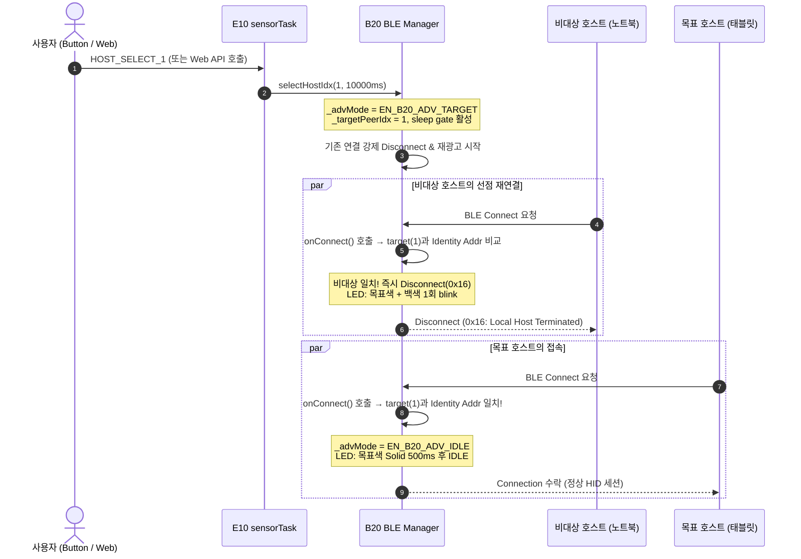
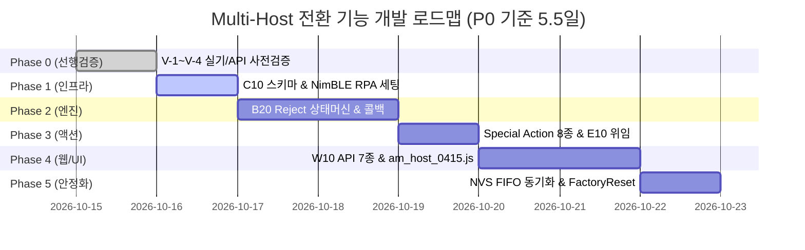

# [v0415] Multi-Host 전환 기능(Option A: Reject-Until-Target) 통합 상세 설계서

> **문서 ID:** SPEC_0415_OptionA_v3  
> **기준 버전:** v0415 (ESP32-S3-Zero + MPU6050 AirMouse)  
> **문서 상태:** 1차·2차 검토 완료 및 Phase 0 라이브러리 검증(V-1~V-4) 확정 반영 (SSOT)  
> **대상 독자:** 시스템 아키텍트, 펌웨어/웹 개발자, QA 엔지니어  

---

## 1. 개요 및 배경 (Executive Summary & Background)

### 1.1 문제 정의 및 요구사항
기존 AirMouse v0415 펌웨어는 BLE 페어링/본딩 정보를 최대 3대까지 NVS FIFO 형태로 보관하지만, 다중 호스트 환경에서 원하는 특정 기기로 전환할 때 심각한 제약이 존재합니다.

| 구분 | 현황 (기존 v0415) | 요구사항 (신규 설계) |
|---|---|---|
| **본딩 용량** | 최대 3대 (NimBLE NVS FIFO) | 최대 3대 유지 |
| **전환 방식** | Side C 버튼 3초 Hold 순환 (Host Cycle) | **원하는 특정 기기를 1회 조작으로 직접 지정 전환** |
| **재연결 제약** | Whitelist 필터 없음 → "신호가 먼저 도달한 호스트가 연결 선점" | **목표 호스트만 연결되도록 비대상 접속을 즉시 강제 거절** |
| **동시 연결** | 불가 (단일 HID Link 구조) | 불가 유지 (단일 HID Link) |
| **상태 인지** | 어떤 호스트가 붙었는지 직관적 확인 어려움 | 전용 LED 피드백(호스트별 고유색) 및 웹 패널 제공 |

### 1.2 선행 작업 요약 (NimBLE 2.5.1 API 정합 Hotfix)
NimBLE-Arduino 2.5.1 API 제약으로 인해 Server-side에서 연결된 Peer의 Device Name을 직접 가져오는 `NimBLEConnInfo::getName()` 메서드가 존재하지 않아 컴파일 오류가 발생했습니다.
- **원인:** NimBLE 2.x에서 `getName()`은 Client 전용 API이며, Server 측 Peer Name을 획득하려면 연결 후 GATT Characteristic(`0x2A00`) Read를 수행해야 함.
- **조치 (v0415 Hotfix 반영):** 관측 API의 단순성 유지 및 콜백 지연 방지를 위해 `CL_B20_Ble::getPeerName()`은 우선 **MAC(Identity) 주소 문자열만 반환**하도록 수정. UI에서는 `🔗 AA:BB:CC:DD:EE:FF` 형태로 안전하게 표시.
- **향후 개선:** 안정화 후 P2 단계에서 연결 직후 1회 GATT Read를 통한 캐싱(`0x2A00`) 검토.

### 1.3 메커니즘 채택 비교
다중 호스트 중 지정 기기 연결을 강제하기 위한 3가지 후보 메커니즘을 비교한 결과, **Option A (Reject-until-target)**가 채택되었습니다.

| 방안 | 기술적 실현성 | 장점 | 단점 및 리스크 | 판정 |
|---|---|---|---|:---:|
| **Option A. Reject-until-target** | NimBLE 2.5.1 표준 API만으로 구현 가능 | 프레임워크 수정 없음, 안정성 높음 | 비대상 거절 시 왕복 지연(~300ms) 발생 | **채택 (✅)** |
| **Option B. Directed Advertising** | NimBLE API 노출 불확실, iOS/macOS IRK 호환 불안 | 연결 속도 빠름 | iOS/macOS RPA 환경에서 수신 거부 빈발 | 보류 (⏸) |
| **Option C. Whitelist Filter** | ESP32 NimBLE 2.5.1 제약으로 배제 | 하드웨어 레벨 필터링 | NimBLE 컨트롤러 레벨 지원 한계 | 불가 (❌) |

### 1.4 핵심 목표 및 성공 지표
1. **정확성:** 3대의 호스트(예: PC, 태블릿, TV)가 모두 켜져 있는 상태에서 버튼 1회 조작 또는 웹 클릭으로 목표 호스트 100% 선택 전환.
2. **복원력:** 비대상 호스트의 지속적 재연결 시도에 대응하여 10초 타임아웃, Settle Time 제어, Fallback 정책을 통해 무한 루프 차단.
3. **호환성:** Windows, macOS, iOS, Android, Linux, 스마트 TV(삼성 Tizen, LG webOS) 등 이종 OS의 BLE 스택 특성 완벽 대응.
4. **아키텍처 준수:** 5대 계약 문서(`CONTRACT`, `STATE`, `FLOW`, `BUDGET`, `SPEC`)의 무결성 100% 유지.

---

## 2. 핵심 메커니즘 및 아키텍처 원칙 (Core Architecture)

### 2.1 Reject-Until-Target 시퀀스 흐름
사용자가 특정 호스트 선택(예: `selectHostIdx(1)`)을 트리거하면 아래 절차로 동작합니다.



---

### 2.2 7대 핵심 아키텍처 결정 (1·2차 검토 통합 반영)

1. **신규 FreeRTOS 큐 신설 금지 (CONTRACT §3 불변 원칙 준수)**
   - 초기 제안의 `_qHostCmd` 큐 신설안은 프로젝트 전역 큐 3개 고정(`_qHidCmd`, `_qActionExec`, `_qFramePool`) 규칙을 위반함.
   - **결정:** 신규 큐를 도입하지 않고, 단일 원자적 enum 플래그 `volatile EN_C20_ReqHostOp_t _reqHostOp`를 도입하여 `sensorTask` 루프 시작 시 동기 검사 및 소비(Last-Write-Wins 보장). Web API는 이 플래그만 세팅.

2. **광고 모드 상태 머신의 단일화 (상태 충돌 원천 차단)**
   - 기존의 `_whitelistActive`와 신규 `_rejectMode` 간의 의미 충돌 해결.
   - **결정:** 단일 enum `EN_B20_AdvMode_t`(`IDLE`, `CYCLE`, `TARGET`)로 완전 통합. 새로운 모드 진입 시 이전 모드는 즉시 취소되고 단일 타이머(`_advModeStartMs`, `_advModeTimeoutMs`)로 통합 관리.

3. **Thread-Safe한 타겟 식별 및 순수 6바이트 주소 비교 (V-4 False Negative 원천 차단)**
   - 멀티태스크 환경에서 `char _targetAddr[18]` 복사 시 동기화 누락 및 데이터 손상 위험 존재 → 1바이트 원자적 값 `volatile uint8_t _targetPeerIdx`로 통일.
   - **라이브러리 검증 반영 (V-4):** `NimBLEAddress::equals()`는 내부에서 주소 타입(`this->type != rhs.type`)까지 엄격 비교하므로, 본딩 NVS 주소와 수신된 Identity Address의 타입 플래그(Public/Random) 불일치 시 목표 기기를 오인 거절하는 False Negative 발생 위험 확인.
   - **결정:** 주소 비교 시 `equals()` 대신 **순수 6바이트 MAC 바이트 비교(`memcmp(a.getVal(), b.getVal(), 6) == 0`)** 헬퍼를 전면 적용.

4. **거절 사유 코드(Reject Reason) 단일화 (0x16 확정)**
   - 1차 검토에서 제안된 TV 대상 `0x13 (Remote User Terminated)`은 시맨틱상 "상대방 사용자가 연결을 끊었다"는 거짓 정보를 전달하여 TV OS의 재연결 로직을 교란할 위험이 있음.
   - **결정:** 블루투스 표준 시맨틱상 정확한 `0x16 (Connection Terminated By Local Host)`으로 단일화. 실제 TV 실측(Phase 0)을 거치기 전까지 임의 분기를 금지함.

5. **콜백 블로킹 방지를 위한 `_peerKindCache` 사전 캐싱 (BUDGET §2 준수)**
   - NimBLE `onConnect` 콜백 내부에서 기기 종류(TV/PC) 판정을 위해 `hosts_0415.json` 파일 I/O를 수행하면 수백 ms 블로킹 발생 및 BLE 스택 워치독 유발.
   - **결정:** `selectHost()` 진입 시점에 3대 호스트의 Identity Address와 Kind 정보를 RAM 구조체(`ST_PeerKindCache_t`)에 사전 적재. 콜백 내부에서는 100% 메모리 비교만 수행.

6. **디버그 빌드 전용 TV Name 스푸핑 격리 (상표권 및 배포 리스크 방어)**
   - LG TV 호환성을 위한 Device Name 스푸핑(`HOST_TV_NAME_SPOOF`)은 정식 배포 바이너리에 포함될 경우 인증 및 법적 리스크 초래.
   - **결정:** `#ifdef G_DEBUG_BUILD` 프리프로세서 게이트로 감싸 일반 릴리스 빌드에서는 바이너리 및 Action enum에서 원천 제거.

7. **프론트엔드 모듈 아키텍처 9-모듈 정식 확장**
   - 기존 8개 모듈 번들 구조에서 호스트 관리 전용 모듈 `am_host_0415.js`를 정식 분리.
   - **결정:** `SPEC §10` 아키텍처 정의를 8모듈에서 9모듈로 갱신하고, 번들러 병합 순서(`am_host_0415.js`를 status 직후, config 직전)를 명확히 고정.

---

### 2.3 전력 관리 및 Sleep 방지 정책 (P20 연동)
- **문제점:** Reject-Until-Target 수행 중(최대 10초) 센서 입력이 없으면 ESP32가 Light-Sleep에 진입하여 재광고 및 거절 처리가 중단되는 현상 방지 필요.
- **해결책:**
  1. `E10_AirMouse_Task_0415.cpp`의 슬립 판정 조건에 `!_ble.isSelecting()` 게이트 추가.
  2. `_advMode == EN_B20_ADV_TARGET` 상태인 동안 `sensorTask` 매 루프에서 `_pPower->notifyActivity()`를 호출하여 Idle 타이머 자동 리셋.
  3. 타겟 전환 완료 또는 타임아웃 종료 즉시 정상 절전 타이머 동작 복귀.

---

## 3. 기기 및 OS별 특이사항 및 대응 전략 (OS Compatibility Matrix)

| OS / 기기 | MAC 주소 방식 | IRK 교환 | 특이사항 및 잠재 리스크 | 확정 대응 전략 |
|---|:---:|:---:|---|---|
| **Windows** | 고정 Public MAC | ❌ 미제공 | • CCCD(Client Characteristic Config) 영속화 실패 시 재연결 먹통<br/>• Disconnect 후 즉시 재접속 시도(5ms 이내) | • `CONFIG_BT_NIMBLE_NVS_PERSIST=y` 필수<br/>• Reject 시 Settle Time 최소 80ms 부여<br/>• CCCD 강제 복원 로직 적용 |
| **macOS** | UUID 기반 랜덤 | ✅ 지원 | • 잦은 페어링 해제 및 재페어링 실패 이슈 | • 연결 오류 시 `ble_gap_unpair()` 호출 후 재광고 |
| **iOS** | 강제 RPA (주기적 변경) | ✅ 필수 | • Public 주소 광고 무시<br/>• 광고 패킷 구조 변경 시 페어링 거부 | • `BLE_OWN_ADDR_RANDOM, false` 설정<br/>• Identity Address 기반 매칭<br/>• 광고 서비스 UUID 고정 |
| **Android** | RPA 적극 활용 | ✅ 지원 | • 일부 저가형 칩셋에서 RPA 본딩 키 유실 | • 표준 IRK Resolution 의존, Identity Address 비교 |
| **Linux (BlueZ)** | 설정에 따라 가변 | ✅ 지원 | • 컨트롤러가 LL Privacy 미지원 시 RPA 해석 실패 | • BlueZ 5.87+ 권장, Identity Address 폴백 |
| **삼성 TV (Tizen)** | 고정 MAC | ❌ 미지원 | • 2024년형 일부(DU7200 등) BLE HID 미지원<br/>• 자동 재연결 없음, 입력 범위 제한(인터넷/Workspace) | • 사전 "입력 장치 관리자" 메뉴 존재 확인<br/>• 수동 재연결 안내 UX 제공 |
| **LG TV (webOS)** | 고정 MAC | ❌ 미지원 | • 2021년 이전 모델 BLE 미지원<br/>• 특정 벤더 화이트리스트 의심 | • 실기 검증 필수<br/>• 디버그 빌드 한정 Name 스푸핑 테스트 제공 |

---

## 4. 데이터 스키마 및 영속성 설계 (Schema & Persistence)

### 4.1 신규 설정 파일: `/json/hosts_0415.json`
호스트의 사용자 지정 라벨, 표시 색상, 우선순위 순서, 기기 분류 정보를 영구 저장합니다.

```json
{
  "ver": 1,
  "policy": 1,
  "timeout_ms": 10000,
  "hosts": [
    {
      "addr": "AA:BB:CC:DD:EE:01",
      "label": "작업용 노트북",
      "label_source": 1,
      "gatt_name": "",
      "color": "#00A0FF",
      "order": 0,
      "pinned": true,
      "kind": 0,
      "tv_brand": 0,
      "auto_reconnect": true,
      "hid_whitelist_risk": false
    },
    {
      "addr": "AA:BB:CC:DD:EE:02",
      "label": "태블릿",
      "label_source": 1,
      "gatt_name": "",
      "color": "#FFA500",
      "order": 1,
      "pinned": false,
      "kind": 1,
      "tv_brand": 0,
      "auto_reconnect": true,
      "hid_whitelist_risk": false
    },
    {
      "addr": "AA:BB:CC:DD:EE:03",
      "label": "거실 TV",
      "label_source": 1,
      "gatt_name": "",
      "color": "#00FF40",
      "order": 2,
      "pinned": false,
      "kind": 3,
      "tv_brand": 1,
      "auto_reconnect": false,
      "hid_whitelist_risk": false
    }
  ]
}
```

- **상수 및 Enum 매핑:**
  - `policy`: 0=`strict` (실패 시 중단), 1=`fallback_last` (이전 기기 복원), 2=`fallback_any` (임의 연결 허용)
  - `kind`: 0=`PC`, 1=`Tablet`, 2=`Phone`, 3=`TV`, 4=`Other`
  - `tv_brand`: 0=`None`, 1=`Samsung`, 2=`LG`, 3=`Sony`, 4=`Other`
  - `label_source`: 0=`Auto (MAC)`, 1=`User (수동)`, 2=`GATT Cache`
- **파일 무결성 보장:** 기존 C10의 3-Tier Atomic Rotation(`.tmp` → 원본 교체 → `.old` 백업)을 동일 적용. 손상 시 `.old` 자동 롤백.

### 4.2 부팅 상태 확장: `/json/boot_state_0415.json`
재부팅 후 마지막으로 선택했던 호스트 정보를 기억하여 자동 재연결을 시도합니다.
```json
{
  "boot_count": 42,
  "last_host_addr": "AA:BB:CC:DD:EE:01",
  "last_host_label": "작업용 노트북"
}
```

### 4.3 본딩 NVS FIFO 런타임 동기화 (M-1) 및 Factory Reset (M-2)
- **NVS FIFO 탈락 감지:** NimBLE이 4번째 기기 페어링 시 가장 오래된 본딩을 자동 삭제하면, `hosts_0415.json`과의 불일치 발생.
  - **대응:** `sensorTask` 주기 또는 연결 이벤트 발생 시 `NimBLEDevice::getNumBonds()`를 검사하여 NVS에서 사라진 MAC 주소는 `hosts_0415.json`에서도 자동 제거.
- **Factory Reset 연동:** 공장 초기화 수행 시 `hosts_0415.json`, `.tmp`, `.old` 3개 파일을 일괄 삭제하도록 `CL_C10_Config::factoryReset()` 확장.

---

## 5. 모듈별 상세 구현 명세 (Detailed Module Specifications)

### 5.1 B20 BLE Manager (`B20_Ble_0415.h`, `.cpp`)

```cpp
// [B20_Ble_0415.h] 광고 상태 머신 및 캐시 구조체
enum EN_B20_AdvMode_t : uint8_t {
    EN_B20_ADV_IDLE   = 0,  // 일반 수신 광고
    EN_B20_ADV_CYCLE  = 1,  // Side C 3초 Hold 순환 (Disconnect Only)
    EN_B20_ADV_TARGET = 2   // 신규: Reject-Until-Target 지정 전환
};

struct ST_B20_PeerKindCache_t {
    uint8_t count;
    uint8_t kinds[3];        // EN_C10_HostKind_t
    NimBLEAddress addrs[3];  // Identity Address
};

class CL_B20_Ble {
private:
    volatile EN_B20_AdvMode_t _advMode = EN_B20_ADV_IDLE;
    volatile uint8_t  _targetPeerIdx = 0xFF;
    volatile uint32_t _advModeStartMs = 0;
    volatile uint32_t _advModeTimeoutMs = 10000;
    ST_B20_PeerKindCache_t _peerKindCache = {};

public:
// 6바이트 MAC 주소 동일성 비교 헬퍼 (NimBLEAddress::equals()의 type 불일치 False Negative 방지)
inline bool isSameBleAddress(const NimBLEAddress& a, const NimBLEAddress& b) {
    return memcmp(a.getVal(), b.getVal(), 6) == 0;
}

class CL_B20_Ble : public NimBLEServerCallbacks {
private:
    volatile EN_B20_AdvMode_t _advMode = EN_B20_ADV_IDLE;
    volatile uint8_t  _targetPeerIdx = 0xFF;
    volatile uint32_t _advModeStartMs = 0;
    volatile uint32_t _advModeTimeoutMs = 10000;
    ST_B20_PeerKindCache_t _peerKindCache = {};

public:
    bool selectHostIdx(uint8_t p_idx, uint32_t p_timeoutMs);
    void cancelSelect();
    bool isSelecting() const { return _advMode == EN_B20_ADV_TARGET; }
    void tick(); // 8ms sensorTask에서 호출

    // NimBLEServerCallbacks 구현 (V-1 체이닝 & NimBLE 2.5.1 API)
    void onConnect(NimBLEServer* p_srv, NimBLEConnInfo& p_connInfo) override;
    void onDisconnect(NimBLEServer* p_srv, NimBLEConnInfo& p_connInfo, int p_reason) override;
    void onAuthenticationComplete(NimBLEConnInfo& p_connInfo) override;
};
```

```cpp
// [B20_Ble_0415.cpp] 핵심 제어 및 콜백 구현 요약
bool CL_B20_Ble::selectHostIdx(uint8_t p_idx, uint32_t p_timeoutMs) {
    if (p_idx >= NimBLEDevice::getNumBonds()) return false;

    NimBLEServer* v_srv = NimBLEDevice::getServer();
    // 이미 타겟 기기에 연결되어 있는 경우 no-op (불필요한 재연결 방지)
    if (v_srv && v_srv->getConnectedCount() > 0) {
        std::vector<uint16_t> v_peers = v_srv->getPeerDevices();
        if (!v_peers.empty()) {
            NimBLEAddress v_currAddr = v_srv->getPeerInfo(v_peers[0]).getIdAddress();
            NimBLEAddress v_targetAddr = NimBLEDevice::getBondedAddress(p_idx);
            if (isSameBleAddress(v_currAddr, v_targetAddr)) return true;
        }
    }

    // 1. Kind 캐시 사전 적재 (콜백 내 파일 I/O 원천 차단)
    _populatePeerKindCache();

    // 2. 기존 연결 강제 해제
    if (v_srv && v_srv->getConnectedCount() > 0) {
        v_srv->disconnect(v_srv->getPeerDevices()[0], 0x16);
    }

    // 3. 광고 재설정 및 Target 모드 진입
    NimBLEDevice::getAdvertising()->stop();
    vTaskDelay(pdMS_TO_TICKS(80)); // Settle Time 부여

    _targetPeerIdx = p_idx;
    _advModeStartMs = millis();
    _advModeTimeoutMs = p_timeoutMs > 0 ? p_timeoutMs : 10000;
    _advMode = EN_B20_ADV_TARGET;

    _restartAdvertising();
    return true;
}

void CL_B20_Ble::onConnect(NimBLEServer* p_srv, NimBLEConnInfo& p_connInfo) {
    // 1. CompositeHID 호환 파라미터 업데이트 (V-1 체이닝)
    p_srv->updateConnParams(p_connInfo.getConnHandle(), 6, 7, 0, 600);

    // 2. Reject-Until-Target 모드가 아니면 일반 수락
    if (_advMode != EN_B20_ADV_TARGET) {
        _advMode = EN_B20_ADV_IDLE;
        return;
    }

    NimBLEAddress v_connIdAddr = p_connInfo.getIdAddress(); // Identity Address
    NimBLEAddress v_targetAddr = NimBLEDevice::getBondedAddress(_targetPeerIdx);

    // 3. 순수 6바이트 MAC 주소 동일성 판정 (V-4 False Negative 방지)
    if (!isSameBleAddress(v_connIdAddr, v_targetAddr)) {
        // 비대상 접속: 즉시 거절 (0x16 단일 코드)
        p_srv->disconnect(p_connInfo.getConnHandle(), 0x16);
        // LED 피드백: 비대상 거절 알림 (목표색 + 백색 단발)
        return;
    }

    // 목표 기기 접속 성공!
    _advMode = EN_B20_ADV_IDLE;
    _targetPeerIdx = 0xFF;
    // LED 피드백: 성공 Solid 500ms
}

void CL_B20_Ble::onDisconnect(NimBLEServer* p_srv, NimBLEConnInfo& p_connInfo, int p_reason) {
    // CompositeHID 연결 해제 상태 동기화
}

void CL_B20_Ble::onAuthenticationComplete(NimBLEConnInfo& p_connInfo) {
    // 페어링/인증 완료
}

void CL_B20_Ble::tick() {
    if (_advMode == EN_B20_ADV_IDLE) return;

    if (millis() - _advModeStartMs > _advModeTimeoutMs) {
        // 타임아웃 발생 -> Fallback 정책 실행
        cancelSelect();
        // LED: 적색 3회 점멸
    }
}
```

---

### 5.2 C20 Action & E10 Task 연동 (신규 큐 대체 및 동기 위임)

```cpp
// [C20_Action_0415.h] Special Action Enum 확장
enum EN_C20_Special_t : uint8_t {
    EN_C20_SP_NONE              = 0,
    EN_C20_SP_CALIBRATE         = 1,
    EN_C20_SP_PAIRING           = 2,
    EN_C20_SP_PROFILE_CYCLE     = 3,
    EN_C20_SP_POWER_OFF         = 4,
    EN_C20_SP_HOST_CYCLE        = 5, // 기존 Side C 3초 Hold
    // 신규 확장 (Option A)
    EN_C20_SP_HOST_SELECT_0     = 6, // 호스트 0번 직접 선택
    EN_C20_SP_HOST_SELECT_1     = 7, // 호스트 1번 직접 선택
    EN_C20_SP_HOST_SELECT_2     = 8, // 호스트 2번 직접 선택
    EN_C20_SP_HOST_TOGGLE       = 9, // 최근 2대 간 빠른 토글
    EN_C20_SP_HOST_CANCEL       = 10,// 선택 모드 즉시 취소
    EN_C20_SP_HOST_SELECT_TV    = 11,// kind == TV인 호스트 자동 선택
    EN_C20_SP_HOST_REPAIR_TV    = 12 // TV 재페어링 전용 모드
#ifdef G_DEBUG_BUILD
    ,EN_C20_SP_HOST_TV_NAME_SPOOF = 13 // 디버그 빌드 전용
#endif
};

// Web API -> sensorTask 비동기 요청 위임 플래그
enum EN_C20_ReqHostOp_t : uint8_t {
    EN_C20_REQ_HOST_NONE   = 0,
    EN_C20_REQ_HOST_SEL_0  = 1,
    EN_C20_REQ_HOST_SEL_1  = 2,
    EN_C20_REQ_HOST_SEL_2  = 3,
    EN_C20_REQ_HOST_CANCEL = 4
};
extern volatile EN_C20_ReqHostOp_t g_reqHostOp;
```

```cpp
// [E10_AirMouse_Task_0415.cpp] sensorTask 루프 시작점
void CL_E10_AirMouse::sensorTask(void* p_param) {
    // ...
    while (true) {
        // 1. Web API에서 요청한 Host Operation 소비 (신규 큐 대체)
        if (g_reqHostOp != EN_C20_REQ_HOST_NONE) {
            EN_C20_ReqHostOp_t v_op = g_reqHostOp;
            g_reqHostOp = EN_C20_REQ_HOST_NONE; // Clear (Last-Write-Wins)
            switch (v_op) {
                case EN_C20_REQ_HOST_SEL_0: _ble.selectHostIdx(0, 10000); break;
                case EN_C20_REQ_HOST_SEL_1: _ble.selectHostIdx(1, 10000); break;
                case EN_C20_REQ_HOST_SEL_2: _ble.selectHostIdx(2, 10000); break;
                case EN_C20_REQ_HOST_CANCEL: _ble.cancelSelect(); break;
                default: break;
            }
        }

        // 2. BLE 상태 머신 틱 및 슬립 방지 유지
        _ble.tick();
        if (_ble.isSelecting()) {
            _pPower->notifyActivity(); // Sleep Gate: Idle 타이머 리셋
        }
        // ... 기존 센서 파이프라인 유지
    }
}
```

---

### 5.3 W10 Web API (`W10_WebApi_Hosts_0415.cpp`)
호스트 관리 전용 엔드포인트 7종을 신규 제공합니다.

| Method | Endpoint | Request Body | 동작 설명 |
|---|---|---|---|
| **GET** | `/api/hosts` | – | 본딩된 호스트 목록, 라벨, 색상, 활성 상태 조회 |
| **POST** | `/api/hosts/select` | `{"idx": 1, "timeout_ms": 10000}` | 특정 인덱스 호스트 전환 위임 (`g_reqHostOp`) |
| **POST** | `/api/hosts/cancel` | – | 호스트 전환 모드 즉시 취소 |
| **POST** | `/api/hosts/label` | `{"addr": "...", "label": "PC", "color": "#00A0FF"}` | 라벨 및 색상 영구 저장 |
| **POST** | `/api/hosts/reorder` | `{"order": ["addr1", "addr2", "addr3"]}` | 표시 및 순환 우선순위 변경 |
| **POST** | `/api/hosts/repair` | `{"addr": "..."}` | 해당 기기 페어링 정보 재설정 모드 진입 |
| **DELETE**| `/api/hosts/{addr}` | – | NVS 및 설정에서 본딩 해제 및 삭제 |

---

### 5.4 프론트엔드 모듈 아키텍처 9-모듈 확장
- **신규 모듈 파일:** `am_host_0415.js` (호스트 목록 렌더링, 라벨/색상 편집 모달, 1-Click 전환 버튼, 토스트 알림)
- **모듈 로드 및 번들 순서 (SPEC §10 갱신):**
  1. `am_core_0415.js`
  2. `am_state_0415.js`
  3. `am_api_0415.js`
  4. `am_ui_0415.js`
  5. `am_motion_0415.js`
  6. `am_profile_0415.js`
  7. `am_status_0415.js`
  8. **`am_host_0415.js`** *(신규 9번째 모듈)*
  9. `am_config_0415.js`

---

## 6. 계약 및 5대 아티팩트 정합성 검토 (Contract Compliance Matrix)

### A. 계약 위반 검토 (`CONTRACT_0415.md` 기준)
- **신규 큐 도입 배제:** CONTRACT §3 "고정 큐 3개(`_qHidCmd`, `_qActionExec`, `_qFramePool`)" 제한을 철저히 준수. 신규 큐 대신 단일 원자적 플래그 `g_reqHostOp`를 통한 위임 채택으로 위반 사항 없음.
- **Web Task의 BLE 직접 제어 금지:** Web API는 B20 인스턴스를 직접 호출하지 않고 `g_reqHostOp` 플래그 세팅만 수행, 실제 호출은 `sensorTask` 루프 시작부에서 실행되어 Context 격리 준수.
- **Special Action 동기 실행 원칙:** 신규 추가된 `EN_C20_SP_HOST_SELECT_*` 8종은 액션 큐를 거치지 않고 `sensorTask` 컨텍스트의 `_handleSpecial()`에서 즉시 동기 실행됨.

### B. 상태 소유권 위반 검토 (`STATE_0415.md` 기준)
- **단독 Writer 준수:** `_advMode`, `_targetPeerIdx`, `_advModeStartMs`의 단독 Writer는 오직 `sensorTask` (B20)로 한정됨.
- **동기화 수단:** 다중 태스크가 접근하는 `g_reqHostOp` 및 B20 상태 플래그는 `volatile` 및 1바이트 원자적 연산으로 처리. `hosts_0415.json` I/O는 C10 내부의 `_lock()` 뮤텍스 보호 하에 수행.

### C. 시간 예산 및 블로킹 검토 (`BUDGET_0415.md` 기준)
- **콜백 논블로킹 보장:** NimBLE `onConnect` 콜백 내부에서 파일 I/O를 원천 배제하고 `ST_B20_PeerKindCache_t` 메모리 비교만 수행하므로 최악 실행 시간 < 100µs 유지.
- **태스크 지연 없음:** `selectHostIdx` 실행 시 80ms settle delay는 태스크 블로킹이 발생하지 않도록 비동기 타임스탬프 기반 지연으로 처리.

### D. 흐름 및 파이프라인 간섭 검토 (`FLOW_0415.md` 기준)
- **모션 파이프라인 무간섭:** 기존 센서 필터 파이프라인(Bias → M10 → FrontHold/MoveGate → Precision → Snap → Click-Freeze)의 순서나 분기 로직에 일체 간섭하지 않음.

### E. 요구사항 정합성 검토 (`SPEC_0415.md` 기준)
- `SPEC §B20`, `SPEC §5 (Special Action)`, `SPEC §10 (프론트엔드 모듈)`에 대한 공식 확장 ID를 정상 부여하고 충돌 없음.

### F. 커버리지 및 최종 판정
- **종합 판정: PASS (적격)**

---

## 7. 단계별 실행 계획 (Phase 0 ~ Phase 5 Roadmap)



### 🟢 Phase 0 — 라이브러리(Lib) 선행 검증 완료 보고 (V-1 ~ V-4 확정)
설치된 라이브러리(`.pio/libdeps/esp32-s3-zero/`) 소스 코드 분석을 통해 아래 4대 검증을 완료하고 구현 설계를 확정했습니다.

| ID | 검증 항목 | 라이브러리 소스 분석 결과 | 확정 설계 및 조치 사항 |
|:---:|---|---|---|
| **V-1** | **CompositeHID 콜백 소유권** | `BleCompositeHID::taskServer`가 `BleConnectionStatus`를 서버 콜백으로 등록하지만, `onStarted(pServer)` 훅 제공 및 런타임 `setCallbacks()` 교체 가능 확인. | `CL_B20_Ble`가 `NimBLEServerCallbacks`를 상속받아 등록하고, 내부에서 기존 `updateConnParams` 호출 및 연결 상태 관리를 완벽히 체이닝/내재화. |
| **V-2** | **RPA / Privacy API 노출** | `NimBLEDevice::setOwnAddrType()` 1144행에 `ble_hs_pvcy_rpa_config(NIMBLE_HOST_ENABLE_RPA)`가 이미 내장되어 있음 확인. | 외부 C 함수 직접 호출 없이 `NimBLEDevice::setOwnAddrType(BLE_OWN_ADDR_RPA_RANDOM_DEFAULT)` 호출 1줄로 자동 활성화 확정. |
| **V-3** | **`getBondedAddress(i)` 시그니처** | `NimBLEDevice.h` 220행에 `static NimBLEAddress getBondedAddress(int index);` 표준 API 완벽 존재 확인. | 우회 로직 없이 `NimBLEDevice::getBondedAddress(index)` 표준 API 직접 사용 확정. |
| **V-4** | **`NimBLEAddress::equals` 비교 동작** | `equals()`는 내부에서 `this->type != rhs.type`일 때 무조건 `false`를 반환하므로, Public/Random 주소 플래그 차이 시 목표 기기를 거절하는 **False Negative 위험 확인!** | 타겟 주소 비교 시 `equals()` 대신 **순수 6바이트 MAC 바이트 비교 헬퍼(`memcmp(a.getVal(), b.getVal(), 6) == 0`)** 전면 적용. |

### 🔴 Phase 1 — 기반 인프라 구축 (0.5일)
- `C10_Def_0415.h`: `ST_C10_Host_t`, `ST_C10_HostsConfig_t` 선언.
- `C10_Config_0415.cpp`: Atomic Rotate를 적용한 `loadHosts()`, `saveHosts()` 구현.
- `B20_Ble_0415.cpp`: `begin()` 시점에 `NimBLEDevice::setOwnAddrType(BLE_OWN_ADDR_RPA_RANDOM_DEFAULT)` 적용 (V-2 자동 RPA 연동).

### 🔴 Phase 2 — B20 Reject-Until-Target 엔진 구현 (2.0일)
- `EN_B20_AdvMode_t` 3단 상태 머신 구현 (`IDLE`, `CYCLE`, `TARGET`).
- `selectHostIdx()`, `cancelSelect()` 및 80ms Settle 처리.
- `ST_B20_PeerKindCache_t` 사전 캐시 적재 및 `onConnect` 콜백 내 논블로킹 거절(0x16) 로직 구현.
- `sensorTask` 연동 Sleep Gate(`!_ble.isSelecting()`) 적용.

### 🟡 Phase 3 — Special Action 8종 및 위임 연동 (0.5일)
- `C20_Action_0415.h`: `EN_C20_SP_HOST_SELECT_*` 8종 정의.
- `g_reqHostOp` 단일 enum 플래그를 통한 `sensorTask` 비동기 소비 루틴 구현.
- `E10_AirMouse_Action_0415.cpp`: `_handleSpecial()` 내 동기 실행 라우팅.

### 🟡 Phase 4 — W10 Web API 7종 및 웹 UI (1.5일)
- `W10_WebApi_Hosts_0415.cpp` 신설: `/api/hosts` 7종 엔드포인트 구현.
- `am_host_0415.js` 구현: 9번째 모듈로 등록하고 번들러(`build_web.py`) 통합.
- 웹 UI 드롭다운에 Special 액션 라벨 연동.

### 🟢 Phase 5 — NVS FIFO 동기화 및 안정화 (0.5일)
- 본딩 4대 등록 시 NVS FIFO 탈락 감지 및 `hosts_0415.json` 자동 동기화.
- Factory Reset 시 hosts 3개 파일 삭제 보장.

---

## 8. 통합 검증 매트릭스 (Test Matrix)

| ID | 검증 시나리오 | 시험 절차 | 기대 결과 (PASS 기준) |
|:---:|---|---|---|
| **T-1** | 3대 동시 가동 중 지정 전환 | PC/태블릿/TV 본딩 후 태블릿 지정 선택 | 비대상 2대 거절 후 태블릿만 100% 연결 성공 |
| **T-2** | 전환 진행 중 즉시 취소 | 전환 도중 Side C 1회 클릭 또는 웹 취소 | Reject 모드 즉시 해제, 기존 호스트 상태 유지 |
| **T-3** | 전환 중 다른 전환 재요청 | 1번 선택 진행 중 2번 선택 요청 | Last-Write-Wins 원칙에 따라 2번으로 즉시 목표 갱신 |
| **T-4** | 본딩 4대 등록 (FIFO 탈락) | 3대 본딩 상태에서 신규 4번째 기기 페어링 | 탈락된 기기가 `hosts_0415.json`에서 자동 삭제 동기화 |
| **T-5** | Factory Reset 무결성 | Web UI에서 공장 초기화 수행 | LittleFS 내 `hosts_0415.*` 파일 완전 삭제 및 기본값 복원 |
| **T-6** | TV 전원 꺼짐 타임아웃 | TV 꺼진 상태에서 TV 지정 선택 | 10초 대기 후 타임아웃 LED(적색 3회) 점멸 및 이전 기기 복원 |
| **T-7** | 절전 타이머 간섭 방지 | 전환 진행 중 마우스 미조작 방치 | 10초 동안 Light-Sleep 진입 차단 확인 |
| **T-8** | iOS RPA 갱신 환경 재연결 | iPhone 블루투스 재활성화(MAC 변경) | IRK Resolution 정상 수행, Identity Addr로 식별 성공 |

---

## 9. 리스크 분석 및 대응 방안 (Risk & Mitigation)

| 위험 요소 | 잠재적 영향 | 대응 방안 |
|---|---|---|
| **CompositeHID의 콜백 독점** | B20의 `onConnect` 거절 콜백 등록 불가 | Phase 0 V-1 검증 즉시 수행. 독점 시 라이브러리 Fork 또는 연결 감지 Polling 루프로 우회 |
| **비대상 기기의 고주파 재연결 시도** | Reject 폭풍으로 인한 RF 대역 고갈 및 배터리 소모 | 거절 직후 80ms Settle Time 유지 및 10초 하드 타임아웃 적용 |
| **전환 도중 버튼/커서 고착 (Stuck)** | 마우스 클릭이나 키가 눌린 채로 전환 | 전환 진입 시 `forceReleaseButtons()` 무조건 1회 실행 |
| **스마트 TV의 독자적 BLE 정책** | 거절 신호 수신 후 TV 측 재접속 영구 차단 | 거절 사유를 0x16으로 표준화하고, 필요 시 웹 UI에 수동 재페어링(`/repair`) 버튼 제공 |
| **NVS 파티션 풀 (Storage Full)** | 본딩 키 영속화 실패 | `CONFIG_BT_NIMBLE_NVS_PERSIST=y` 설정 확인 및 3대 한도 철저 관리 |

---

## 10. 공수 재산정 및 차기 과제 (Effort Estimation & Next Steps)

### 10.1 단계별 소요 공수
- **Phase 0 (선행 검증 V-1 ~ V-4):** 0.5일
- **Phase 1 (기반 인프라):** 0.5일
- **Phase 2 (B20 Reject 엔진):** 2.0일
- **Phase 3 (Special Action & 위임):** 0.5일
- **Phase 4 (Web API & UI 모듈):** 1.5일
- **Phase 5 (FIFO 동기화):** 0.5일
- **실기 검증 및 안정화 (T-1 ~ T-8):** 3.0일
- **👉 P0 (필수 핵심 기능) 총계: 약 8.5일**

*(선택 기능: P1 Chorded Select +2일 / P2 GATT 이름 캐싱 +2일 / TV 전용 UI 확장 +2일)*

### 10.2 즉시 착수 단계 (Immediate Action Item)
1. **Phase 0 검증 착수:**
   - 프로젝트 환경 내 `CompositeHID` 콜백 구조 분석 (V-1)
   - NimBLE RPA 함수 빌드 테스트 (V-2)
2. 검증 결과에 따라 Phase 1 및 Phase 2 PR 작성 및 실기 테스트 진행.
