# FLOW_0415.md — 기능별 데이터 흐름 및 파이프라인 명세

> 대상 버전: `v0415` (ESP32-S3-Zero + MPU6050 AirMouse)  
> 위치: `src/v0415/docs_v0415/contract_doc/FLOW_0415.md`  
> 최종 갱신: 2026-10-12 (rev13 — LED 태스크 스택 관측 파이프라인 §15 신설, _stackLedMinWords 샘플·갱신·노출 흐름 명세)

---

> [!TIP]
> **GitHub & Obsidian Mermaid 렌더링 호환성 가이드**:
> 본 문서의 모든 Mermaid 다이어그램은 GitHub 웹 뷰어 및 Obsidian 내장 Mermaid 엔진에서 문법 오류(`Syntax error in graph`) 없이 안정적으로 렌더링되도록 아래 5대 규칙을 엄격히 준수합니다:
> 1. **노드 라벨 큰따옴표 래핑**: 괄호 `()`, 대괄호 `[]`, 중괄호 `{}`, 쉼표 `,`, 콜론 `:`, 슬래시 `/` 등이 포함된 모든 노드 텍스트는 반드시 큰따옴표로 감쌉니다 (`id["..."]` / `id{"..."}`).
> 2. **특수 문자 및 연산자 격리**: C++ 연산자(`++`, `*=`, `==`, `!=`, `<=`, `>=`) 및 Mermaid 예약어(`&s_mux`의 `&`)는 따옴표 내부에 안전하게 격리합니다.
> 3. **분기 에지(Edge) 라벨 큰따옴표 래핑**: 슬래시나 공백이 포함된 조건 텍스트는 `-- "조건" -->` 형태로 큰따옴표로 감쌉니다.
> 4. **라벨 내부 화살표 기호 유니코드 치환**: 텍스트 내부의 `->`는 연결선 구문과 혼동되지 않도록 유니코드 화살표 `➔`로 치환합니다.
> 5. **그래프 연결성(Connectivity) 보장**: 모든 노드는 선행 에지와 유기적으로 연결되어야 하며, 선행 연결이 없는 고립 노드(Unrooted/Disconnected Node)를 생성하지 않습니다.

---

## 1. 모션 처리 파이프라인 (`sensorTask` 내부, 8ms 주기)

MPU6050 센서 원시 데이터가 가공되어 최종 HID 전달 큐(`_qFrame`)로 출력되기까지의 직렬 파이프라인입니다.

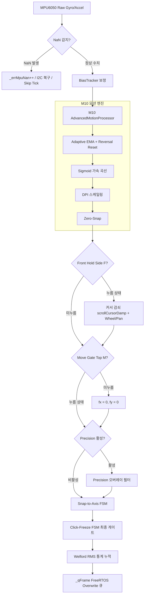

### 파이프라인 순서 (v0415 확정, 10단계)

| 순서 | 단계 | 담당 | 비고 |
|:---:|---|---|---|
| 1 | NaN Guard | `sensorTask` | BiasTracker 오염 원천 차단 |
| 2 | BiasTracker 보정 | `M20` | Fast Recalib (Wake 후 config 지정 ms) |
| 3 | Adaptive EMA + Reversal Reset | `M10` | Phase 2 |
| 4 | Zero Snap + Sigmoid | `M10` | – |
| 5 | DPI Scaling + Accel Shaping | `E10` | – |
| 6 | Front Hold (Side F) | `E10` | 커서 감쇠 + Wheel/Pan, 전 Mode 일관 |
| 7 | Move Gate (Top M) | `E10` | 미누름 시 `fx=fy=0` |
| 8 | Precision FSM | `E10` | ENTRY/TRACK/EXIT |
| 9 | Snap-to-Axis | `E10` | Phase 3 |
| 10 | Click-Freeze | `E10` | **최종 게이트** (Phase 1) |

> **v0415 변경**: M10의 Click-Lock 삭제 (Phase 11.5에서 Click-Freeze가 대체). 파이프라인에서 Click-Lock 분기 완전 제거.

### 실패 및 예외 복구 경로
- **MPU NaN 감지 시**: `_errMpuNan++` 증가, 5회 연속 시 `_recoverI2C()` 실행 및 해당 틱 조기 건너뜀
- **Mutex Miss 발생 시 (`_state` 갱신 2ms 초과)**: `_errMutexMiss++` 증가 후 프레임 전송은 계속 진행

---

## 2. 프로파일 전환 파이프라인 (`switchProfile(idx)`)

웹 태스크 또는 내부 요청에 의해 프로파일을 전환할 때 시스템 안전성을 보장하는 순차 시퀀스입니다.

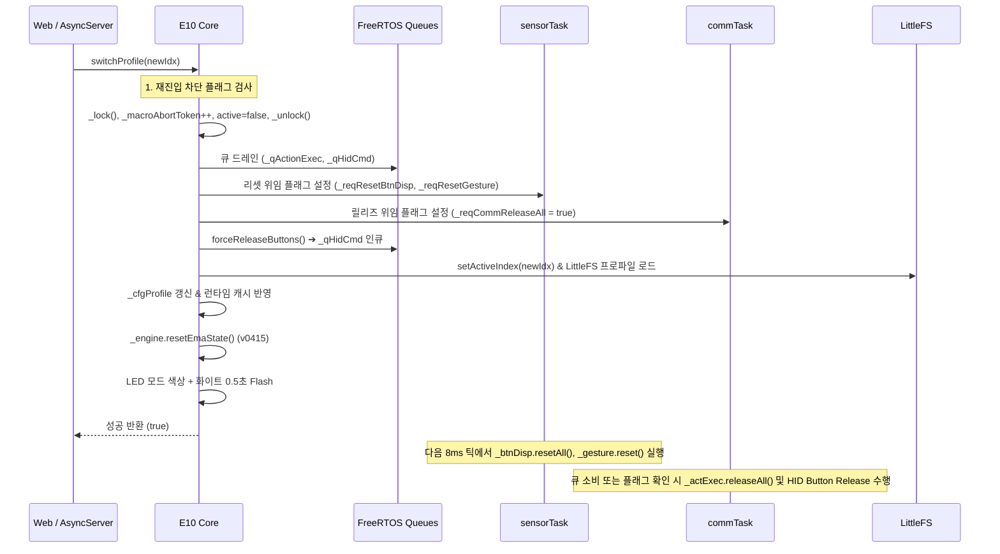

### v0415 변경
- `_macroAbortToken++` + `active=false`가 `_lock()` 하 원자적 (재정렬 방지)
- `_engine.resetEmaState()` 호출 추가 (Phase 5 Q2-a)
- `_reloadActiveProfile` 내 `static ST_C10_ProfileConfig_t` (스택 2.2KB 절감)

---

## 3. 액션 및 제스처 디스패치 흐름

물리 버튼 이벤트, 센서 제스처 및 웹 Live Test 요청이 슬롯 매핑을 거쳐 최종 실행되는 분기 구조입니다.

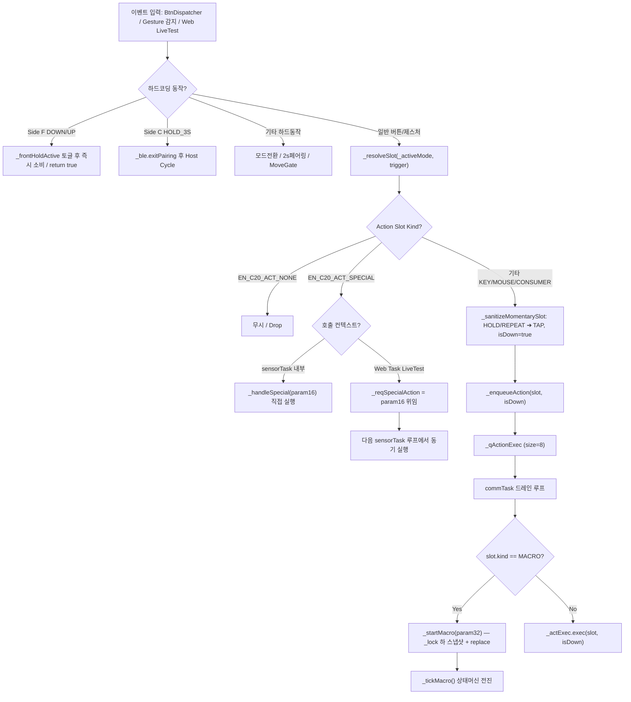

### v0415 핵심 변경 — BB-1 공통 헬퍼 확장

**v0412 문제**: `_handleSlotButton`에만 sanitization 적용. `_handleGesture`(제스처)는 미적용 → Tilt Hold를 KB_REPEAT로 매핑 시 키 stuck.

**v0415 해결**: `_sanitizeMomentarySlot(slot)` namespace 정적 헬퍼로 통합:
- `MOUSE_HOLD` → `MOUSE_CLICK`
- `KB_REPEAT` → `KB_TAP`
- `CONSUMER_REPEAT` → `CONSUMER_TAP`
- `holdMode = EN_C20_HOLD_NONE` 강제

**적용 위치**:
- `_handleSlotButton` — 버튼 순간 이벤트(CLICK/DOUBLE/LONG)
- `_handleGesture` — 제스처 발동 (Flick/Linear/Tilt)

### Side C 이벤트 처리 (v0415)

| 이벤트 | 하드코딩 | 슬롯 매핑 |
|---|:---:|:---:|
| CLICK | – | ✓ (S11) |
| DOUBLE | ✓ (Mode Cycle) | – |
| LONG | **명시적 무시** (v0415) | – |
| HOLD_2S | ✓ (Pairing) | – |
| HOLD_3S | ✓ (Host Cycle + exitPairing) | – |

### Side F 이벤트 처리

| 이벤트 | 하드코딩 | 슬롯 매핑 |
|---|:---:|:---:|
| DOWN | ✓ (`_frontHoldActive = true` + return true) | – |
| UP | ✓ (`_frontHoldActive = false` + return true) | – |
| CLICK | – | ✓ (S9) |
| LONG | – | ✓ (S10) |

### 매크로 대체(Replace) 정책
- 이미 매크로가 실행 중일 때 `_startMacro(newIdx)` 호출 시 **abort 토큰 증가 없이 조용히 대체** (v0412 정책 유지)
- `switchProfile`/`_setActiveMode`/`forceReleaseButtons`/BLE disconnect/SafeMode 진입 시에는 반대로 `_lock()` 하 `_macroAbortToken++`로 명시적 abort

---

## 4. HID 커맨드 큐 처리 흐름 (commTask)

`_qHidCmd`를 통해 웹 태스크 및 내부 요청이 HID 실행을 위임하는 경로입니다. **오직 commTask만 `_mouse`/`_keyboard` 인스턴스를 제어**한다.

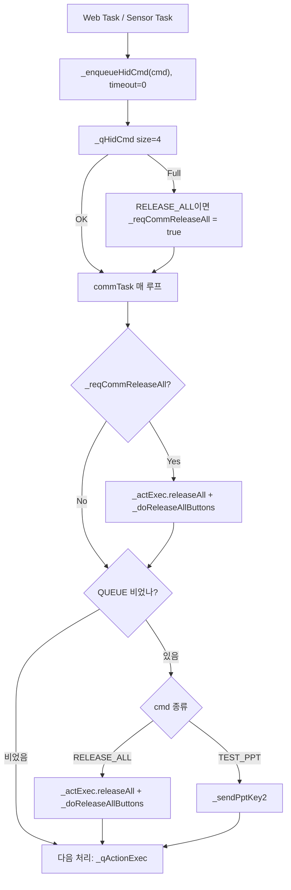

### v0415 변경 — `ST_E10_HidCmd_t` 구조 축소
- `holdMs` 필드 삭제 (TEST_CLICK 삭제(rev5) 이후 Dead)

### commTask Gate 진입 시퀀스 (SafeMode / OTA Guard)

게이트 진입 시 commTask는 다음 순서로 큐를 정리:

1. `_lock()` 하 `_macroAbortToken++` + `active=false` (v0415 원자화)
2. `_qHidCmd` 드레인 (모든 대기 cmd 폐기)
3. `_qActionExec` 드레인 (모든 대기 액션 폐기)
4. `_qFrame` 1회 receive (stale frame 폐기 — gate 해제 후 1회 커서 점프 방지)
5. 최초 1회만 `_actExec.releaseAll` + `_doForceReleaseNow`
6. 20ms 대기 후 continue

---

## 5. 매크로 실행 상태머신 흐름 (`_tickMacro`)

`commTask` 루프 내에서 프레임 지연 없이 스텝별 딜레이와 실행을 제어하는 비동기 상태머신입니다.

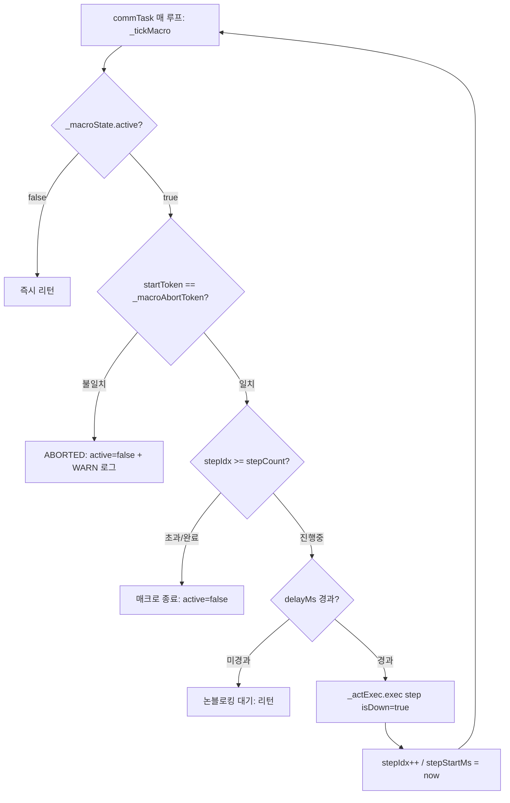

### v0415 정책 명확화
- **"블로킹 없음"은 delay에 한정**. step 실행(`_actExec.exec`)은 HID tap 지속 (~28ms) 블로킹.
- 매크로 8 step × 28ms = 최대 224ms 누적 블로킹 (분산 실행).
- 커서 프레임 소비는 각 step 사이에 계속됨.

### `_startMacro` v0415 원자화

```
1. _lock()
2. prev active 검사 → WARN 로그 (replace)
3. profile valid + idx range 검증
4. _macroSnapshot = _cfgProfile.macros.macros[idx]
5. state 초기화 (macroIdx, stepIdx, stepStartMs, startToken)
6. _macroState.active = true   ← 마지막 write
7. _unlock()
```

### 취소 정책 (v0415 원자화)
- `_macroAbortToken` 카운터가 `_macroState.startToken`과 다르면 즉시 abort
- **`switchProfile`, `_setActiveMode`, `forceReleaseButtons`, BLE disconnect edge, SafeMode/OTA gate 진입** 시 `_lock()` 하 토큰 증가
- **`_startMacro(newIdx)` 자체는 토큰을 증가시키지 않음** (조용히 대체)

---

## 6. 전원 관리 흐름 (`sensorTask` 내부, v0415 Safe/Pairing 분기)

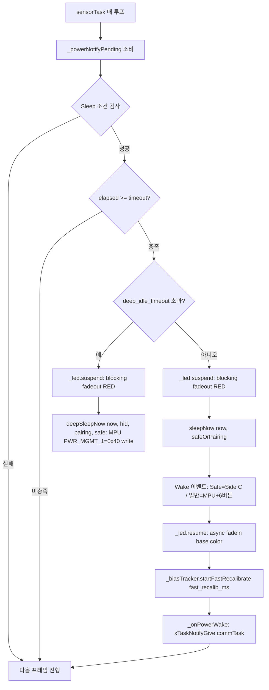

### Deep Sleep 진입 전 전원 격리 시퀀스 (v0415 하드닝)
1. **WS2812 래칭 차단**: `deepSleepNow()` 호출 직전 `_led.suspend(v_snap)`를 선제 호출하여 LED를 완전 소등 (미호출 시 슬립 중 LED 전류 유지 버그 차단).
2. **MPU6050 센서 수면화**: `deepSleepNow()` 내부에서 `G_MPU_PWR1_SLEEP (0x40)` 비트를 I2C 레지스터 `0x6B`에 기입하여 센서를 저전력 수면 모드로 진입시킨 후 ESP32 deep sleep 실행.

### Sleep 조건 (모두 만족)
- `!isSafeMode() && !isOtaGuard()`
- `!_moveGateHeld && !_frontHoldActive`
- `_qActionExec` 비어있음 + 매크로 미실행
- 유휴 시간 >= Mode/BLE/Pairing별 timeout

### v0415 Safe/Pairing Wake Mask 분기

| 시나리오 | 사용 마스크 |
|---|---|
| Light-sleep 일반 | `buildWakeMaskNormal()` (MPU + 6버튼) |
| Light-sleep Safe | `buildWakeMaskSafe()` (Side C 단독) |
| Light-sleep Pairing | `buildWakeMaskSafe()` |
| Deep-sleep 일반 | `buildWakeMaskButtons()` (6버튼, MPU 제외) |
| Deep-sleep Safe | `buildWakeMaskSafe()` (Side C 단독) |
| Deep-sleep Pairing | (sleep 금지 — `p_pairing` 시 return false) |

### SLEEP_NOW 즉시 진입 (v0415 Q4-a)

```
_handleSpecial(SLEEP_NOW):
  1. _led.suspend(snap)  — blocking fadeout RED
  2. safeOrPairing = (_safeMode || _ble.isPairing())
  3. _power.sleepNow(now, safeOrPairing)  — wake까지 blocking
  4. _led.resume(snap)  — async fadein
  5. if (didSleep && _cfgProfileValid)
         _biasTracker.startFastRecalibrate(_cfgProfile.e10.power.fast_recalib_ms)
```

**주의**: `fast_recalib_ms`는 **E10 config 단독 SSOT** (P20 필드 삭제, Round E).

---

## 7. OTA 및 안전 게이트 흐름 (W10)

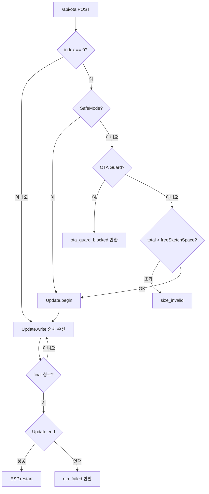

### v0415 OTA Guard 체크 최적화 (Round M)
- **`index==0`에서만 Guard 체크** (매 청크마다 `getStatus()` 호출 제거)
- 성능 개선: N 청크 × getStatus() 락/CPU 부담 제거

### SafeMode 게이트 정책 (method-aware)
- **허용 (GET/POST)**: `/api/status`, `/api/diag`, `/api/keycodes`, `/api/safeboot`, `/api/ota`, `/api/factory_reset`, `/api/reboot`, `/api/config/export`, `/api/export`, `/api/config/rollback`
- **허용 (GET만)**: `/api/profiles/active`, `/api/profiles`, `/api/triggers`
- **차단**: `/api/config/save`, `/api/config/apply`, `/api/config/import`, `/api/control`, `/api/ppt/*`, `/api/profiles/{switch,create,delete,rename}`, `/api/action/test*`

---

## 8. Front Hold 스크롤 흐름

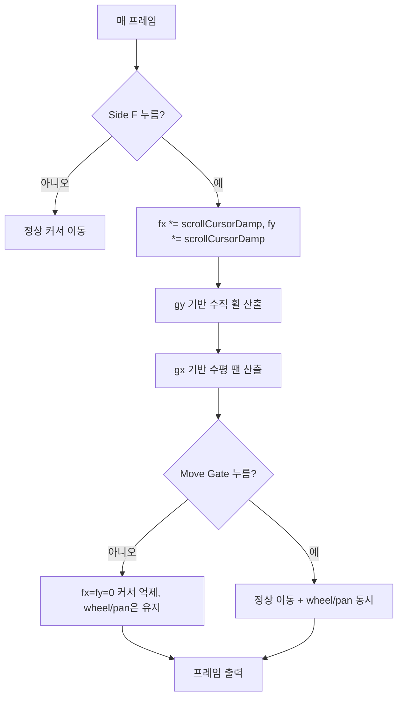

### 규약
- **감쇠 계수**: `scroll_cursor_damp` (기본 0.25)
- **휠 축**: `gy` (Pitch, 앞뒤 기울기)
- **팬 축**: `gx` (Roll, 좌우 기울기)
- **전 Mode 일관**

---

## 9. 스키마 마이그레이션 흐름 (v410 → v411)

v0412(v410) 프로파일을 v0415(v411)에서 로드할 때 자동 변환 및 즉시 영구 저장됩니다.

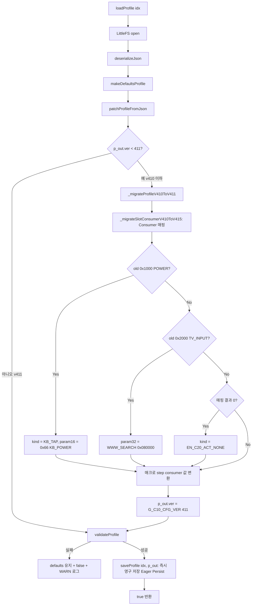

### Consumer 매핑 및 치환 (`_migrateSlotConsumerV410ToV415`)

| old (v410) | new (v411) | 치환 결과 | 비고 |
|---|---|---|---|
| 0x0001 (VOL_UP) | 0x2000 (Bit 13) | `EN_C20_CON_VOL_UP` | – |
| 0x0002 (VOL_DOWN) | 0x4000 (Bit 14) | `EN_C20_CON_VOL_DOWN` | – |
| 0x0004 (MUTE) | 0x1000 (Bit 12) | `EN_C20_CON_MUTE` | – |
| 0x0008 (PLAY_PAUSE) | 0x0800 (Bit 11) | `EN_C20_CON_PLAY_PAUSE` | – |
| 0x0010 (STOP) | 0x0080 (Bit 7) | `EN_C20_CON_STOP` | – |
| 0x0020 (NEXT_TRACK) | 0x0020 (unchanged) | `EN_C20_CON_NEXT_TRACK` | – |
| 0x0040 (PREV_TRACK) | 0x0040 (unchanged) | `EN_C20_CON_PREV_TRACK` | – |
| 0x0080 (FF) | 0x0008 (Bit 3) | `EN_C20_CON_FAST_FORWARD` | – |
| 0x0100 (REWIND) | 0x0010 (Bit 4) | `EN_C20_CON_REWIND` | – |
| 0x0200 (AC_BACK) | 0x200000 (Bit 21) | `EN_C20_CON_WWW_BACK` | – |
| 0x0400 (AC_HOME) | 0x008000 (Bit 15) | `EN_C20_CON_WWW_HOME` | – |
| 0x0800 (AC_SEARCH) | 0x080000 (Bit 19) | `EN_C20_CON_WWW_SEARCH` | – |
| **0x1000 (POWER)** | – | **`EN_C20_ACT_KB_TAP` + `0x66` (`EN_C20_KB_POWER`)** | **키보드 액션으로 자동 전환** |
| **0x2000 (TV_INPUT)**| 0x080000 (Bit 19) | **`EN_C20_CON_WWW_SEARCH`** | **안전 대체 키 매핑** |
| **0x4000 (CH_UP)** | 0 | **`EN_C20_ACT_NONE`** | **미지원 코드: 유효 슬롯으로 정제** |
| **0x8000 (CH_DOWN)** | 0 | **`EN_C20_ACT_NONE`** | **미지원 코드: 유효 슬롯으로 정제** |

### 영구 반영 정책 (Eager Persist)
- **v0415 Eager Persist 도입**: `loadProfile`에서 마이그레이션 적용 후 `validateProfile`을 통과하면, 즉시 `saveProfile(idx, p_out)`을 실행하여 LittleFS 플래시 파일을 v411 스키마로 덮어씁니다.
- **도입 사유**: 기존 Lazy Persist(다음 저장 시점 반영) 방식은 재부팅 시마다 반복해서 마이그레이션이 실행되고, 검증 미비 시 매 부팅마다 기본값(RAM fallback)으로 복구되는 현상을 근본적으로 차단하기 위함입니다.
- `buildProfileJson`은 항상 `p_out["ver"] = G_C10_CFG_VER` (411)을 기록합니다.

---

## 10. `_markNeedReboot` 되돌림 감지 흐름 (W10)

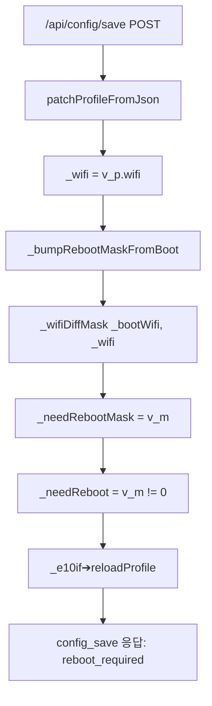

### v0415 정책
- `_bootWifi`: `begin()` 시점에 스냅샷 저장
- 매 저장 시 `boot` ↔ 현재 WiFi 상태 diff 재계산 → 되돌림 시 마스크 자동 클리어
- W10 8파일에서 `_bootWifi` 사용처: `begin()` (write), `_bumpRebootMaskFromBoot` (read)

---

## 11. MPU6050 I2C 진단, 주소 자동 감지 및 런타임 복구 흐름

부팅 초기화 실패 및 런타임 I2C 버스 멈춤(Lock-up)을 방지하는 자가 진단 및 다계층 복구 시퀀스입니다.

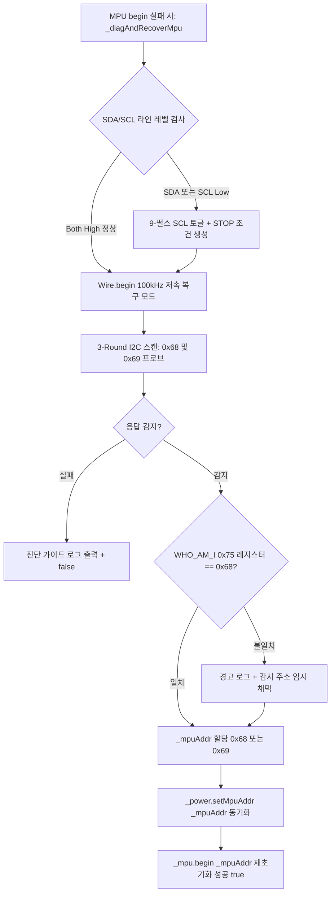

### 1) 부팅 진단 및 버스 언락 (`_diagAndRecoverMpu`)
1. **GPIO 레벨 점검**: GP4(SDA), GP5(SCL) 핀의 디지털 입력 레벨을 측정하여 버스 라인이 Low로 붙어있는지 확인.
2. **9-Pulse Bus Unlock**: 슬레이브가 ACK 상태에서 정지하여 SDA를 Low로 잡고 있는 경우, SCL을 9회 수동 토글한 후 STOP(SDA High) 조건을 만들어 I2C 상태머신을 리셋.
3. **100kHz 저속 스캔**: 노이즈 마진 확보를 위해 100kHz 클럭으로 3회 라운드 스캔 수행.
4. **WHO_AM_I 검증 및 주소 바인딩**: 0x68 또는 0x69 주소에서 0x75 레지스터를 조회하여 MPU6050 정상 응답을 검증하고, `_mpuAddr` 및 `_power.setMpuAddr`에 동기화.

### 2) 런타임 선제 점검 (sensorTask Pre-probe)
- `sensorTask` 루프에서 `_mpu.getEvent()` 호출 전, 경량 I2C 송신 프로브(`Wire.beginTransmission(_mpuAddr)` / `endTransmission()`)를 수행하여 통신 실패를 선제 감지.
- **카운터 분리 (v0415 하드닝)**: 선제 프로브 실패는 `_consecutiveI2cFail`로 독립 계측(10회 연속 실패 시 복구), 센서 메인 틱 루프 실패는 `_consecutiveFailures` 및 `_errMpuComm`으로 계측하여 진단 간섭 방지.
- 연속 10회 실패(`_consecutiveI2cFail >= 10`) 시 `_recoverI2C()`를 트리거하여 비차단 방식으로 복구 수행.

### 3) 슬립 복귀 복원 (P20 Wake)
- Light-sleep 복귀 시 `Wire.end()` / `Wire.begin()` 후 `_restoreMpuAfterWake(true)`를 호출하여 MPU6050 내부 전원 관리 레지스터(PWR_MGMT_1) 및 인터럽트 레지스터를 즉시 정상 상태로 복구.

---

## 12. Wi-Fi SoftAP 즉시 구동, 웹 라우팅 별칭 및 SafeBoot 분기 흐름

부팅 지연을 최소화하고 SafeBoot 환경에서 SSID 버퍼 오버플로우를 원천 방지하며, AP/STA 모드에서 완벽한 웹 진입성을 보장하는 흐름입니다.

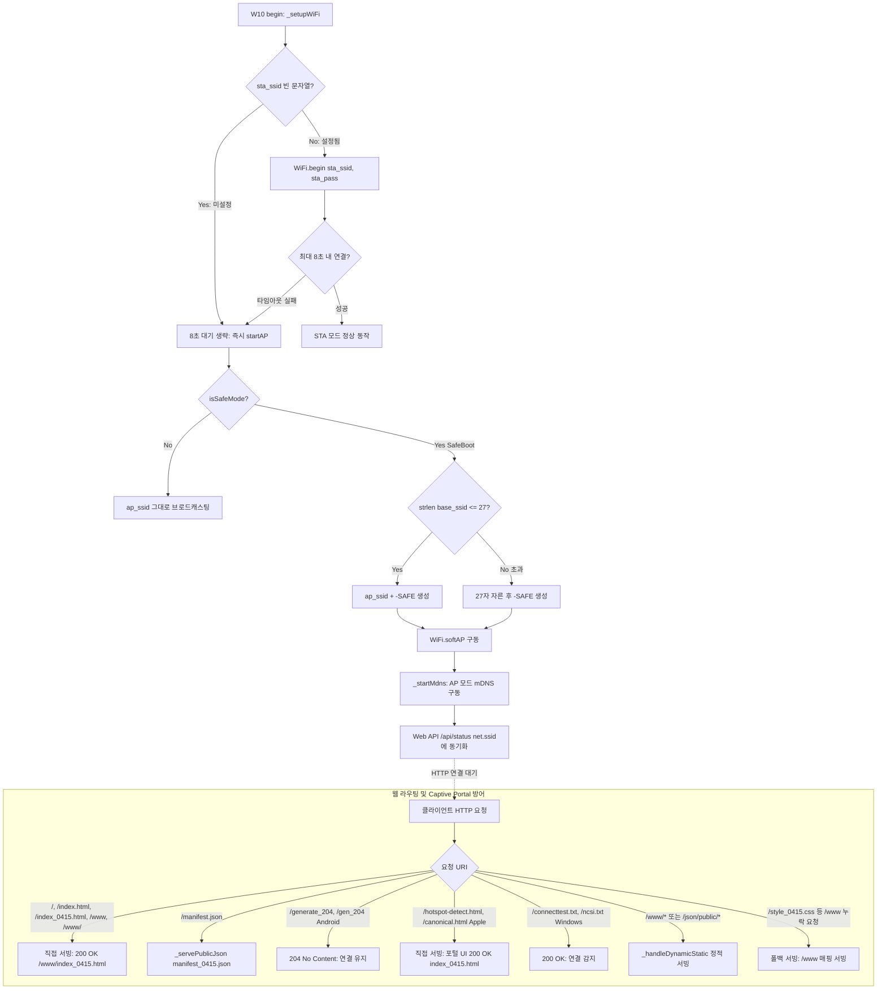

### 핵심 규약
1. **8초 부팅 단축**: `sta_ssid[0] == '\0'`일 때 STA 시도 루프를 완전히 건너뛰어 에어마우스 부팅 시간을 8초 이상 절감.
2. **SSID 32바이트 버퍼 안전**: SafeBoot 모드 접미사 `-SAFE`(5바이트) 추가 시 버퍼 오버플로우를 방지하도록 베이스 길이를 27바이트 이하로 엄격히 제한.
3. **관측 일치**: Web UI 상태 조회(`/api/status`)의 `net["ssid"]` 필드에 실제 브로드캐스팅 중인 `-SAFE` SSID를 정확히 노출.
4. **웹 진입 무결성 및 리다이렉트 루프 원천 방지**: 
   - `_svr.on("/www")` 접두사 라우트 삭제 (ESPAsyncWebServer 하위 경로 전체 매칭 충돌 방지).
   - `/`, `/index.html`, `/index_0415.html` 접속 시 302 리다이렉트 없이 200 OK로 `/www/index_0415.html`을 즉시 다이렉트 서빙(`_serveWwwStatic`).
   - `/style_0415.css`, `/lib/*` 등 `/www` 생략 요청에 대해 `/www` 자동 폴백 매핑 서빙.
5. **Captive Portal 자동 프로브 대응**: Android 204 유지, Apple 200 포털 직접 로딩, Windows 200 OK 표준 응답으로 Wi-Fi 연결 안정성 보장.
6. **AP/STA 겸용 mDNS**: STA뿐만 아니라 AP 모드 활성화 시에도 `MDNS.begin("elite-airmouse")`를 구동하여 호스트명 접근성 제공.
7. **ESP32 TCP 소켓 고갈 방지 JS 번들링 파이프라인**:
   - ESP32 LWIP TCP 소켓 풀 한계(8개)로 인한 다중 개별 JS 요청 시 TCP 연결 드롭 및 5분 타임아웃 방지.
   - `pio_gzip_0415.py`에서 원본 JS 소스(`data_v0415_www/lib/*.js` 및 `app_0415_0001.js`)는 무변경 유지하고, 빌드 스테이징 시 9개 모듈을 단일 `app_bundle_0415.js.gz`로 자동 결합.
   - `index_0415.html`의 9개 `<script>` 태그를 `<script src="./app_bundle_0415.js"></script>` 단일 태그로 자동 치환.
   - 전체 웹 요청을 11개 ➔ 3개(`index`, `style`, `app_bundle`)로 압축하여 0.5초 이내 고속 렌더링 달성.

---

## 13. D10 Logger 2단계 락(Two-Phase Locking) 및 Serial 단일 버퍼 파이프라인

모든 태스크(`sensorTask`, `commTask`, `webTask`, `ledTask`)에서 호출되는 `CL_D10_Logger`의 spinlock 경합을 수십 나노초로 최소화하고, Serial 포트 출력 인터리빙이 FreeRTOS 링버퍼 임계구역에 간섭하지 않도록 분리한 파이프라인입니다.

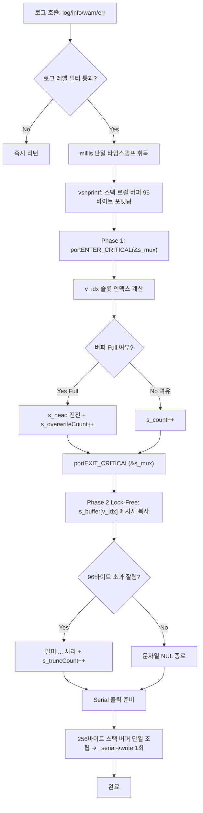

### 핵심 규약
1. **Two-Phase Locking (임계구역 극소화)**: Phase 1에서 spinlock(`portENTER_CRITICAL`)으로 극단적으로 짧은 시간(수십 나노초) 동안 슬롯 인덱스(`v_idx`)만 원자적으로 확보/예약하고 즉시 critical을 해제. Phase 2에서 할당된 인덱스 슬롯에 critical 외부에서 락 없이 안전하게 96바이트 페이로드를 복사. 각 태스크는 서로 다른 인덱스를 가지므로 무경합.
2. **Serial 인터리빙 방지 (단일 버퍼 Write)**: `printf` 다중 호출을 금지하고 라인 전체를 256바이트 스택 버퍼에 사전 조립하여 `_serial->write(buf, len)`을 1회만 호출함으로써 USB CDC 패킷 분할 인터리빙을 원천 차단.
3. **USB CDC 초기화 대기 동기화**: `main.cpp` 부팅 시 `Serial`이 열릴 때까지 최대 1500ms 동안만 조건부 대기 루프를 두어 초반 부팅 로그 유실 차단.

---

## 14. C10 Config 안전 회전(Atomic Rotate Save) 파이프라인

LittleFS 파일시스템에서 예기치 않은 전원 차단, 크래시 발생 시 프로파일 색인(`index.json`) 및 부팅 상태(`boot.json`)의 손상을 방지하기 위한 `main -> old`, `tmp -> main` 회전 파이프라인입니다.

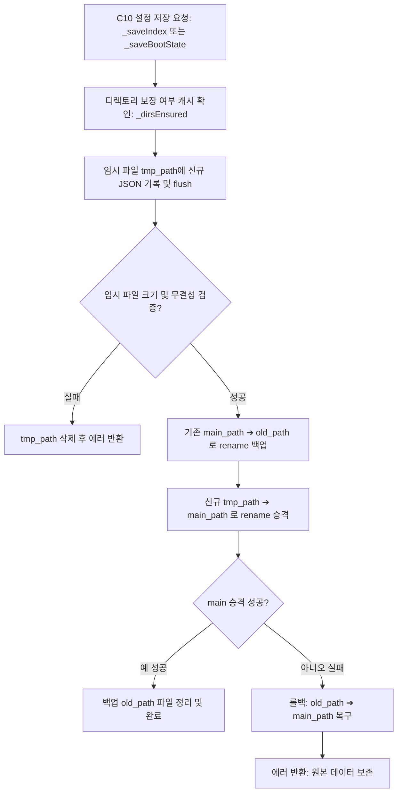

### 핵심 규약
1. **임시 파일 선행 검증 (Write-then-Validate)**: 임시 파일 작성이 완전히 성공하고 파일 크기가 유효할 때만 회전을 시작.
2. **2단계 Rename 원자성 회전**: `main -> old`, `tmp -> main` 순서로 안전하게 파일 전환.
3. **실패 시 자동 롤백**: `tmp -> main` 실패 시 즉시 `old -> main`으로 복구하여 파일 손상 방지.
4. **`_bootMutex` 전역 동기화**: `boot.json` 읽기/쓰기/SafeMode 클리어 시 다중 태스크 경합 방지를 위해 전용 뮤텍스 보호.

---

## 15. LED 태스크 스택 관측 파이프라인 (rev13 신규, B-2)

`_ledTask`(50ms) → 매 tick 후 워터마크 샘플 → `_stackLedMinWords`(단조 최소) 갱신 → `getStatus()` 노출 → `/api/status` 응답 → 프론트 관측 카드.

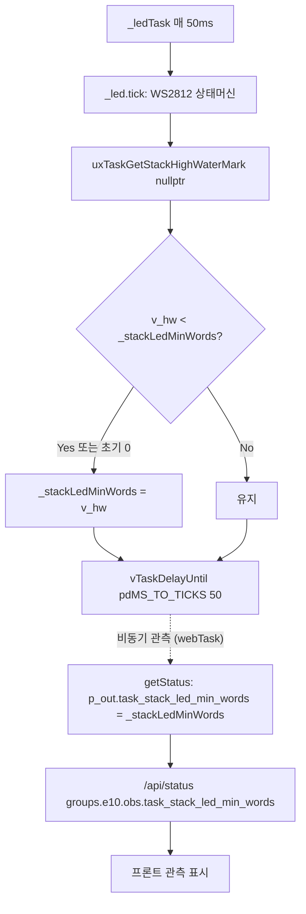

### 핵심 규약:
1. **단조 최소(Monotonic Minimum) 갱신**: `sensorTask`/`commTask`와 동일 패턴 적용 (초기 0 센티넬 처리).
2. **비차단 초경량 관측**: 50ms 주기 종료 시 호출되며, 오버헤드는 수 μs 수준으로 주기 예산에 영향 없음.
3. **문서-코드 정합**: SPEC·BUDGET·STATE·FLOW 4대 문서 및 진단 구조체에서 동일 필드명(`task_stack_led_min_words`) 일관 사용.

---

## 16. 개정 이력

| 버전 | 날짜 | 변경 사항 |
|---|---|---|
| rev0 | 2026-09-15 | 최초 작성 (v0412) |
| rev1 | 2026-10-01 | §3 Macro 대체 정책, §1 모션 파이프라인 정합 |
| rev5 | 2026-10-02 | commTask Safe/OTA gate 드레인 시퀀스 |
| rev6 | 2026-10-07 | 매크로 삭제 시 슬롯 초기화 + 원자적 동반 저장 |
| rev7 | 2026-10-07 | 순간 트리거 단발화(BB-1), Host Cycle 페어링 취소(BB-2), Side F DOWN/UP 소비(BB-6) |
| rev8 | 2026-10-09 | **v0415 리팩터**: BB-1 제스처 sanitization 공통 헬퍼, Consumer mask 마이그레이션(v410→v411), Safe/Pairing Wake Mask 분기, `_fsmUpdate(gyroAbs)` 1-param, M10 Click-Lock 삭제, `_startMacro` lock 원자화, `_bootWifi` 되돌림 감지 |
| rev9 | 2026-10-11 | **I2C 진단/복구 및 SoftAP/SafeBoot/웹라우팅 흐름 신규**: §11 MPU6050 9-펄스 버스 언락, 100kHz 스캔, WHO_AM_I 검증, 0x68/0x69 동적 감지, 런타임 pre-probe 및 10회 복구, 슬립 복귀 복원 흐름 신설. §12 Wi-Fi SoftAP 즉시 구동(8초 지연 제거), SafeBoot `-SAFE` SSID 버퍼 안전. **§9 마이그레이션 갱신**: POWER→KB_POWER(0x66), TV_INPUT→WWW_SEARCH, 미지원 코드 NONE 변환, validate 통과 즉시 `saveProfile()` Eager Persist 정책 반영. |
| rev10 | 2026-10-11 | **무한 리다이렉트 해결 및 JS 자동 번들링 규약 반영**: §12 `_svr.on("/www")` 충돌 라우트 제거, `/`, `/index.html` 200 OK Direct Serving 전환, `/www` 누락 경로 폴백 매핑. `pio_gzip_0415.py` 빌드 자동 번들링(`app_bundle_0415.js.gz`) 및 HTML script 태그 자동 치환을 통한 ESP32 TCP 소켓(PCB) 고갈 원천 차단 규약 확정. |
| rev11 | 2026-10-11 | **API 메모리 최적화, Special 액션 BLE 독립성 및 스토리지 디렉토리 보장 흐름**: §12 `/api/keycodes`의 AST 직할 빌드로 15KB JSON 통째 딥카피 제거 및 유효 키코드 한정 zero-copy 스트리밍(OOM/RST 방지). `execLiveTest` 내 Special 액션(모드전환/영점)의 BLE 미연결 검사 선행 제외로 SoftAP 모드 단독 실행 보장. LittleFS `_atomicWriteJson` 및 `begin()`의 `/json/profiles` 서브디렉토리 무조건 선행 생성 보장(`no permits for creation` 에러 차단) 및 기본 STA 자격증명(`NetE89C` / `38D#4FP001`) 부팅 Fallback 흐름 명시. |
| rev12 | 2026-10-12 | **안정성 하드닝 & D10 Two-Phase Logging / C10 Atomic Rotate Save 흐름 명세**: §6 딥슬립 직전 WS2812 LED 소등(`_led.suspend`) 및 MPU6050 `PWR_MGMT_1=0x40` 슬립 레지스터 기입 흐름 명세. §11 선제 프로브 실패 계측(`_consecutiveI2cFail`) 분리. §13 D10 Logger 2단계 락(Two-Phase Locking) 파이프라인 및 Serial 비차단 출력 흐름 신설. §14 C10 설정 안전 회전(`main->old`, `tmp->main`) 파이프라인 및 `_bootMutex` 동기화 흐름 신설. **GitHub/Obsidian Mermaid 전수 점검**: 예약어(`End`, `NaN`) 노드 ID 격리, 인라인 세미콜론 정돈, `_serial➔write` 유니코드 치환, §12 고립 서브그래프 에지 연결. |
| **rev13** | **2026-10-12** | **LED 태스크 스택 관측 파이프라인 (§15 신규, B-2)**: `_stackLedMinWords` 샘플·갱신·노출 흐름 명세. |
